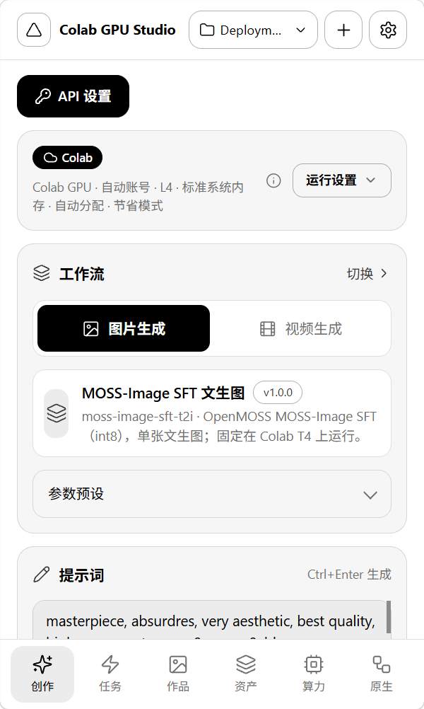
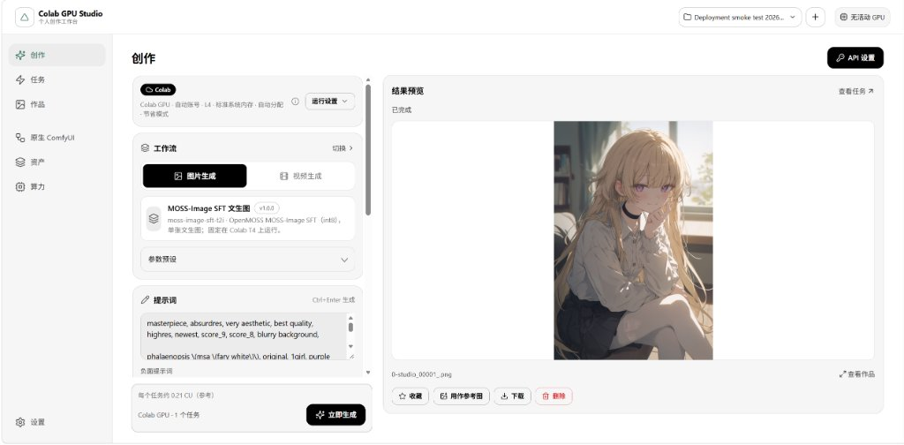
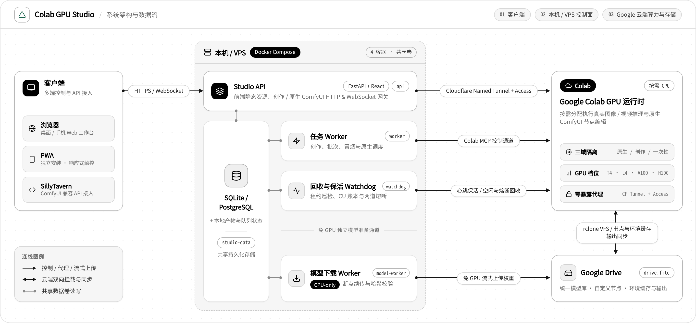

# Colab GPU Studio

Colab GPU Studio 是一个自托管的 ComfyUI 与 Google Colab 算力创作工作台。Web 控制面、任务队列、作品库、模型传输与实例回收服务运行在你自己的本机或 VPS 上，真实图像/视频推理与原生节点编辑由 Google Colab GPU 按需执行。

新部署默认关闭真实 GPU（`GPU_REAL_ENABLED=0`），启动后可用内置 `demo-mock` 体验完整的创作、排队与作品管理流程。接入 Google 账号后，可按需申请 Colab GPU，并结合权威 CU 账本、两道熔断保护与三域实例隔离稳定控费。

[核心特性](#核心特性) · [系统架构](#系统架构) · [快速开始](#快速开始) · [接入真实 Colab GPU](#接入真实-colab-gpu) · [原生 ComfyUI 与模型库](#原生-comfyui-与模型库) · [API 接入](#api-接入) · [运维与配置](#运维与配置) · [开发与验证](#开发与验证) · [文档索引](#文档索引)

| 手机创作页 | 桌面创作页 |
| --- | --- |
|  |  |

> 当前版本真实界面截图（浅色主题），支持桌面 / 移动端响应式布局与深色、浅色、跟随系统主题切换。上游原项目只读演示见 [演示说明](docs/DEMO.md)。

---

## 核心特性

### 创作工作台与双源作品库

- **多端响应式与 PWA**：同时适配桌面宽屏与手机触控操作，支持安装为独立 PWA 应用，提供深色 / 浅色 / 跟随系统三档主题。
- **开箱即用与安全审核流程**：内置 4 套真实模板草稿（Krea-2 + MOSS 双采文生图、MOSS-Image SFT 文生图、MiniMax H3 首尾帧有声视频、MiniMax H3 多参考图有声视频），支持导入自定义 ComfyUI 工作流及从 PNG 元数据提取工作流；所有真实模型与工作流均经过「校验 → 审核 → 真实 GPU 冒烟 → 验收 → 发布」向导，防止误烧算力。
- **本地与原生 Drive 双作品库**：在「作品」页可直接切换管理 Studio 本地作品（按工作流、类型、收藏筛选、堆叠展开、批量操作与参数复用）以及 Google Drive 中的原生 ComfyUI 产出（`native-comfy/output`）。

### GPU 实例三域硬隔离与创作池互通

- **三域隔离模型**：严格将运行时划分为 `native`（原生 ComfyUI）、`creation`（创作池：前端创作页 + 创作 API）与 `ephemeral`（一次性域：冒烟测试 + CPU 缓存准备），三域互不复用、互不阻塞。
- **创作池双向互通**：网页创作与创作 API 共享常驻 ComfyUI 进程与 4 级优先级复用（已预热命中 → 规格精确匹配 → 更高规格最低档 → 空闲最近活跃），统一由最后一次任务决定实例保留策略（`save` / `smart` / `batch` / `retain`），长驻卡在任务失败或取消时不会误销毁。
- **可配置 GPU 规格顺序与安全确认**：内置从低到高 GPU 档位顺序表（`T4` → `T4 HighMem` → `L4` → `A100` → `G4` → `H100`），支持在「设置」页自定义排序与自动探测 Colab 上游新增型号；明确拒绝低于工作流默认规格的选卡与复用，并在涉及跨规格复用、温和停旧开新、人工多卡或缩短实例存活时长时触发强制二次确认。[设计规范](docs/specs/GPU_INSTANCE_ISOLATION_AND_REUSE.md)

### 原生 ComfyUI 与启动深度优化

- **透明代理官方编辑器**：通过独立 HTTPS 域名代理 Colab 上的官方 ComfyUI（含内置 `--enable-manager` 与完整 HTTP/WebSocket），由 Studio 鉴权与 Cloudflare Access Service Auth 组成双层安全边界。
- **网页配置向导与零 GPU 预检**：在「原生 ComfyUI」页提供分步配置向导，支持填写 Cloudflare Named Tunnel、Access Service Token、ComfyUI 锁定提交与独立域名，自动生成 Nginx / Caddy 反代配置并执行免开 GPU 的 6 项预检；凭据经 `ENCRYPTION_KEY` 加密存库并自动兼容 `.env` 与 `./secrets/*` 回退。
- **双模型存储模式与同实例重启**：原生会话与 API 自动开机默认使用 **本地模式（按需完整下载校验至 Colab 实例本地 SSD + 工作流模型预热）**，也支持切换为 **Drive 挂载模式（rclone VFS 按需缓存）**；可在保留当前 GPU 实例与租约的前提下，一键同步模型库索引并重启 ComfyUI 进程。
- **节点持久化与冷启动加速**：自定义节点以校验归档方式持久化至 Google Drive 并在新实例自动恢复依赖；内置并行系统/插件恢复、`uv` 合并与插件依赖快速路径、`.dist-info` 精确增量 Python 环境缓存（`env-cache`）、异步启动扫描、IPv4 优先隧道轮询与小产物内联回传等多阶段优化（均配独立环境变量开关）。

### 统一模型库（免 GPU 准备）

- **零算力入库**：独立的 CPU-only `model-worker` 负责从 Hugging Face（Model / Dataset / Space）、Civitai 或 HTTPS 直链下载权重、校验完整性并写入 Google Drive，整个模型准备过程不申请 GPU、不消耗 CU。
- **断点续传与空间可视化**：采用有界内存流式传输，支持 HTTP Range 下载续传与 Drive 可恢复分块上传；前端直观展示按类别统计的模型体积与全量 `drive.file` 空间占用明细。

### 权威 CU 账本、实时遥测与两道熔断

- **真实余额流水总账**：按工作台本地时区（默认 `Asia/Shanghai`）以 Google 账号实时余额变动为权威基准，统计今日扣费、历史累计、按日平滑趋势图，并将每次实例会话实扣精确拆解至单轮任务与空闲待机。
- **实时遥测面板**：算力页集中展示运行中实例的 GPU / VRAM / 系统内存 / VFS 缓存 / 磁盘余量、活跃队列与多账号余额状态。
- **极简两道真熔断**：直接在网页配置并持久化，取代旧版分散的静态预算门禁：
  - **今日总上限（温和熔断）**：当日实扣达到上限后拒绝新任务；正在执行的创作任务改为完成后即释放，原生会话进入排空模式等待队列与同步完成后释放。
  - **余额底线（强制熔断）**：账号有效余额降至底线及以下时，立即阻止该账号新开并强制释放其在线实例止损（网络采样失败防误杀）。

---

## 系统架构

<picture>
  <source media="(prefers-color-scheme: dark)" srcset="docs/images/architecture-dark.png">
  <source media="(prefers-color-scheme: light)" srcset="docs/images/architecture-light.png">
  
</picture>

Docker Compose 默认由 4 个职责分离的容器协作（共享 `studio-data` 数据卷与同一份 `.env`）：

| 服务 | 职责 |
| --- | --- |
| `api` | 提供 React 前端静态资源、Studio / 创作 / 原生 ComfyUI HTTP & WebSocket 网关与管理接口 |
| `worker` | 消费创作、批次、冒烟、原生启动等调度任务，管理 Colab 运行时与生命周期 |
| `model-worker` | 独立执行模型权重下载、哈希校验、断点续传与 Google Drive 入库（不占 GPU） |
| `watchdog` | 定期巡检租约保活、空闲超时、硬时限排空、CU 余额采样与熔断回收 |

---

## 快速开始

### 方式一：拉取 GHCR 云端镜像部署（推荐，免本机编译）

需要 Git、Docker、Docker Compose 和 `uv`。云端预构建镜像发布于 GitHub Container Registry，原生支持 **`linux/amd64`** 与 **`linux/arm64`** 双架构（Docker 自动匹配 x86_64 VPS、ARM 服务器、树莓派与 Apple Silicon 宿主机），无需在本机或低配 VPS 编译前端与 Python 依赖：

```bash
git clone https://github.com/Naoya666/colab-comfy-studio.git
cd colab-comfy-studio
uv run python scripts/init_env.py --site-url http://127.0.0.1:8788
cp docker-compose.example.yml docker-compose.yml
docker compose pull
docker compose up -d --no-build
```

- **镜像地址与标签**：默认拉取多架构清单 `ghcr.io/naoya666/colab-comfy-studio:latest`（与 `main` 分支最新通过 CI 的提交保持同步）。如需锁定版本，可在 `.env` 中设置 `STUDIO_IMAGE`（多架构支持 `:main`、`:sha-<7位提交SHA>` 或版本 Tag；单架构可使用 `:sha-<7位提交SHA>-amd64` / `-arm64`），或手动执行 `docker pull ghcr.io/naoya666/colab-comfy-studio:latest`。
- **GHCR 权限提示**：若拉取时提示 `unauthorized` / `denied`，说明该镜像包在 GitHub Packages 中为私有状态——仓库管理员可在 GitHub `Packages → colab-comfy-studio → Package settings` 将可见性设为 **Public** 以支持免登录拉取，或使用含 `read:packages` 权限的 PAT 登录：`echo <GITHUB_PAT> | docker login ghcr.io -u <GitHub用户名> --password-stdin`。

启动后访问 `http://127.0.0.1:8788`，使用 `.env` 中的 `STUDIO_PASSWORD` 登录：

1. 在「创作」页选择 `demo-mock` 提交第一条离线任务；
2. 到「任务」与「作品」页查看执行阶段和生成结果。

> **部署到 VPS 时的关键提示**：
> - 将 `--site-url` 改为实际访问的 HTTPS 地址（例如 `https://studio.example.com`），通过 Nginx / Caddy 反向代理转发默认监听的 `127.0.0.1:8788`。
> - 数据库与本地产物保存在 `studio-data` 数据卷；迁移或升级前请同时备份数据卷与 `.env`（其中的 `ENCRYPTION_KEY` 用于解密已保存的 OAuth 令牌与原生隧道凭据，切勿丢失或提交到 Git）。

### 方式二：从源码本地构建 Docker 镜像

适用于需要自行修改代码、定制镜像或在无法访问 GHCR 的环境中构建的场景（完成上述 `.env` 与 `docker-compose.yml` 初始化后执行）：

```bash
docker compose up -d --build
# 或直接运行构建与健康检查脚本
./scripts/deploy.sh
```

### 方式三：本机一体化启动 / Android Termux

如果希望在单机直接运行（不含独立 `model-worker` 容器，自动拉起 `api`、`worker` 与 `watchdog` 并在首次运行时自动生成 `.env`）：

```bash
uv sync
npm --prefix web ci
npm --prefix web run build
PYTHONPATH=api uv run python -m app.launcher --host 127.0.0.1 --port 8788
```

Android Termux 环境可直接在仓库根目录执行一键安装与启动脚本：

```bash
bash scripts/termux_setup.sh
```

### 方式四：离线 Mock 演示（零云端依赖）

需要 Python 3.11+、`uv`、Node.js 与 npm。使用临时数据库和本地文件，不发起任何外网或 Google 调用：

```bash
uv sync
npm --prefix web ci
npm --prefix web run build
uv run python scripts/offline_server.py --port 18788
```

打开 `http://127.0.0.1:18788`，使用演示密码 `mock-local-only` 登录。

---

## 接入真实 Colab GPU

系统将 **Google Colab 算力** 与 **Google Drive 存储** 解耦管理，同时支持「纯自用账号」与「第三方交付 CU（Colab CLI）+ 自有 Drive」两种常见场景：

1. **连接 Google Colab 算力（推荐网页内置 Colab CLI 授权）**：
   - 登录 Studio 后进入 **「设置 → Google 账号」**，新增账号并点击 **「Colab CLI 授权（推荐）」**；
   - **纯自用**：点击「新窗口打开」登录自己的 Google 账号，将页面返回的 `4/0A...` 授权码粘贴回网页即可；
   - **异地 / 第三方交付 CU**：点击「复制授权链接」发给交付方，收到对方返回的授权码后粘贴回网页即可完成授权（会话持久化 30 分钟，刷新不丢失）。
   - 该向导**无需**在宿主机手动安装 `google-colab-cli`、配置 keyring 或设置 `OAUTHLIB_RELAX_TOKEN_SCOPE`，仅请求 Colab 最小必要权限（不访问对方 Drive / GCP），提交后自动加密入库并探测余额与可用 GPU；如已有现成 CLI 凭据 JSON 也可在向导底部折叠区直接导入。
   - **备用方式**：如需使用自建 GCP Web OAuth 应用授权 Colab，可点击账号卡片上的 **「Web OAuth 授权（实验性）」**（需在 GCP 开通 Colaboratory API；当前长驻保活与实时 CU 速率在 Colab CLI 通道上实测覆盖更充分）。
2. **配置 Google Drive 授权（模型库、缓存与原生 ComfyUI 必需）**：
   - 在 Google Cloud 创建一个 **Web 应用** OAuth 客户端（只需启用 **Google Drive API**，仅申请 `drive.file` 权限，不扫描网盘中其他文件），进入「设置 → Google 账号 → Google Web OAuth 应用配置」导入 JSON 并为一个主账号完成 **Drive 授权**；
   - 若算力号与 Drive 主账号分开（如购买的第三方 CU 算力号），在算力号卡片的 **「Drive 存储来源」** 选择复用主账号的 Drive 即可，后续更换算力号不会丢失模型库与自定义节点缓存。详见 [Google Colab 与 Drive 授权配置](docs/OAUTH_SETUP.md)。
3. **启用真实 GPU**：编辑 `.env`，将 `GPU_REAL_ENABLED` 设为 `1`（需要 Drive 模型缓存与持久化时同步设 `GPU_STORAGE=drive`，并按需确认 `STUDIO_TIMEZONE=Asia/Shanghai`），再执行 `docker compose up -d` 使配置生效。完整变量说明见 [`.env.example`](.env.example)。
4. **配置 CU 熔断保护与检查算力**：进入「算力」页设置**今日总上限（温和熔断）**与**余额底线（强制熔断）**，点击「检查可用 GPU」确认账号可分配的规格（如 T4 / L4 / A100）；如需调整选卡优先级或收纳上游新卡，可在「设置 → GPU 规格顺序」编辑。详见 [CU 统计与熔断说明](docs/cu-accounting-and-fuse-redesign.md)。
5. **启用工作流草稿**：进入「资产 → 工作流」，点击内置模板右侧的**一键启用**，按五步向导完成校验、模型许可确认、依赖锁定、真实 GPU 冒烟测试与发布；也可自行导入 ComfyUI 工作流或从 PNG 图片提取。详见 [内置工作流说明](docs/BUILTIN_WORKFLOWS.md) · [工作流审核流程](docs/WORKFLOW_REVIEW.md) · [PNG 导入与 GPU 选择](docs/runtime-gpu-and-png-import.md)。

> GPU 实际可用规格受 Google Colab 当时容量影响，参考费率仅作界面提示，实际扣费以 Google Colab 账号余额流水与官方账单为准。解绑或删除 Colab CLI 账号时，默认**仅从本站移除本地凭据**而不向 Google 远端吊销令牌，避免影响其他复用端。

---

## 原生 ComfyUI 与模型库

- **配置向导与安全架构**：在「原生 ComfyUI」页打开**配置向导**，填入 Cloudflare Named Tunnel Token、Access Service Auth 凭据、锁定 ComfyUI 提交与可选独立 HTTPS 域名，并执行零 GPU 消耗的 6 项预检；也可继续使用 `.env` + `./secrets/*` 只读挂载配置。[部署与验收说明](docs/NATIVE_COMFYUI.md) · [Nginx 反代示例](docs/deploy/native-comfy.nginx.conf.example)
- **会话策略与保活**：支持自定义任意正整数分钟的「空闲回收时间」（默认 120 分钟）与「会话上限时间」（默认 720 分钟），看门狗按周期维持 Colab 保活并在到期或空闲后等待生成与 Drive 同步完成再安全释放。
- **统一模型库与双存储模式**：
  - 通过独立 `model-worker` 将权重预先准备到 Drive（或登记外部来源），原生会话与 API 自动开机默认采用 **本地模式**，配合「检查并下载此工作流所需模型」将权重按需下载校验并预热直读 **Colab 实例本地 SSD**（不占用本机或 VPS 磁盘）；也可按需切换为 **Drive 挂载模式（rclone VFS 缓存）** 即插即用。
  - 新模型入库后，可在原生页点击「重启原生 ComfyUI」，在不释放当前 GPU 实例的前提下刷新模型索引并重载进程。[模型库配置](docs/model-library-phase3.md) · [下载恢复与原生重启](docs/specs/NATIVE_COMFYUI_RESTART.md)
- **自定义节点与启动加速**：自定义节点经校验归档保存至 Google Drive 并自动恢复依赖；冷启动优化（`NATIVE_FAST_SCAN`、`NATIVE_PARALLEL_RESTORE`、`NATIVE_USE_UV`、`NATIVE_FAST_CONTROL_PLANE`、`NATIVE_ENV_CACHE`、`NATIVE_BATCH_PLUGIN_PIP`、`NATIVE_PARALLEL_BOOTSTRAP`）默认开启，可按需通过环境变量独立开关。[自定义节点持久化](docs/CUSTOM_NODES_PERSISTENCE.md) · [启动优化设计 V1](docs/specs/NATIVE_COMFYUI_STARTUP_OPTIMIZATION.md) · [启动优化设计 V2](docs/specs/NATIVE_COMFYUI_STARTUP_OPTIMIZATION_V2.md)

---

## API 接入

所有对外 ComfyUI 兼容接口（创作 API / 原生 ComfyUI API）均支持**三档鉴权并存**（强鉴权 Bearer Key / 弱鉴权 URL 路径短码 / 免鉴权本机或受信内网），并可自由选择**同端口子路径**、**独立 HTTPS 域名**或**独立监听端口（1024–65535）**接入，SillyTavern、柏宝绘等不支持自定义请求头的客户端可直接填入路径短码 URL 免中继出图。

| 接口 | 核心能力 | 鉴权与路由方式 | 文档与示例 |
| --- | --- | --- | --- |
| **Studio API** | 上传参考素材、提交单任务/批次、查询进度与 CU 用量、下载产物 | `Authorization: Bearer <STUDIO_API_TOKEN>` | [API 调用文档](docs/API调用文档.md) · [Python 示例](docs/examples/studio_api_example.py) |
| **创作 API** | 面向已审核发布工作流的 ComfyUI 兼容接口；支持版本授权、预热复用、与网页创作池双向互通、严禁自动多开 | 强 Key / 短码 `<SITE_URL>/comfy/c/<短码>` / 本机免密；支持子路径、独立域名或独立端口 | [创作 API 文档](docs/CREATION_API.md) · [Nginx 中继示例](docs/deploy/sillytavern-creation.nginx.conf.example) |
| **原生 ComfyUI API** | 直连原生 ComfyUI 推理接口；弱/免鉴权放开 `/prompt`、`/history`、`/view`、`/upload/image`、`/ws` 等完整推理链路并硬性隔离节点管理接口 | 强 Key / 短码 `<SITE_URL>/comfy/n/<短码>` / 本机免密；支持子路径、独立域名或独立端口 | [专用 API 接入](docs/NATIVE_COMFYUI.md#专用-api-接入) · [SillyTavern 配置](docs/NATIVE_COMFYUI.md#sillytavern) · [Nginx 中继示例](docs/deploy/sillytavern-comfy.nginx.conf.example) |

---

## 运维与配置

### 常用环境变量

完整配置项与注释见 [`.env.example`](.env.example)，以下列出日常部署最常调整的项：

| 变量 | 默认值 | 说明 |
| --- | --- | --- |
| `STUDIO_IMAGE` | `ghcr.io/naoya666/colab-comfy-studio:latest` | Docker Compose 使用的镜像地址与标签，可用于锁定特定提交或版本 |
| `SITE_URL` | `http://localhost:8788` | 工作台外部访问地址，需与 Google OAuth 回调域一致 |
| `STUDIO_PASSWORD` | `init_env.py` 自动生成 | Web 工作台登录密码 |
| `ENCRYPTION_KEY` | `init_env.py` 自动生成 | 数据库敏感凭据（OAuth 令牌、隧道密钥等）加密主密钥 |
| `GPU_REAL_ENABLED` | `0` | 真实 Colab GPU 总开关，设为 `1` 后允许申请真实算力 |
| `GPU_STORAGE` | `local` | 设为 `drive` 以启用 Google Drive 模型缓存与持久化 |
| `STUDIO_TIMEZONE` | `Asia/Shanghai` | 本地自然日切日时区，用于今日 CU 统计与每日熔断重置 |
| `NATIVE_COMFY_URL` / `NATIVE_COMFY_BACKEND_URL` | 空 | 原生 ComfyUI 公网域名与 Cloudflare Tunnel 内部地址（也可直接在网页向导配置） |
| `NATIVE_COMFY_IDLE_MINUTES` / `NATIVE_COMFY_MAX_RUNTIME_MINUTES` | `120` / `720` | 原生会话默认空闲回收与会话上限时间（正整数分钟） |
| `NATIVE_ENV_CACHE` 等优化开关 | `1` | 原生 ComfyUI 启动加速开关组，置 `0` 可逐项回退旧路径 |

### 备份与版本升级

- **数据备份**：SQLite 部署可运行 `PYTHONPATH=api uv run python scripts/backup.py` 生成一致性快照与本地产物归档（脚本不会打包 `.env`，请单独安全保管 `.env` 与 `ENCRYPTION_KEY`）；PostgreSQL 请使用 `pg_dump -Fc`。
- **云端镜像升级（推荐）**：直接拉取最新 GHCR 镜像并重启容器，涉及表结构更新时执行数据库迁移：

```bash
docker compose pull
docker compose up -d --no-build
docker compose exec api alembic upgrade head
```

- **源码构建升级**：若采用本地构建方式，拉取代码后重建并执行迁移：

```bash
git pull
docker compose up -d --build
docker compose exec api alembic upgrade head
```

---

## 开发与验证

后端采用 **Python 3.11+ / FastAPI / SQLAlchemy 2 / Alembic**（`uv` 管理依赖），前端采用 **React 19 / TypeScript / Vite 6**（`npm` 管理依赖）。

每次推送（及手动触发 `workflow_dispatch`）都会运行 GitHub Actions。前后端测试均通过后，CI 在 `ubuntu-latest`（`amd64`）与 `ubuntu-24.04-arm`（`arm64`）上原生并行构建根目录的 `Dockerfile`：

- **推送双架构镜像到 GHCR**：两路架构各自推送 `:sha-<7位提交SHA>-amd64` / `:sha-<7位提交SHA>-arm64`，随后通过 `docker buildx imagetools create` 合并发布为多架构清单 `ghcr.io/naoya666/colab-comfy-studio:sha-<7位提交SHA>`（默认分支同步更新 `:latest` 与 `:main`，Tag 推送同步发布对应版本标签）。
- **双架构离线 Artifact 归档**：同时分别导出 `colab-gpu-studio-amd64.tar.gz` 与 `colab-gpu-studio-arm64.tar.gz` 到该次运行的 **Artifacts**（保留 14 天）。离线或受限网络环境可下载对应架构的产物 ZIP 并解压，执行 `docker load -i colab-gpu-studio-<arch>.tar.gz`，再以 `STUDIO_IMAGE=colab-gpu-studio:<完整提交SHA>-<arch> docker compose up -d --no-build` 启动。

在仓库根目录执行完整离线自动化验证与构建：

```bash
uv sync --extra test
npm --prefix web ci
uv run pytest -q
npm --prefix web run test:contract
(cd web && node --test tests/*.test.mjs)
npm --prefix web run build
```

如需进行本地端到端浏览器覆盖验证，可运行：

```bash
uv run python scripts/verify_offline.py
```

> 离线自动化测试使用本地隔离数据库与 Mock 传输，不申请真实 GPU、不消耗 CU。真实云端环境验证清单与记录见 [真实 GPU 验证](docs/REAL_GPU_VALIDATION.md) 与 [原生 ComfyUI 自动测试与真实验收](docs/NATIVE_COMFYUI.md#自动测试与真实验收)。

---

## 文档索引

| 分类 | 文档 |
| --- | --- |
| **入门与账号** | [Google OAuth 与 Drive 配置](docs/OAUTH_SETUP.md) · [内置工作流说明](docs/BUILTIN_WORKFLOWS.md) · [工作流审核与发布](docs/WORKFLOW_REVIEW.md) · [PNG 导入与 GPU 选择](docs/runtime-gpu-and-png-import.md) |
| **算力与调度** | [GPU 实例三域隔离与创作池复用](docs/specs/GPU_INSTANCE_ISOLATION_AND_REUSE.md) · [CU 统计与熔断设计](docs/cu-accounting-and-fuse-redesign.md) · [Colab MCP 运行时协议](docs/RUNTIME_PROTOCOL.md) |
| **原生 ComfyUI 与模型库** | [原生 ComfyUI 部署与验收](docs/NATIVE_COMFYUI.md) · [自定义节点持久化](docs/CUSTOM_NODES_PERSISTENCE.md) · [统一模型库说明](docs/model-library-phase3.md) · [原生重启与断点续传](docs/specs/NATIVE_COMFYUI_RESTART.md) · [启动优化 V1](docs/specs/NATIVE_COMFYUI_STARTUP_OPTIMIZATION.md) · [启动优化 V2](docs/specs/NATIVE_COMFYUI_STARTUP_OPTIMIZATION_V2.md) |
| **API 接入** | [Studio API 调用文档](docs/API调用文档.md) · [创作 API 文档](docs/CREATION_API.md) · [Python 调用示例](docs/examples/studio_api_example.py) |
| **安全与参考** | [安全说明](SECURITY.md) · [演示说明与截图](docs/DEMO.md) · [真实 GPU 验证清单](docs/REAL_GPU_VALIDATION.md) |

---

## 上游致谢与许可证

- 本项目基于 [TizenryA/colab-gpu-studio](https://github.com/TizenryA/colab-gpu-studio) 持续演进，沿用 [GNU AGPL-3.0](LICENSE) 许可证。
- 原生 ComfyUI 网关代理与隧道机制参考了 [FireTable/comfy-colab-kit](https://github.com/FireTable/comfy-colab-kit)，其 MIT 许可声明保留于 [docs/licenses/comfy-colab-kit.txt](docs/licenses/comfy-colab-kit.txt)。
- ComfyUI、ComfyUI-Manager、第三方自定义节点与各模型权重均受其各自独立许可证约束，本仓库不内置第三方模型权重。
- 上游参考：[上游英文说明](README.en.md) · [上游 0.3.1 更新记录](docs/RELEASE_NOTES_0.3.1.md)
