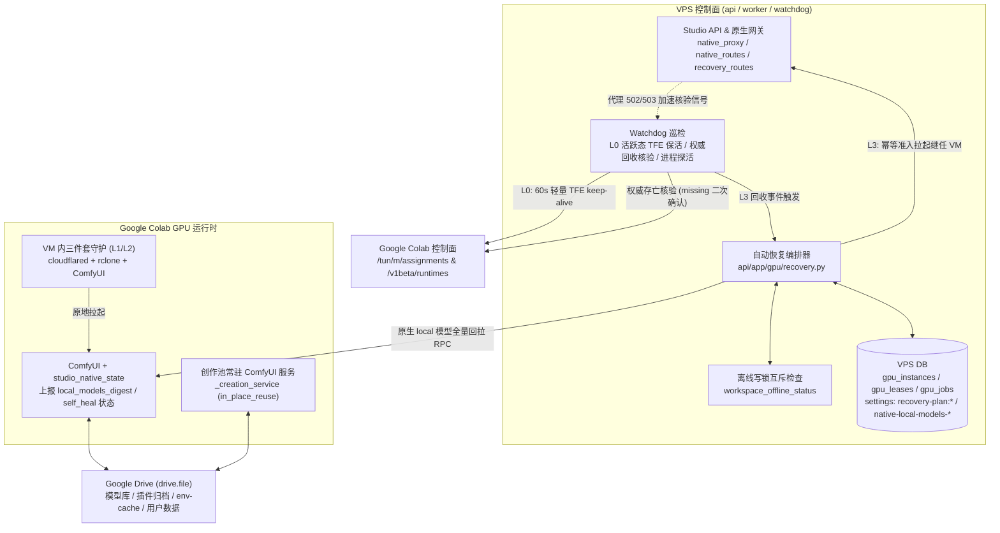
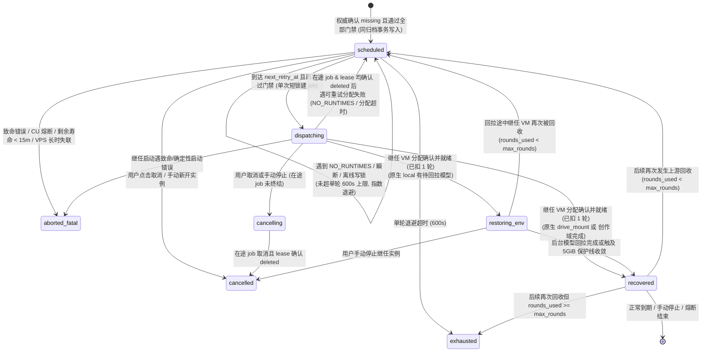

# GPU 实例主动保活强化与自动恢复机制设计

> **基线版本**：本文档基于 `main` 分支提交 `97b2b30` 编写，适配既有的三域实例隔离（`native` / `creation` / `ephemeral`）、权威 CU 账本与两道熔断、Colab 分配错误分类体系，以及原生 ComfyUI 离线工作流/插件管理。

---

## 1. 背景与设计目标

当前系统已经具备较为完善的**预防性保活**与**被动止损收敛**能力：

- **预防性保活**：Watchdog 对 `idle` / `retained_idle` 状态的 Colab 租约（原生域全部 + 创作池 `smart`/`retain`）按 60 秒发送 TFE `keep-alive` 与 Proxy/Kernel 心跳，每 240 秒附带一次轻量内核空操作（[native.py](../../api/app/gpu/native.py)、[colab.py](../../api/app/gpu/colab.py)）。
- **被动止损**：Watchdog 每 45 秒通过 `_inspect_runtime` 核查 Colab 控制面；一旦确认远端运行时消失（`provider_runtime_missing`），`_close_reclaimed_runtime` 会立即将 `instance` 与 `lease` 标记为 `deleted`、将运行中 `job` 置为 `failed` 并闭合 CU 账本分段（[instances.py](../../api/app/gpu/instances.py)）。

但在长时间 GPU 任务与长驻待机场景下，仍存在四类可主动预防或自动自愈的缺口：

1. **运行中长任务（`active` 态）缺少 TFE 层保活**：`keepalive_lease` 当前仅作用于 `state == "idle"` 的租约，创作域长时间采样或大权重传输期间不触发 `/tun/m/{endpoint}/keep-alive/`。
2. **VM 仍存活但内部关键进程崩溃时缺少同机自愈**：原生域 Colab 侧 `WATCHDOG` 目前仅守护 `cloudflared`，未守护 `ComfyUI` 与 `rclone` FUSE 挂载；创作域 `_probe_creation_process` 发现常驻 ComfyUI 进程退出后仅清空 `creation_runtime`，不会原地修复。
3. **Colab 上游意外回收后无自动接替机制**：在实例预期生命周期尚未结束、未手动停止且未触发 CU 熔断的情况下，一旦被上游强行回收，会话与热环境直接中断，需人工重新启动与预热。
4. **原生本地模式（`local`）SSD 模型清单未落库**：已拉取到 Colab 本地 SSD 的模型仅存在于当前进程与临时磁盘中，重建新 VM 后无法自动回拉上次的模型环境。

### 核心设计原则与边界约束

本机制定位为**预防性高可用保护能力**，覆盖 `native`（原生域）与 `creation`（创作池 `smart`/`retain` 长驻实例），核心原则为：**在实例预期生命周期内，优先通过轻量同机自愈恢复；若实例意外被上游释放，则在严格安全与控费边界内自动重新拉起继任实例，并尽可能恢复到上次的环境**。

已确认的硬性边界如下：

| 维度 | 约束决策 |
| :--- | :--- |
| **覆盖范围** | 统一覆盖 **`native` 域** 与 **`creation` 域（仅 `smart` / `retain` 长驻实例）**；`ephemeral`（冒烟/CPU Prep）与 `creation` 的 `save`/`batch` 绝不触发跨机自动恢复。 |
| **开关分层** | **L0（运行期 TFE 保活）与 L1/L2（同机链路/挂载/进程自愈）默认开启**（零新卡成本，各自保留降级开关）；**L3（跨机自动重新申请新 VM）默认关闭**，通过环境变量 `GPU_AUTO_RECOVERY_ENABLED=1` 显式启用。 |
| **配额与门槛** | 单逻辑生命周期最多 **3 轮** L3 换机恢复；**剩余有效寿命 `< 15` 分钟**（可由环境变量调整）不再触发 L3；触及**任一 CU 熔断**（今日上限软熔断 / 余额底线硬熔断）或用户手动停止时立即终止。 |
| **中断任务语义** | **创作域（`smart`/`retain`）**：空闲待机被回收时自动拉起并再预热；运行中被回收时自动拉起并重跑该中断 `job`，**单条 `job` 最多自动重跑 1 次**。<br>**原生域**：仅恢复环境与模型，**绝不自动重发中断的 `/prompt` 请求**。 |
| **原生 `local` 模型恢复** | 新 VM 启动并打通隧道后**先标记就绪可进入 UI**，同时后台异步将上次 SSD 中全部可追踪模型按最近使用顺序全量回拉；对无登记来源的野生模型标注提示无法自动回拉。 |
| **账号与规格守约** | **严格守原账号 + 原 GPU 规格**，单轮内按指数退避等待 `NO_RUNTIMES` 等瞬态异常，遇到致命错误立即速断；绝不自动降配、不静默升配、不越权切换账号。 |
| **离线管理互斥** | 原生域存在进行中的自动恢复计划（含退避等待期）时，[原生离线工作流/插件管理](NATIVE_COMFYUI_WORKSPACE_MANAGER.md) 保持只读锁定，并提供一键「取消自动恢复」按钮解锁编辑。 |

---

## 2. 总体架构与四层自愈阶梯

### 2.1 系统协作拓扑



### 2.2 L0 → L1 → L2 → L3 自愈阶梯矩阵

按恢复成本从低到高逐级介入，优先就地解决，仅在物理 VM 确认消失时才触发跨机重建：

| 层级 | 名称 | 触发条件 | 恢复动作 | 预计耗时 | 新开 VM | 默认开关 |
| :--- | :--- | :--- | :--- | :--- | :---: | :--- |
| **L0** | 活跃态保活强化 | `lease.state == "active"` 且距上次 TFE 心跳 ≥ 60s | 仅发轻量 TFE `/tun/m/{endpoint}/keep-alive/`，不抢占 Jupyter kernel | `< 1s` | 否 | **开启**（`GPU_ACTIVE_KEEPALIVE=1`） |
| **L1** | 链路与挂载自愈 | VM 存活；`cloudflared` 或 `rclone` 进程已确认退出（PID 不存在或僵尸态 `Z`） | Colab 侧守护原地重启 `cloudflared`，或在确认旧 `rclone` 已退出后清理僵挂载并重挂 | `3–15s` | 否 | **开启**（`GPU_IN_VM_SELF_HEAL=1`） |
| **L2** | 同机进程自愈 | VM 存活；原生 `ComfyUI` 已确认非计划退出（不含存活慢响应），或创作池常驻进程/worker 非确定性退出 | 原生：VM 内原地重启 ComfyUI（保留 SSD 模型与环境）；<br>创作：同机走 `in_place_reuse` 重建进程，视策略重跑中断任务（≤1 次） | `10–30s` | 否 | **开启**（`GPU_IN_VM_SELF_HEAL=1`） |
| **L3** | 跨机自动重建 | Colab 控制面权威二次确认 VM `missing`，且通过全部恢复门禁（含 VPS 未长时间失联） | 同事务归档旧实例、闭合 CU 分段并持久化恢复计划 → 退避等待原账号/原规格拉起新 VM → 恢复插件/环境/本地模型或创作预热/重跑任务 | `1–5min` | **是** | **关闭**（`GPU_AUTO_RECOVERY_ENABLED=0`） |

### 2.3 六条核心不变量

1. **物理实例不可变与权威 CU 账本零污染**：每次新拉起的 Colab VM 必然对应全新的 `instance_id`、`lease_id` 与独立的 `instance-lifetime:{instance_id}` CU 账本分段，**绝不复用或覆写旧 `instance_id`**；逻辑连续性由上层 `recovery_group_id` 串联。
2. **权威死亡确认与原子接管（绝不凭数据面误判换机）**：代理 502/503、Cloudflare 隧道断开、MCP `poll` 瞬断仅允许加速控制面核验，**绝不直接触发 L3**；仅当 Colab 独立控制面确认运行时 `missing` 时，在归档旧实例与闭合 CU 分段的**同一数据库事务**内冻结现场快照并持久化恢复计划（及需要接管重跑的创作任务状态），消除进程崩溃窗口与 API 提前报失败竞态。
3. **原子防双卡与单锁短事务**：门禁校验、计划状态更新与分配意图写入必须在**同一次短锁事务**内完成（不嵌套重入 `dispatch_lock`），释放锁后再执行 Colab 外部 I/O；且当某次继任分配超时进入 `remote_state_unknown` 时，**必须等待本次继任租约走完现有 60s `nbh` 精确核对并确认 `deleted`**，方可发起下一次分配尝试。
4. **硬截止与空闲截止严格守约（防永动机）**：继任实例的 `hard_deadline_at` 从派发起即以绝对时间戳严格继承初始值，全阶段零越界；空闲态被回收时 `idle_deadline_at` 同样严格继承原值不顺延补回。
5. **原账号原规格刚性守约**：L3 重建始终锁定原 `account_id` 与原 `requested_spec`（若原实例已上报 `runtime_spec_reported` 则保持一致且校验不低于工作流默认规格），绝不降配、不静默升配、不跨账号迁移。
6. **离线写锁对称互斥与安全取消**：原生域存在活跃 L3 恢复计划期间，离线工作流/插件管理禁止写 Drive；反过来，若离线管理已持有 `native-workspace-write-lock`，L3 派发自动顺延等待写锁释放；取消已进入 `dispatching` 的恢复计划后，离线写权限必须等到在途启动任务取消并清理确认后才解锁。

---

## 3. 环境变量与配置规范

新增配置全部兼容既有 `.env` 与 `api/app/config.py` / `env_flag` 读取方式（在 `api`、`worker`、`watchdog` 共享同一份 `.env`）：

| 环境变量 | 默认值 | 取值范围 | 作用域 | 说明 |
| :--- | :---: | :--- | :---: | :--- |
| `GPU_AUTO_RECOVERY_ENABLED` | **`0`** | `0` / `1` | **L3** | **跨机自动重建总开关**（默认关闭，设为 `1` 启用）。关闭时不创建任何 L3 恢复计划，不触发任何自动重开 VM。 |
| `GPU_AUTO_RECOVERY_MAX_ROUNDS` | `3` | `1..10` | L3 | 单个逻辑生命周期内允许的最多 L3 换机恢复轮次。 |
| `GPU_AUTO_RECOVERY_MIN_REMAINING_MINUTES` | `15` | `≥ 1`（正整数） | L3 | 触发 L3 及退避重试前要求的最低剩余有效寿命（分钟）；低于该值直接放弃恢复。 |
| `GPU_AUTO_RECOVERY_MAX_JOB_RETRIES` | `1` | `0..3` | L2 / L3 | 创作域 `smart`/`retain` 单条被中断 `job` 最多自动重跑次数（默认 1 次；设为 `0` 时仅恢复空闲热实例，不自动重跑任务）。 |
| `GPU_AUTO_RECOVERY_BACKOFF_BASE_SECONDS` | `30` | `10..300` | L3 | 单轮内遇到 `NO_RUNTIMES`/瞬断时的指数退避基准秒数（`30s → 60s → 120s → 240s`）。 |
| `GPU_AUTO_RECOVERY_ROUND_TIMEOUT_SECONDS` | `600` | `60..3600` | L3 | 单轮 L3 退避等待总时长上限（默认 10 分钟），超时仍无法分配则终止恢复。 |
| `GPU_AUTO_RECOVERY_STARTUP_GRACE_SECONDS` | `30` | `0..300` | L3 | `watchdog` 进程启动后的宽限秒数，避免 VPS 重启瞬间网络未稳引发误判。 |
| `GPU_AUTO_RECOVERY_MAX_VPS_OUTAGE_MINUTES` | `18` | `5..60` | L3 | VPS 距上次成功心跳/控制面探测超过该时长（略低于 Colab 20 分钟失联自释放线）时，视远端 `missing` 为 VPS 停机维护或失联自释放，放弃自动重拉（`aborted_vps_outage`）。 |
| `GPU_ACTIVE_KEEPALIVE` | **`1`** | `0` / `1` | **L0** | 运行中长任务（`lease.state == "active"`）周期性发送轻量 TFE `keep-alive`（默认开启）。 |
| `GPU_IN_VM_SELF_HEAL` | **`1`** | `0` / `1` | **L1 / L2** | 启用原生 VM 内 `ComfyUI`/`rclone` 守护及创作域同机常驻进程自愈（默认开启；置 `0` 回退旧行为）。 |

> **开关隔离保障**：当用户保持默认 `GPU_AUTO_RECOVERY_ENABLED=0` 时，系统仅运行零额外算力成本的 L0/L1/L2；若需要完全回退至改造前行为，也可将 `GPU_ACTIVE_KEEPALIVE=0`、`GPU_IN_VM_SELF_HEAL=0` 逐项关闭。

---

## 4. L0 / L1 / L2 预防性保活与同机自愈设计（默认开启）

### 4.1 L0：运行中长任务（`active` 态）轻量 TFE 保活

#### 现状缺口
当前 [native.py](../../api/app/gpu/native.py) `keepalive_lease()` 入口要求 `lease.get("state") == "idle"` 且 `not lease.get("current_job_id")`。在创作池执行长达数十分钟的视频生成或大模型下载任务时，`lease.state == "active"`，无法触达 Colab TFE 保活端点。

#### 改造方案
1. 在 `GoogleColabProvider.keep_alive()`（[colab.py](../../api/app/gpu/colab.py)）增加参数 `tfe_only: bool = False`：
   - 当 `tfe_only=True` 时，**仅发送** `GET /tun/m/{endpoint}/keep-alive/?authuser=0`（复用现有 `connect=6s, read=4s` 流式短探测），**跳过** Proxy `/api/kernels` 查询与 Jupyter WS `1 + 1` 执行，确保零干扰正在运行 `runtime_worker` 的内核通道。
2. 在 `native.py` 新增 `keepalive_active_lease(repo, lease, clock=time.time, *, provider_factory=None)`：
   - 仅当 `env_flag("GPU_ACTIVE_KEEPALIVE", True)`、`lease.provider == "colab"`、`lease.state == "active"`、`lease.tunnel_endpoint` 存在且未到 `deadline_epoch`、未标记 `force_stop`/`cleanup_claim_token` 时生效；
   - 按 `KEEPALIVE_INTERVAL_SECONDS = 60s`（失败重试 `30s`）节流，独立记录 `active_last_keepalive_at` 与 `active_keepalive_status`，写入前以 `_lease_identity` 在短锁内校验租约未切换。
3. 在 `SchedulerWatchdogMixin.watchdog()`（[scheduler_watchdog.py](../../api/app/gpu/scheduler_watchdog.py)）遍历 `all_leases` 时，对 `state == "active"` 且非 `force_stop` 的 Colab 租约调用 `keepalive_active_lease()`。

#### 事件驱动加速死亡探测
为了缩短从“远端异常”到“确认死亡”的盲窗（现状固定 45 秒轮询间隔）：
- 在 `native_proxy.py` 转发上游连续返回 `502`/`503`/`ConnectError`（如 10 秒内连续 3 次），或 `scheduler._run()` 遇到 `MCPTransient` / `gpu_poll_failed` 时，向租约写入 `provider_runtime_check_hint_at = now`（受 10 秒最小节流保护）；
- `_inspect_runtime()`（[scheduler.py](../../api/app/gpu/scheduler.py)）在判断节流窗口 `now < next_check_at` 时，若发现 `provider_runtime_check_hint_at > checked_at` 且距上次检查已满 10 秒，立即放行本次控制面探测。

---

### 4.2 L1 / L2：原生域 Colab 侧三件套守护进程

升级 [native_runtime.py](../../api/app/gpu/native_runtime.py) 的 `WATCHDOG` 脚本（由 `GPU_IN_VM_SELF_HEAL` 环境变量注入到 `payload["native_flags"]` 控制），使其从单一的 `cloudflared` 守护升级为 **三件套守护（`cloudflared` + `rclone` + `ComfyUI`）**：

#### 1. 启动元数据固化
在 `native_runtime.run()` 启动完成后，除现有字段外，向 `/content/ai-studio/native/state.json` 增补：
- `comfy_start_id`：ComfyUI 进程的 `/proc/<pid>/stat` 启动时间标识（防 PID 复用误杀）；
- `comfy_args`：本次启动 ComfyUI 的完整命令行参数数组与 `cwd`（不含凭据）；
- `rclone_pid`、`rclone_start_id`、`rclone_args`：rclone 前台挂载进程元数据（`rclone.conf` 路径已在本地 0600 文件中，不重复落明文 token）；
- `self_heal_enabled`：布尔开关。

#### 2. 三件套巡检与原地拉起规则（每 15 秒一轮）

> **防误杀红线（重要）**：第一阶段 L1/L2 **仅自动拉起已确认退出的进程**（严格校验 `pid` + `/proc/<pid>/stat` 启动时间 `start_id`，确认进程已不存在或处于僵尸态 `Z`）。对于**进程仍存活但探活响应慢**的情况（例如 ComfyUI 加载 20GB 大模型或重采样时 `/system_stats` 卡顿、`rclone` 后台写回大视频时 RC 端口繁忙），**绝不强杀或卸载挂载点**，仅在 `self-heal-status.json` 记录慢响应告警供控制面展示，避免误杀正常长任务或造成旧进程占住 `5572` 端口与丢失 VFS 待写数据。

| 守护组件 | 触发自愈的唯一判定条件 | 计划内操作豁免 | 自愈动作 | 防抖上限 |
| :--- | :--- | :--- | :--- | :--- |
| **`cloudflared`** | 校验 `tunnel_pid` + `tunnel_start_id` 确认进程已退出或为僵尸态 `Z` | 无 | 沿用现有逻辑原地拉起并更新 `state.json` | 10 分钟内最多 5 次 |
| **`rclone mount`** | 校验 `rclone_pid` + `rclone_start_id` **确认旧进程已退出**（不存在或 `Z`） | 无 | 在确认旧进程已彻底退出（不占用 `5572` 端口与 VFS 写句柄）后，执行 `fusermount3 -uz <mount>` 清理遗留僵挂载点，按 `rclone_args` 重新挂载并等待 `ismount` 就绪，更新 `state.json` | 退避 `5s → 15s → 30s`，10 分钟内最多 3 次 |
| **`ComfyUI`** | 校验 `pid` + `comfy_start_id` **确认进程已退出**（不存在或 `Z`） | **排除 Manager 计划内重启**：检查 `/content/ai-studio/native/reboot-active` 标记或 `studio_native_state` 写入的计划重启时间戳（宽限 300s），避免与 [native_restart.py](../../api/app/gpu/native_restart.py) 冲突 | 保留 `/content/ai-studio/native/ComfyUI`、Python 环境与已下载本地模型，记录新的 `comfy_log_offset`，按 `comfy_args` 原地拉起 ComfyUI，等待 `/system_stats` 就绪并校验 Manager，更新 `state.json` | 退避 `5s → 15s → 30s`，10 分钟内最多 3 次；超限后写入 `self-heal-status.json` 的 `unrecoverable=true` |

#### 3. 自愈状态上报与 20 分钟失联自杀协调
- `WATCHDOG` 将最近重启计数、时间戳、组件名和 `unrecoverable` 标志原子写入 `/content/ai-studio/native/self-heal-status.json`；
- `/studio_native/state` 返回结果中附带轻量字段 `self_heal: {"comfy_restarts": 1, "rclone_restarts": 0, "tunnel_restarts": 0, "last_event_at": ..., "unrecoverable": false}`，由 VPS `sync_plugins()` 顺带记录到租约事件，用户可在前端日志看到“ComfyUI 进程异常退出，已在同机自动恢复”；
- **与既有 20 分钟失联自杀（`runtime.unassign()`）协调**：若当前正处于 `ComfyUI` 或 `rclone` 自愈拉起阶段，禁止触发 20 分钟失联自杀，防止自愈过程中误释放 VM。

---

### 4.3 L2：创作域同机常驻进程与任务自愈

1. **空闲待机态（`retained_idle`）常驻进程自愈**：
   - 在 [scheduler_watchdog.py](../../api/app/gpu/scheduler_watchdog.py) `_probe_creation_process()` 中，当探测返回 `healthy is False` 时，不立即一锤定音清空 `creation_runtime`，而是记录连续失败计数 `health_failures += 1`；
   - 连续 2 次确认进程退出（且 `_inspect_runtime` 确认 VM 仍 `present`）后：
     - 清空 `creation_runtime.process`（标记 `status = "process_exited"`，**保留** `workflow_key`、`workflow_version`、`fingerprint` 便于恢复引用），记录实例事件；
     - 下次任务到达该实例时，[runtime_worker.py](../../api/app/gpu/runtime_worker.py) `_creation_service()` 已天然支持 **`in_place_reuse`**（跳过 ComfyUI checkout、自定义节点和 Python 依赖重装，直接复用 SSD 上的模型权重重启 ComfyUI，耗时约 10–25 秒）；
     - 若该实例源自创作 API 主动预热且开启了 `GPU_IN_VM_SELF_HEAL=1`、剩余空闲寿命 ≥ 10 分钟、且同实例 10 分钟内同机修复次数 `< 2`，Watchdog 可在**同一实例**上自动投递一次轻量同机恢复预热（不释放、不开新机），使酒馆调用前始终保持显存热态。
2. **运行中任务（`running` 态）非确定性进程退出自愈**：
   - 仅当满足以下**全部条件**时触发 L2 同机重跑：
     - `env_flag("GPU_IN_VM_SELF_HEAL", True)`；
     - 实例属于 `creation` 域且策略为 `smart`/`retain`；
     - 错误码属于**非确定性进程崩溃白名单**（如 `gpu_worker_exited`、`cuda_device_lost`，**明确排除** `OutOfMemoryError`、工作流/节点校验错、模型哈希错、鉴权错、`gpu_timeout`）；
     - `_inspect_runtime()` 确认 Colab VM 仍为 `present`；
     - 该 `job` 的 `auto_retry_count < GPU_AUTO_RECOVERY_MAX_JOB_RETRIES`（默认 1 次），且距离硬截止剩余时间充足；
   - 动作：保留原 `instance_id` 与 `lease_id`，将 `job.auto_retry_count += 1`、清空 `execution_id` 后直接回到 `loading` 重新在同机 `_creation_service`（`in_place_reuse`）执行，避免整机重建开销。

---

## 5. L3 跨机自动恢复状态机与安全协议（默认关闭）

当 `GPU_AUTO_RECOVERY_ENABLED=1` 时，启用完整的跨机自动重建编排器（新增模块 `api/app/gpu/recovery.py`）。

### 5.1 逻辑生命周期链与持久化数据模型（零破坏性迁移）

为 100% 保持现有 `gpu_instances` / `gpu_leases` / `gpu_instance_usage_segments`（CU 账本）结构与对账逻辑不变，采用**“物理实例不可变 + `settings` 恢复计划表 + 轻量关联字段”**方案，无需修改任何既有表 DDL：

#### 1. `gpu_instances.data` 新增关联字段（同步加入 `InstanceService._PUBLIC`）
```json
{
  "recovery_group_id": "rec-a1b2c3d4e5f6...",
  "recovery_generation": 1,
  "parent_instance_id": "inst-old-uuid",
  "replaced_by_instance_id": "inst-new-uuid",
  "recovery_plan_id": "rec-a1b2c3d4e5f6...",
  "recovery_source": "auto_recovery"
}
```
- 初始正常启动的实例在首次创建时可选延迟分配 `recovery_group_id`（首次进入恢复时以初始 `instance_id` 派生稳定 `recovery_group_id` 并回写旧实例，零侵入正常路径）。

#### 2. `gpu_jobs.data` 新增关联字段
```json
{
  "attempt_id": "att-f9e8d7c6b5a4",
  "recovery_group_id": "rec-a1b2c3d4e5f6...",
  "auto_retry_count": 1,
  "retry_not_before_epoch": 1795500060.0,
  "attempt_history": [
    {
      "attempt_id": "att-112233445566",
      "attempt_number": 1,
      "instance_id": "inst-old-uuid",
      "lease_id": "lease-old-uuid",
      "ended_at": 1795500000.0,
      "reason": "provider_runtime_missing",
      "stage": "sampling"
    }
  ]
}
```
- `attempt_id` 标识单次分配尝试，与 `gpu_leases.data.attempt_id` 及 `InstanceService._attempt_key` 严格绑定，使同一 `job` 重跑时不会按 `owner_job_id` 捡回旧的 `deleted` 租约；`attempt_number` 仍由 [repository.py](../../api/app/gpu/repository.py) `prepare_execution()` 唯一维护递增，编排器绝不手动修改。

#### 3. 恢复计划记录（存入既有 `settings` 表，Key 为 `recovery-plan:{recovery_group_id}`）
```json
{
  "plan_id": "rec-a1b2c3d4e5f6",
  "recovery_group_id": "rec-a1b2c3d4e5f6",
  "owner_id": "owner",
  "pool": "native",
  "state": "scheduled",
  "account_id": "acc-123",
  "drive_account_id": "acc-drive",
  "requested_spec": {"variant": "VARIANT_GPU", "accelerator": "L4", "shape": "SHAPE_STANDARD"},
  "retention_mode": "retain",
  "retain_idle_minutes": 120,
  "hard_deadline_at": 1795543200.0,
  "orig_idle_deadline_at": 1795507200.0,
  "was_busy": false,
  "rounds_used": 0,
  "max_rounds": 3,
  "round_counted_for_instance_id": null,
  "round_started_at": 1795500000.0,
  "backoff_attempt": 1,
  "next_retry_at": 1795500030.0,
  "source_instance_id": "inst-old-uuid",
  "active_job_id": null,
  "active_lease_id": null,
  "successor_instance_id": null,
  "last_trigger_reason": "provider_runtime_missing",
  "last_error_code": "gpu_capacity_unavailable",
  "last_error_message": "Colab 暂时无法分配运行时（NO_RUNTIMES）；30s 后重试",
  "native_snapshot": {
    "comfy_commit": "423cbd20511becb1f16122ab518e92e58bfa03d9",
    "model_storage": {"model_storage_mode": "local", "cache_gb": 20, "cache_max_age_minutes": 60},
    "plugin_generation": null,
    "recoverable_models": [
      {
        "category": "checkpoints",
        "name": "anima/model.safetensors",
        "sha256": "...",
        "size": 6938040682,
        "drive_file_id": "1AbC...",
        "account": "acc-drive",
        "last_used_at": 1795499800.0
      }
    ],
    "wild_models": ["loras/manual_downloaded_unregistered.safetensors"],
    "model_restore_job_id": null,
    "model_restore_state": null
  },
  "creation_snapshot": {
    "mode": "warmup",
    "interrupted_job_id": null,
    "workflow_id": "wf-uuid",
    "workflow_key": "krea2-moss-dual-t2i",
    "workflow_version": "1.2.0",
    "fingerprint": "..."
  },
  "created_at": 1795500000.0,
  "updated_at": 1795500000.0,
  "cancelled_at": null,
  "history": [
    {
      "round": 1,
      "from_instance_id": "inst-old-uuid",
      "to_instance_id": "inst-new-uuid",
      "triggered_at": 1795500000.0,
      "recovered_at": 1795500210.0,
      "trigger_reason": "provider_runtime_missing",
      "outcome": "recovered"
    }
  ]
}
```

### 5.2 恢复计划状态机



> **唯一轮次扣减时点与配额口径**：
> - `rounds_used` 的**唯一持久化扣减时点**为：**继任 VM 分配确认完成（即 `Scheduler._prepare()` 确认 `ready` 且新 `instance` 标记 `ready`，原子写入 `rounds_used += 1` 与 `round_counted_for_instance_id = new_instance_id` 防重复扣减）**；
> - 由此保证即使新 VM 在进入 `restoring_env` 回拉模型或执行重跑任务途中再次被回收，也已经消耗了本轮配额，绝不会用同一轮无限重拉；
> - 单轮内遇到 `NO_RUNTIMES`、网络抖动、5xx、分配超时或 `NATIVE_WORKSPACE_LOCKED` 均在**同一轮内退避等待**（`30s → 60s → 120s → 240s`，总等待上限 `600s`），不重复扣除 3 轮恢复配额；
> - 若单轮等待超过 `600s` 仍未拿到卡，标记 `exhausted` 并告警停止。

### 5.3 权威死亡二次确认与归档同事务原子接管

Colab `/tun/m/assignments` 在极少数上游抖动下可能出现瞬时不一致；同时原有归档逻辑会在提交时清空 `current_job_id`/`idle_deadline_at` 并将运行中任务打向 `cleaning_up(failed)`。为同时消除**误判换机**、**进程崩溃丢现场**和**创作 API 提前向客户端返错**三大隐患，采用如下原子协议：

1. **二次确认 `missing`（防误杀活卡）**：
   - 在 `_inspect_runtime()`（[scheduler.py](../../api/app/gpu/scheduler.py)）中，针对 `colab` 租约首次返回 `missing` 时：
     - 若 `GPU_AUTO_RECOVERY_ENABLED=1` 且该实例属于潜在 L3 恢复候选（`native` 或 `creation` 长驻），不立刻提交 `_close_reclaimed_runtime`，而是记录 `missing_first_seen_at = now` 并将 `next_check_at = now + 5`；
     - 5 秒后（下一轮 watchdog tick）**第二次**调用 Colab 控制面 `provider.inspect(handle)`：
       - 若第二次仍确认 `missing`（且对原生域而言，同时观测到代理侧非健康或已失联），才进入下方第 2 步的同事务归档与接管；
       - 若第二次返回 `present`，清零 `missing_first_seen_at`，按正常存活处理。
   - 当 `GPU_AUTO_RECOVERY_ENABLED=0` 时，保持现有单次 `missing` 立即收敛行为，零回归影响。
2. **归档与恢复接管在同一数据库事务内原子完成（防崩溃窗口与 API 提前报失败）**：
   - 在 `InstanceService._close_reclaimed_runtime()`（[instances.py](../../api/app/gpu/instances.py)）修改旧实例与旧租约**之前**，先读取并冻结回收现场（`current_job_id`、`idle_deadline_at`、`hard_deadline_at`、`retention_mode`、`creation_runtime`、`was_busy`、原生最新本地模型快照与 `last_successful_probe_at`）；
   - 在同一个 SQLAlchemy 事务（`ccu.transaction`）内同步执行：
     - ① 归档旧 `instance` / 旧 `lease` 为 `deleted` 并调用 `ccu.close_instance_session()` 闭合 CU 分段（完全保持账本原语义）；
     - ② 调用 `recovery.on_runtime_reclaimed_in_tx(session, snapshot, checked_at)` 评估恢复门禁：若通过，**同事务写入/更新 `recovery_plan`（`state = "scheduled"`）并冻结目标快照**；
     - ③ 针对旧实例关联的未终态 `job` 分流处理：
       - 若为 **`uploading` 阶段且产物已在 VPS 本地落盘**（`output_asset_ids` / `persisted_outputs` 或本地产物文件完整）：保持 `uploading` 续传路径，不误伤重跑 GPU；
       - 若为 **确定由 L3 接管重跑的 `creation` 域长驻 `job`**（满足 §6.2 路径 B 全部条件）：**不推进至 `cleaning_up(failed)`**，而是同事务直接赋予新 `attempt_id`、记录 `attempt_history`、置 `auto_retry_count += 1`、`retry_not_before_epoch = plan.next_retry_at` 并原子转回 `waiting_for_capacity`——由此 [creation_api.py](../../api/app/creation_api.py) `GET /history/{prompt_id}` 中的 `is_active(job)` 全程保持 `True`，绝不会在切换瞬间提前向酒馆返回 `execution_error` 终态失败；
       - 其余不符合 L3 接管条件的 `job`（含 `native` 启动任务、已达重试上限任务、`save`/`batch` 任务等）：按原有逻辑进入 `cleaning_up(failed)` 收尾。

### 5.4 恢复资格门禁、单锁事务边界与硬性否决清单

每次**在归档事务内创建恢复计划**与每次**退避到期派发启动前**，都执行同一套门禁函数 `evaluate_recovery_eligibility()`，任一不满足即拒绝或终止：

> **锁与事务边界（防非重入锁冲突）**：`db_store.dispatch_lock()` 不可重入，**绝不在持有 `dispatch_lock` 的外层直接调用会自行加锁的 `native.admit()`**。应从 `native.py` 拆出内部无外锁函数 `_admit_locked(repo, owner, body, key, ...)`：编排器按固定顺序获取 `dispatch_lock` → `admission_lock` 后，在**同一短事务**内完成「门禁复核 → 更新计划为 `dispatching` 并写入 `active_job_id` → 调用 `_admit_locked()` 或创建创作任务」，**立即释放两把锁**，后续全部 Colab HTTP/WS 外部 I/O 交由 `Scheduler.tick()` 异步执行。

硬性否决与门禁清单：

1. **总开关与真实 GPU 开关**：`GPU_AUTO_RECOVERY_ENABLED == 1` 且 `GPU_REAL_ENABLED == 1`。
2. **启动宽限期**：当前 `watchdog` 进程存活时间 `>= GPU_AUTO_RECOVERY_STARTUP_GRACE_SECONDS`（默认 30s）。
3. **VPS 长时失联 / 停机维护保护（处理 20 分钟 VM 自释放边界）**：
   - 计算自上次成功与该运行时通信/核验以来的断联间隔 `outage_s = now - last_successful_probe_at`（取 `provider_runtime_check.checked_at`、`native_last_keepalive_at`、`active_last_keepalive_at`、`last_seen` 中的最新有效成功时间）；
   - Google Colab API 物理上无法区分远端 `missing` 来自上游抢占还是原生 VM 失联 20 分钟后的主动 `runtime.unassign()`（[native_runtime.py](../../api/app/gpu/native_runtime.py#L284-L301)）；
   - 当 `outage_s >= GPU_AUTO_RECOVERY_MAX_VPS_OUTAGE_MINUTES * 60`（默认 18 分钟）时，说明经历过长时间 VPS 宕机/断网维护，保守判定为 **`aborted_vps_outage`**，**放弃自动重新开卡**并写审计事件提醒用户按需手动启动；
   - 若 `outage_s < 18 分钟`（VPS 始终在线巡检且突然观测到 `missing`），则按意外回收正常进入 L3 恢复。
4. **域与策略过滤**：
   - `pool == "native"`：允许；
   - `pool == "creation"`：要求 `retention_mode in {"smart", "retain"}`；`save`、`batch` 拒绝；
   - `pool == "ephemeral"`：一律拒绝。
5. **主动停止 / 排空否决**：原实例无 `manual_stop_requested`、`force_stop`、`fuse_forced_stop`，且不是由到期/手动/软熔断引起的 `native_draining`。
6. **CU 两道熔断实时复查**：调用 `CuGuardService.state_in()`，若 `soft_tripped == True` 或原 `account_id` 在 `hard_tripped_accounts` 中，**立刻终止计划（`aborted_fatal`）**。
7. **原账号可用性**：原 `account_id` 必须仍存在、已连接、`enabled=True`、`allow_allocation=True`。
8. **轮次上限校验**：`rounds_used < GPU_AUTO_RECOVERY_MAX_ROUNDS`（默认 3）。
9. **剩余有效寿命门槛（默认 `>= 15 分钟`）**：
   - 计算 `min_rem = GPU_AUTO_RECOVERY_MIN_REMAINING_MINUTES * 60`；
   - **`native` 域**：
     - 必查硬截止：`hard_deadline_at - now >= min_rem`；
     - 若回收前为空闲态（`was_busy == False`），还需满足原空闲截止 `orig_idle_deadline_at - now >= min_rem`；若回收前正忙，只受 `hard_deadline_at` 约束；
   - **`creation` 域**：
     - 若回收前为 `busy`（长任务运行中）：查 `hard_deadline_at`（若未设独立硬截止则取原任务 `deadline_epoch`）满足 `deadline - now >= min_rem`；
     - 若回收前为 `retained_idle`（空闲待机）：查 `min(orig_idle_deadline_at, hard_deadline_at or inf) - now >= min_rem`；
     > **默认值提示**：创作页/创作 API 的 `smart` 默认空闲保留为 15 分钟，进入空闲态后剩余时间即 `< 15 分钟`，默认不会触发空闲态 L3 重建（避免只剩十来分钟却花 3–5 分钟冷启动）；当用户将保留时长设为 `> 15 分钟`（如 30/60/120 分钟）或通过 `GPU_AUTO_RECOVERY_MIN_REMAINING_MINUTES` 调低门槛时自动生效。
10. **无并发同域实例与在途分配冲突**：
    - `native` 域：无 `native.active_lease()`，无未终态原生 `job`；
    - `creation` 域：原账号下同池不存在已就绪/分配中的新兼容实例（防止与用户手工重启打架）；
    - **在途继任分配排他检查**：若恢复计划已存在 `active_job_id` 或 `active_lease_id`，必须确认该继任 `job` 已终态 **且** 对应 `lease` 与 `instance` 均已 confirmed `deleted`（不得在未知结果核对完成前派发下一次尝试）。

### 5.5 故障分类、在途分配核对与致命错误速断表

直接复用提交 `97b2b30` 在 [colab.py](../../api/app/gpu/colab.py) 中建立的结构化 `error_code` / `category` / `outcome` 体系与 60s `nbh` 精确核对机制（`_reconcile_tunnel_intent`）：

> **防双卡核对铁律（针对本次继任分配超时）**：当某次继任 `assign POST` 遇到超时、断连或 5xx（`remote_state_unknown=True`）时，第一次 `POST` 可能已在 Colab 上游成功建卡、只是响应丢失。恢复编排器**不需要另造第二套核对状态机**，但必须严格复用现有 `gpu_leases` + `Scheduler._cleanup()` + `_reconcile_tunnel_intent()` 的 60s `nbh` 核对流程：**只要 `plan.active_job_id` 尚未到达终态，或其关联的 `plan.active_lease_id`（本次继任租约）尚未 confirmed `deleted`（空响应/异常均不算释放证据），编排器必须原地等待，绝不允许发出下一次 `assign POST`**。待确认该次分配未建卡或建卡后已释放完毕，再按下方退避表推进下一次尝试。

| 错误码 / `outcome` / 分类 | 性质 | L3 恢复处置策略 |
| :--- | :--- | :--- |
| `gpu_capacity_unavailable`（`NO_RUNTIMES`、`QUOTA_DENIED_REQUESTED_VARIANTS`） | 瞬态算力容量不足（明确拒绝，`remote_state_unknown=False`） | 待本次 `active_job` / `active_lease` 快速收尾 `deleted` 后，**单轮内指数退避**（`30s → 60s → 120s → 240s`，总等待 ≤ 600s） |
| `colab_assign_timeout`、`colab_network_error`、`colab_upstream_unavailable`（HTTP 5xx） | 瞬态网络/上游抖动（`POST` 后可能 `remote_state_unknown=True`） | **强制等待本次继任 `active_lease_id` 走完 60s `nbh` 精确核对并 confirmed `deleted`**，再按**单轮内指数退避**重试 |
| `colab_rate_limited`（HTTP 429） | 上游限流 | **长间隔退避**（起步 `60s → 120s → 240s`，防触发更严风控） |
| `NATIVE_WORKSPACE_LOCKED` / `SCHEDULER_BUSY` | 本地短暂互斥锁 | 短延后 **5–10 秒** 重试，不递增 `backoff_attempt` |
| `colab_auth_failed`（HTTP 401/403、`DENYLISTED`、`BANNED`、`RESTRICTED`） | **致命：账号受限/授权失效** | **立即速断（`aborted_fatal`）**，写明确诊断事件并通知用户 |
| `colab_quota_exceeded`（HTTP 412、`QUOTA_EXCEEDED_USAGE_TIME`、`TOO_MANY`） | **致命：账号时长/并发硬配额** | **立即速断（`aborted_fatal`）**，绝不盲目撞墙 |
| `CU_BALANCE_FLOOR_REACHED`、`CU_DAILY_LIMIT_REACHED` | **致命：CU 熔断** | **立即速断（`aborted_fatal`）** |
| `gpu_spec_invalid`、`GPU_SPEC_BELOW_WORKFLOW_DEFAULT`、`NATIVE_CONFIG`、`NATIVE_DISABLED` | **致命：配置/规格无效** | **立即速断（`aborted_fatal`）** |
| 启动期确定性失败（`Custom node load failed`、`OutOfMemoryError`、模型哈希不匹配、受保护 PyTorch 变更） | **致命：确定性环境/业务错** | **立即速断（`aborted_fatal`）**，避免毒药循环反复烧 CU |

### 5.6 恢复后生命周期时钟继承公式

假设原逻辑会话的初始硬截止为 $T_{\text{hard}}$、原空闲截止为 $T_{\text{idle,orig}}$、原空闲保留时长为 $M_{\text{idle}}$（分钟）、继任实例就绪（或重跑任务完成）时刻为 $T_{\text{ready}}$：

1. **硬截止时间（绝对时间戳全阶段透传，绝不越界）**：
   $$T'_{\text{hard}} = T_{\text{hard}}$$
   派发继任任务时，**直接透传绝对时间戳** `hard_deadline_at = T_hard`、`deadline_epoch = T_hard`、`native_session_deadline_epoch = T_hard` 至 `job`、`lease` 与 `instance`（不通过 `ceil(剩余分钟)` 近似），保证分配、准备、加载、运行与清理全阶段严格不超过 $T_{\text{hard}}$。
2. **空闲回收截止时间（严格守约，语义唯一）**：
   - 若回收时原实例处于 **忙碌态（`was_busy == True`）**：新实例就绪（或重跑任务完成）后，从完成时刻按原 $M_{\text{idle}}$ 重新起算，且不超过硬截止：
     $$T'_{\text{idle}} = \min\big(T_{\text{ready}} + 60 \cdot M_{\text{idle}},\; T_{\text{hard}}\big)$$
   - 若回收时原实例处于 **空闲态（`was_busy == False`）**：**严格继承原空闲截止时间，不顺延补回重建耗时**（既与 §5.4 准入余量计算口径完全一致，又杜绝任何变相延长计费窗口的歧义）：
     $$T'_{\text{idle}} = \min\big(T_{\text{idle,orig}},\; T_{\text{hard}}\big)$$

---

## 6. 环境快照采集与双域恢复闭环

### 6.1 原生域（`native`）恢复闭环与本地模型全量回拉

#### 1. 原生 `local` 模式 SSD 模型增量快照（零高频轮询开销）
沿用 `4459631` 中 `telemetry_digest` 的增量同步架构，避免给每分钟心跳增加带宽负担：

- **Colab 侧采集（[native_models.py](../../api/app/gpu/native_models.py)）**：
  - 在 `LocalModels` 中维护内存 + 磁盘文件 `/content/ai-studio/native/local-models-inventory.json`；
  - 每次预准备下载完成、`/prompt` 自动拉取完成或校验命中本地文件时，更新对应条目的 `last_used_at` 与来源身份（`category`、`name`、`sha256`、`md5`、`size`、`drive_file_id`、`account`、`source`）；
  - 同时支持轻量扫描 `ComfyUI/models/<category>/` 下的真实权重文件（过滤 `.partial`/临时文件）：
    - 能匹配 `catalog`、已登记 Drive 副本或合法外链元数据的文件 → 归入 **`recoverable_models`**（按 `last_used_at` 降序）；
    - SSD 上存在但既不在 `catalog` 中、又无 `drive_file_id` 与无凭据外链来源的文件（例如用户直接在 ComfyUI-Manager 界面下载到 SSD 的未登记权重）→ 归入 **`wild_models`**（仅记录相对路径与字节数）；
  - 安全红线：清单中**绝不保存**任何 OAuth Token、HF Token、Civitai Key 或临时签名重定向 URL；仅保存类别、相对路径、校验哈希、文件大小、Drive 文件 ID / 账号 ID 及模型库已登记的无凭据来源元数据。
  - 计算稳定 `local_models_digest = sha256(inventory_json)`，暴露在 `/studio_native/state` 响应的 `local_models_digest` 字段中。
- **新增只读受控接口**：
  - Colab 扩展新增 `GET /studio_native/models/inventory`（要求同时通过 Cloudflare Access Service Auth 与 `X-Studio-Model-Channel` HMAC 校验）；
- **VPS 侧增量落库与防空盘覆盖（[native.py](../../api/app/gpu/native.py) `sync_plugins()`）**：
  - 将**单机实况库存**与**恢复目标清单**严格分离：
    - 单机实况库存按 `instance_id` / `lease_id` 标识写入 `settings` 表 `native-local-models-{digest(owner)[:32]}` 的 `by_instance`（仅保留当前活跃与最近 1 台）；落库前必须在短锁内复核 `lease.id == active_lease.id`，防止旧 VM 迟到响应覆盖新状态；
    - 恢复目标清单在 `_close_reclaimed_runtime()` 同事务内**冻结拷贝**至 `recovery_plan.native_snapshot.recoverable_models`；在继任 VM 处于 `restoring_env` 尚未回拉完毕的空盘阶段，新 VM 上报的空库存**绝不覆盖**冻结目标清单；若新 VM 上用户新增下载了额外模型，仅做并集追加；若在回拉途中再次发生上游回收，下一轮依然以冻结目标清单（加新增并集）完整回拉。

#### 2. 原生域 L3 恢复全流程（先就绪可进入 UI → 后台异步全量回拉）
1. **拉起继任 VM**：恢复编排器在单次短锁事务内通过内部 `_admit_locked()`（不重入 `dispatch_lock`）以确定性幂等键创建继任原生启动任务，继承 `account_id`、`spec`、`model_storage`、`plugin_generation`、`retain_idle_minutes` 与**绝对时间戳 `hard_deadline_at` / `native_session_deadline_epoch`**，关联 `recovery_group_id`、`parent_instance_id`、`recovery_generation = rounds_used + 1`，并将 `active_job_id` 持久化到计划中。
2. **标准冷启动、唯一扣减轮次与先标记就绪**：
   - 新 VM 分配确认（`preparing` → `ready`）时，在唯一时点原子扣减 `rounds_used += 1`（记录 `round_counted_for_instance_id` 防重复扣减）；
   - 新 VM 正常执行 [native_runtime.py](../../api/app/gpu/native_runtime.py)：恢复 Drive 挂载、从 Drive `plugins/` 拉取最新已验证/待生效自定义节点（自动尊重离线停用 `disabled.json`）、命中 `env-cache` 加速装依赖、启动 ComfyUI + Manager 并接管同一个 Cloudflare Named Tunnel 公网域名；
   - 健康检查通过后，**立即标记 `native_ready = True`**——此时用户刷新原生 ComfyUI 域名即可直接进入编辑器，无需苦等模型下完。
3. **后台异步全量回拉上次 SSD 模型（仅 `local` 模式）**：
   - 若 `native_snapshot.recoverable_models` 非空，编排器将计划推进至 `restoring_env` 状态，并通过 `native_model_api` 发起一次恢复专用批量预准备请求 `POST /studio_native/models/restore`（新增路由，与 `/prepare` 共用 `LocalModels` 底层下载器、并发去重队列、`models-active.lock` 防空闲回收与 5 GiB 磁盘保护线）；
   - 请求携带由 `native_model_api.runtime_context()` 实时生成的最新 `catalog`、`drive_auth`、`tokens` 以及按 `last_used_at` 倒序排列的 `recoverable_models` 冻结目标清单；
   - 每下载校验完成一个模型，立即原子发布到 `ComfyUI/models/<category>/<name>` 并调用 `refresh()` 刷新 ComfyUI 文件列表，用户界面实时可见新模型；
   - **磁盘保护优雅降级**：若中途触及 5 GiB 剩余空间红线（`DiskSpaceError`），停止拉取剩余较早未使用的模型，记录 `partial_disk_limit` 摘要，不破坏已回拉成功的模型，也不影响当前会话继续使用；
   - **野生模型透明提示**：若 `native_snapshot.wild_models` 非空，在恢复计划与原生状态事件中列出这些文件名，明确告知“未登记于 Studio 模型库，无法自动回拉，需手动在 Manager 或模型库重新下载”；
   - 回拉任务结束后计划收敛为 `recovered`（轮次已在第 2 步分配确认时扣减，此处不再重复递增）。
4. **绝不重发 `/prompt`**：原生域恢复过程不缓存、不重放任何历史或中断的 `/prompt` 请求。

---

### 6.2 创作域（`creation`）恢复闭环（仅 `smart` / `retain`）

仅当原实例属于 `creation` 域且 `retention_mode in {"smart", "retain"}` 时进入 L3 恢复，按回收瞬间状态分两条路径：

#### 路径 A：空闲热待机态（`retained_idle`）被回收 → 自动拉起并再预热
1. 捕获原实例快照：`account_id`、`requested_spec`（优先 `runtime_spec_reported`）、`retention_mode`、`retain_idle_minutes`、`orig_idle_deadline_at`、`hard_deadline_at` 及 `creation_runtime`（`workflow_key`、`workflow_version`、`fingerprint`）。
2. 校验对应已发布工作流版本仍处于 `eligible` 状态（若工作流已被撤销/下架，放弃自动再预热并记 `aborted_fatal`）。
3. 编排器使用确定性幂等键提交一条内部 `auto_recovery_warmup` 任务（复用现有创作 API 预热链路 `creation_api.submit(..., warmup=True)` 的执行逻辑，但显式锁定原 `account_id`、`requested_spec`、`lifecycle = retention_mode`、`retain_idle_minutes`、继承的 `hard_deadline_at` 与 `reuse_action = "new"`）。
4. 新 VM 完成环境恢复、权重下载与常驻 ComfyUI 预热后，新实例转入 `retained_idle`，时钟按 §5.6 公式写入 `idle_deadline_at` 与 `hard_deadline_at`，并回写 `creation_runtime`。
5. 前端创作页与创作 API（酒馆）随后按既有 4 级优先级自动命中这台继任热实例，无缝续用。

#### 路径 B：长任务运行中（`busy`）被回收 → 自动拉起并重跑中断 `job`（单条限 1 次）
1. 定位原实例关联的 `current_job_id`（记作 `job`），校验：
   - `job` 未被用户取消（`not cancel_requested`），未触发 CU 熔断；
   - `job` 处于 `preparing` / `loading` / `running`（或 `uploading` 且尚未落盘本地产物）；若 `uploading` 阶段产物已在本地持久化，仅需补完上传阶段，不触发 L3 重跑 GPU；
   - `job.auto_retry_count < GPU_AUTO_RECOVERY_MAX_JOB_RETRIES`（默认 `1`）；
   - `job` 自身 `execution_policy.lifecycle` 或所在实例的 `retention_mode` 为 `smart`/`retain`（若用户本次提交显式把该任务切成了 `save`，按“最后一次任务决定生命周期”原则视为非长驻，不触发 L3）。
2. 若单条 `job` 重试次数已达上限（`auto_retry_count >= 1`）：
   - 保持该 `job` 为 `failed`（避免异常任务反复触发重试循环），同时本轮不再继续重试该任务，计划记为 `aborted_fatal` 并向用户提示“该任务已达到自动重试上限（1 次），已停止自动恢复”。
3. 若满足重跑条件（**在 `_close_reclaimed_runtime` 同一事务内原地推进 `job` 新 `attempt_id`，不断裂 `job_id` 与创作 API `prompt_id` 映射**）：
   - 原子记录本次失败片段至 `job.attempt_history`（含旧 `attempt_id`、`attempt_number`、`instance_id`、`lease_id`）；
   - **独立 `attempt_id` 隔离旧租约 & 不手动修改 `attempt_number`**：
     - 生成全新 `attempt_id = f"att-{uuid4().hex[:12]}"`（并把旧 `lease_id` 记入 `attempt_retry_keys` 保持向后兼容），在 `Scheduler._lease()`（[scheduler.py](../../api/app/gpu/scheduler.py#L375-L382)）与 `_ensure_lease()` 中按 `attempt_id` 精确匹配租约（同时跳过任何 `state == "deleted"` 的旧租约），彻底杜绝重跑时按 `owner_job_id` 捡回旧租约；
     - `attempt_number` 保持不变，继续由 [repository.py](../../api/app/gpu/repository.py#L1584-L1586) `prepare_execution()` 在真正进入执行时唯一递增，防止执行编号跳号；
   - 更新 `job`：`auto_retry_count += 1`，清空旧的 `instance_id`、`lease_id`、`execution_id`、`error_code`、`error_message`、`cleanup_final_state`、`requested_outcome`、`instance_completion_recorded`、`stage`；
   - 锁定继任约束：`requested_account_id = orig_account_id`、`requested_spec = orig_spec`、`hard_deadline_at = orig_hard_deadline_at`、`deadline_epoch = orig_hard_deadline_at`、`recovery_group_id = plan.recovery_group_id`、`parent_instance_id = old_instance_id`、`retry_not_before_epoch = plan.next_retry_at`；
   - 将 `job.state` 同事务原子重置回 `waiting_for_capacity`（全程不经过终态 `failed`，创作 API `/history/{prompt_id}` 持续返回 `{}`），并写一条事件：“检测到 Colab 运行时被上游回收，正在自动拉起新实例并重跑任务（第 1/1 次任务重试，第 X/3 轮实例恢复）”。
   - 依托 `InstanceService._attempt_key` 既有的 `{job_id}:{attempt_id}` 机制（[instances.py](../../api/app/gpu/instances.py#L312-L318) 已优先读取 `job["attempt_id"]`），调度器为新 `attempt_id` 生成全新 `stable_id`（新 `instance_id`），彻底避免与旧实例主键及 CU 账本冲突。
   - **调度器退避与在途核对配合**：`Scheduler._claim_next_job()` 与 `_advance()` 识别 `retry_not_before_epoch > now` 时跳过抢占（不空转消耗 tick），到点后放行分配；若该次继任分配遇到 `NO_RUNTIMES` 或 `colab_assign_timeout` 等可退避错误，**必须先等本次分配产生的 `active_lease_id` 走完清理与 60s `nbh` 核对确认 `deleted`**，再由恢复编排器为该 `job` 分配下一次 `attempt_id` 与退避时间戳（直到单轮退避超时或遇致命错误才最终落 `failed`）。

---

## 7. 离线工作流/插件管理互斥与并发防呆协议

严格对接 [NATIVE_COMFYUI_WORKSPACE_MANAGER.md](NATIVE_COMFYUI_WORKSPACE_MANAGER.md) §6.1 的离线写锁契约（[native.py](../../api/app/gpu/native.py#L167-L235)）：

1. **离线管理侧检查扩展（`workspace_offline_status()`）**：
   - 在现有两项检查（`active_lease` 与未终态原生 `job`）之后，新增第 3 项检查：
     ```python
     plan = recovery.active_plan(repo, owner, pool="native")
     if plan:
         return False, "当前原生 ComfyUI 正在自动恢复中（等待重新拉起实例），请等待恢复完成或先取消自动恢复后再执行离线修改"
     ```
   - `acquire_workspace_write_lock()` 自动复用该函数，因此在退避等待空窗期内的任何离线写接口（工作流归档/删除、插件停用/启用/卸载/回滚、清空缓存、清理孤立归档）均严格返回 `HTTP 409 NATIVE_INSTANCE_ACTIVE`。
2. **恢复编排器侧对称检查**：
   - 在 `recovery.py` 准备为 `native` 域派发继任启动任务前，先检查 `native.active_workspace_write_lock(repo, owner)`；
   - 若离线写锁正被持有，本轮不报错、不消耗退避次数，自动将 `next_retry_at = now + 5` 顺延等待写锁释放。
3. **人工操作优先接管与安全取消协议（防在途分配晚到双卡）**：
   - 用户调用 `POST /api/gpu/recovery/{plan_id}/cancel` 时，按计划当前状态区分处理：
     - 处于 **`scheduled`（未派发，尚无在途 `active_job_id`）**：立即转 `cancelled`，原生离线写权限立刻恢复；
     - 处于 **`dispatching`（请求可能已发往 Colab 且结果未知）**：先将计划置为 `cancelling`（禁止再发下一轮退避），同时对在途 `active_job_id` 发起 `Scheduler.cancel()`，由既有清理与 60s `nbh` 核对流程继续确认远端未创建或已释放；待在途 `job` 终态且关联 `lease` confirmed `deleted` 后，计划收敛为 `cancelled`，此时 `workspace_offline_status()` 检查无活跃租约、无未终态原生 job、无活跃恢复计划，离线写权限才安全解锁；
     - 处于 **`restoring_env`**：停止后续未开始的模型回拉（不强制销毁已经健康就绪的继任实例），计划转 `cancelled`。
   - 用户在恢复计划处于 `scheduled` 期间手动调用 `POST /api/gpu/native/start`（且参数合法）或对旧/继任实例发起 `POST /api/gpu/instances/{id}/stop` 或 `POST /api/gpu/jobs/{id}/cancel` 时，同锁将关联的活跃恢复计划置为 `cancelled`（或 `cancelling`），交还完全控制权给用户。

---

## 8. API 接口契约与前端交互设计

### 8.1 新增与扩展后端接口

所有接口遵循现有 `{ok, data, request_id}` 响应信封与 `APIError` 规范：

| 方法与路径 | 权限 | 用途 |
| :--- | :---: | :--- |
| `GET /api/gpu/recovery/status` | 登录用户 | 返回当前恢复配置快照（`enabled`、`max_rounds`、`min_remaining_minutes`、`max_job_retries`、`max_vps_outage_minutes`、`active_keepalive`、`in_vm_self_heal`）及该用户当前活跃与最近 10 条历史恢复计划。 |
| `POST /api/gpu/recovery/{plan_id}/cancel` | 登录用户 | 幂等取消指定活跃恢复计划（支持 `Idempotency-Key`）。若计划处于 `scheduled` 退避期，立即转 `cancelled` 并立刻解锁原生离线管理；若处于 `dispatching`（含在途未知分配），转 `cancelling` 并取消在途启动任务，待 60s 核对及清理确认无活动租约和未终态任务后自动收敛 `cancelled` 并恢复离线写权限；若处于 `restoring_env`，停止后续后台模型回拉。 |
| `GET /api/gpu/native/status` *(扩展)* | 登录用户 | 响应新增 `recovery` 字段：包含活跃或最近一次原生恢复计划摘要（`plan_id`、`state`、`rounds_used`、`max_rounds`、`next_retry_at`、`last_error_message`、`model_restore` 进度统计、`wild_models` 列表）。 |
| `GET /api/gpu/instances` & `/{id}` *(扩展)* | 登录用户 | `InstanceService._PUBLIC` 增加 `recovery_group_id`、`recovery_generation`、`parent_instance_id`、`replaced_by_instance_id`、`recovery_source`。 |
| `GET /api/gpu/native/workspace/overview` *(扩展)* | 管理员 | 新增 `recovery_plan_id`（仅在因自动恢复被锁定时返回），方便前端在只读横幅上直接渲染「取消自动恢复」按钮。 |

### 8.2 前端交互增强

1. **原生 ComfyUI 页（[NativeComfyPage.tsx](../../web/src/pages/NativeComfyPage.tsx)）**：
   - 当 `status.recovery` 处于 `scheduled` / `dispatching` 时，顶部展示醒目状态横幅：显示触发原因（如“Colab 上游回收了原运行时”）、恢复轮次（`第 1/3 轮`）、退避倒计时或当前启动阶段、最新分配错误摘要，以及 **「取消自动恢复」** 按钮；
   - 当进入 `restoring_env`（原生已就绪、后台回拉本地模型中）时，保留正常的「打开原生 ComfyUI」主按钮，并在下方显示轻量进度条（`后台恢复上次本地模型：已完成 3 / 7`）；
   - 若存在 `wild_models`，展示可折叠提示：“以下 N 个文件上次未登记在 Studio 模型库，无法自动回拉”。
2. **原生工作流与插件管理页（[NativeWorkspaceManager.tsx](../../web/src/components/NativeWorkspaceManager.tsx)）**：
   - 当 `offline_writable === false` 且 `recovery_plan_id` 非空时，在只读横幅右侧直接提供 **「取消自动恢复以解锁」** 按钮（带确认，取消后自动刷新概览解锁写操作）。
3. **算力中心（[InstanceCenter.tsx](../../web/src/components/InstanceCenter.tsx)）**：
   - 处于退避等待中的恢复计划（`scheduled`）以独立状态卡置顶展示，含池类型标签、原账号/规格、轮次进度、下次重试倒计时与「取消自动恢复」按钮；
   - 已恢复的新/旧物理实例卡片展示 `自动恢复 #1/3` 徽章与父子关联提示，同时各自保留独立的 CU 账本分段与实扣记录，消费明细完全透明。

---

## 9. 模块规划与分阶段实施建议

### 9.1 涉及文件清单

| 层级 | 文件 | 改动职责 |
| :--- | :--- | :--- |
| 配置与文档 | `api/app/config.py`<br>`.env.example` | 新增 L0/L1/L2/L3 环境变量读取、默认值与校验（`GPU_AUTO_RECOVERY_ENABLED=0` 等） |
| L0 保活 | `api/app/gpu/colab.py`<br>`api/app/gpu/native.py`<br>`api/app/gpu/scheduler_watchdog.py` | `keep_alive(tfe_only=True)`、`keepalive_active_lease()`、watchdog 覆盖 `active` 租约及代理/轮询异常加速探测 |
| L1/L2 原生自愈 | `api/app/gpu/native_runtime.py`<br>`api/app/gpu/native_restart.py` | Colab 侧 `WATCHDOG` 扩展守护 `rclone` 与 `ComfyUI`、计划内重启标记协调、上报 `self_heal` 状态 |
| L1/L2 创作自愈 | `api/app/gpu/scheduler_watchdog.py`<br>`api/app/gpu/scheduler.py` | `_probe_creation_process` 连续失败判定与同机自愈、运行中非确定性进程退出同机重试（限 1 次） |
| L3 编排核心 | `api/app/gpu/recovery.py` *(新增)* | 恢复计划 CRUD、资格门禁、时钟继承计算、指数退避与致命错误速断、双域派发编排、人工取消与收尾 |
| 回收确认与调度联动 | `api/app/gpu/scheduler.py`<br>`api/app/gpu/instances.py`<br>`api/app/gpu/repository.py`<br>`api/app/gpu/scheduler_watchdog.py`<br>`api/app/worker.py` | `_inspect_runtime` 候选态 `missing` 二次确认、`_close_reclaimed_runtime` 同事务冻结快照与写恢复计划、`_lease()`/`_ensure_lease()` 按 `attempt_id` 隔离旧租约（`prepare_execution()` 唯一递增 `attempt_number`）、分配确认唯一时点扣减轮次、在途继任分配 60s 核对等待、watchdog 驱动 `recovery.tick()` |
| 原生模型快照与回拉 | `api/app/gpu/native_models.py`<br>`api/app/native_model_api.py`<br>`api/app/gpu/native.py` | `LocalModels` 维护可回拉/野生模型清单与 `local_models_digest`、新增 `/studio_native/models/inventory` 与 `/restore`、`sync_plugins` 按 `lease_id` 校验落库且不覆盖冻结目标清单、拆出 `_admit_locked()` 避免 `dispatch_lock` 重入 |
| 离线写锁互斥 | `api/app/gpu/native.py`<br>`api/app/gpu/native_workspace.py` | `workspace_offline_status()` 纳入原生活跃恢复计划、overview 返回 `recovery_plan_id`、对称检查 `active_workspace_write_lock` |
| REST API | `api/app/instance_routes.py` *(或新建 `recovery_routes.py`)*<br>`api/app/native_routes.py`<br>`api/app/main.py` | 注册 `/api/gpu/recovery/status` 与 `/{plan_id}/cancel`、扩展 `/native/status` 与 `/instances` 输出字段 |
| 前端 UI | `web/src/lib/gpu-api.ts`<br>`web/src/pages/NativeComfyPage.tsx`<br>`web/src/components/InstanceCenter.tsx`<br>`web/src/components/NativeWorkspaceManager.tsx` | 接入恢复状态轮询、恢复进度横幅、野生模型提示、一键取消恢复按钮与父子实例徽章 |

### 9.2 分阶段实施路线

1. **阶段 1：L0 活跃态保活 + L1/L2 同机自愈（默认开启，风险最低）**
   - 落地 `keepalive_active_lease` 与代理/轮询异常加速 `_inspect_runtime`；
   - 升级原生 Colab 侧三件套 `WATCHDOG`（`cloudflared` + `rclone` + `ComfyUI`）并与 `native_restart` 互斥；
   - 落地创作域 `_probe_creation_process` 同机恢复与 `gpu_worker_exited` 同机单次重试。
2. **阶段 2：L3 恢复编排核心 + 双域基础恢复 + 离线写锁互斥 + 前端交互（默认关闭）**
   - 实现 `recovery.py`、环境变量门禁、二次 `missing` 确认、3 轮 × 退避 × 致命错误速断、时钟继承；
   - 接通原生域跨机重建、创作域 `smart`/`retain` 空闲再预热与中断 `job` 原地新 `attempt` 重跑（限 1 次）；
   - 接通 `workspace_offline_status` 双向互斥、恢复控制 API 与前端横幅/取消按钮。
3. **阶段 3：原生 `local` 模型增量快照与后台全量回拉**
   - 实现 `LocalModels` 清单追踪、`local_models_digest` 增量同步、`/studio_native/models/inventory` 与 `/restore` 端点；
   - 接通原生就绪后后台异步按最近使用顺序全量回拉、5 GiB 磁盘保护降级与野生模型列表提示。

---

## 10. 测试与真机验收清单

### 10.1 离线自动化测试（零 GPU / 零外网，新增 `tests/gpu/test_auto_recovery.py`）

1. **默认关闭零副作用**：
   - `GPU_AUTO_RECOVERY_ENABLED=0` 时，模拟原生与创作实例被上游回收（`RUNTIME_MISSING`），验证完全不创建恢复计划、不发起新分配，行为与基线 100% 一致。
2. **L0 活跃态 TFE 保活**：
   - 模拟 `creation` 域长任务处于 `running`（`lease.state == "active"`），验证 watchdog 每 60s 仅发送 TFE `keep-alive`，不执行 WS `1 + 1` 内核代码。
3. **L1 / L2 同机自愈（含防误杀验证）**：
   - 原生模拟 `ComfyUI` 已确认退出（PID 不存在或 `Z`，且非 `reboot-active`）→ 验证原地拉起且计数递增；模拟 `ComfyUI` 进程仍存活但 `/system_stats` 连续超时 60s → 验证**绝不强杀**，仅记慢响应告警；模拟 `reboot-active` 计划重启期间 → 验证守护不误干预；10 分钟超 3 次后标记 `unrecoverable`。
   - 原生模拟 `rclone` 进程已确认退出 → 验证清理僵挂载并重新挂载；模拟 `rclone` 存活但 RC 端口超时 → 验证**绝不卸载或重起第二个 `rclone`**。
   - 创作模拟 `smart` 实例运行中报 `gpu_worker_exited` 且控制面 `present` → 验证同机重试成功且 `auto_retry_count == 1`；若报 `OutOfMemoryError` → 验证不重试直接失败。
4. **L3 权威二次确认与门禁防呆（含 VPS 长时失联保护）**：
   - 模拟首次 `inspect` 返回 `missing`、5 秒后复核返回 `present` → 验证不销毁、不触发 L3；连续两次 `missing` → 同事务闭合旧实例并写入 `scheduled` 计划。
   - 验证以下情形一律**不触发或立即终止 L3**：`ephemeral` 域、`creation` 的 `save`/`batch` 策略、用户 `manual_stop_requested`、触发今日上限软熔断或余额底线硬熔断、剩余有效寿命 `< 15 分钟`、已达 3 轮上限、以及 `now - last_successful_probe_at >= 18 分钟`（VPS 长时停机/断网触发 `aborted_vps_outage`）。
5. **退避计数口径、在途核对与致命错误速断**：
   - 模拟单轮内连续 2 次 `NO_RUNTIMES` 后第 3 次成功 → 验证仅消耗 **1/3 轮** 配额，严格使用原 `account_id` 与原 `spec`。
   - 模拟本次继任 `assign POST` 响应超时（`remote_state_unknown=True`）→ 验证在 60s `nbh` 精确核对确认本次 `active_lease_id` 已 `deleted` 之前，编排器绝不发起下一次 `POST`（零双卡）。
   - 模拟分配返回 `DENYLISTED` / `QUOTA_EXCEEDED_USAGE_TIME` / `colab_auth_failed` → 验证**立即进入 `aborted_fatal`**，不再退避重试。
   - 模拟单轮退避超 `600s` → 验证收敛为 `exhausted`。
6. **时钟严格继承（绝对硬截止与不顺延空闲截止）**：
   - 模拟初始 12 小时原生会话在第 3 小时被回收、耗时 4 分钟恢复 → 验证从派发入队起的 `job.deadline_epoch`、`lease.deadline_epoch` 与最终 `hard_deadline_at` 均精确等于初始值（绝不向上取整越界）；空闲态被回收时 `idle_deadline_at` 严格继承原值不顺延补回。
7. **创作域 `smart`/`retain` 双场景恢复与 `uploading` 保护**：
   - `retained_idle`（设保留 30 分钟，剩 25 分钟被回收）→ 验证新开继任物理实例（独立 `instance_id` 与 CU 账本分段）并自动完成上次工作流再预热。
   - `busy`（运行中被回收）→ 验证原 `job` 在归档同事务直接转 `waiting_for_capacity`（`/history/{prompt_id}` 全程返回 `{}` 不断裂）、分配新 `attempt_id`、`auto_retry_count=1` 且 `attempt_number` 由 `prepare_execution()` 唯一递增为 `2`（不跳号）；若重跑中再次被回收，因已达单条 `job` 1 次上限而停止重跑并标失败。
   - `uploading` 且产物已在 VPS 本地落盘 → 验证旧实例归档后保留上传续传路径，不触发 L3 重跑 GPU。
8. **原生 `local` 模式全量模型回拉与防空盘覆盖**：
   - 模拟 `local_models_digest` 增量同步（未变化时不拉取 `/inventory`，且落库校验 `lease.id`）；
   - 模拟 VM 回收重建后先就绪，后台按 `last_used_at` 倒序回拉冻结目标清单中的全部模型，遇 `DiskSpaceError` 优雅部分收敛，并准确透出 `wild_models` 列表；
   - 验证绝不重发任何中断的 `/prompt`。
9. **离线写锁双向互斥与单锁短事务**：
   - 原生处于 `scheduled` 退避等待期时，调用 `/api/gpu/native/workspace/*` 写接口返回 `409 NATIVE_INSTANCE_ACTIVE`；调用 `POST /api/gpu/recovery/{plan_id}/cancel` 后，离线写接口立即恢复可用。
   - 离线管理持锁期间恢复计划到点派发，验证自动顺延 5 秒、不消耗退避失败次数；验证派发走内部 `_admit_locked()` 不触发 `dispatch_lock` 重入冲突。
   - 退避期间用户手动发起 `POST /api/gpu/native/start`，验证自动取消旧恢复计划、只创建 1 台物理实例（零双卡）。
10. **四大高危交错场景专项回归（必测）**：
    - **交错 A（分配成功但响应丢失后取消）**：继任 `assign POST` 超时（`remote_state_unknown=True`）后用户立刻调用 `/cancel` → 验证计划进入 `cancelling`、不再发起新一轮，且继续走完 60s `nbh` 核对并在远端发现晚到 VM 后完成 `delete` 确认；在清理确认前原生离线管理保持 `409` 锁定，确认 `deleted` 后转为 `cancelled` 并解锁。
    - **交错 B（旧实例归档提交后进程崩溃）**：模拟 `_close_reclaimed_runtime()` 事务提交后立刻重启 `worker`/`watchdog` → 验证同事务落库的 `recovery_plan` 与处于 `waiting_for_capacity` 的创作 `job` 完整保留，重启后无缝继续退避并拉起继任实例，且创作 API 轮询期间未出现误报终态失败。
    - **交错 C（同一任务重跑时旧租约仍在库中）**：模拟旧 `deleted` 租约与新任务共用同一 `owner_job_id` → 验证 `Scheduler._lease()` 按 `attempt_id` 跳过旧 `deleted` 租约、为新尝试创建全新租约，且 `prepare_execution()` 产出的 `attempt_number` 严格连续（`1 → 2`）。
    - **交错 D（继任 VM 在模型回拉途中再次被回收）**：原生 `local` 模式继任 VM 就绪后处于 `restoring_env`（空盘/部分回拉）时收到心跳同步、随后再次被 Colab 回收 → 验证：① 轮次已在分配确认时扣减为 `1/3`（再次拉起为 `2/3`，不白嫖轮次）；② 冻结在 `recovery_plan.native_snapshot` 中的原始 7 个模型目标清单未被空盘心跳覆盖，第 2 轮继任 VM 依然完整回拉全部 7 个模型。

### 10.2 真机端到端验收清单

1. **L2 原生原地恢复实测**：启动 L4 原生 ComfyUI（`local` 模式并下载 2 个模型），在 VM 内模拟杀掉 ComfyUI 进程，验证 30 秒内原地拉起、公网域名重新可用且本地 SSD 模型零重下。
2. **L3 原生跨机恢复 + 本地模型全量回拉实测**：开启 `GPU_AUTO_RECOVERY_ENABLED=1` 启动 L4 原生 ComfyUI（`local` 模式），预准备一个常用工作流模型并额外放一个未登记野生文件；从 Colab 外部手动 `unassign` 该运行时，验证：
   - Watchdog 二次确认后归档旧实例并闭合其 CU 分段；
   - 自动按原账号原规格拉起新 L4，完成后原生域名立刻可进，后台自动把已登记模型全量拉回 SSD，野生文件在界面清晰提示；
   - 核对新实例硬截止时间与原会话一致、CU 账本拆分为两段独立会话无错账。
3. **L3 创作域热待机 & 长任务中断实测**：开启 `GPU_AUTO_RECOVERY_ENABLED=1`，在创作页/创作 API 启动 30 分钟 `smart` 实例并跑图，分别在“空闲预热态”和“采样执行中”从 Colab 侧手动释放运行时，验证空闲态自动拉起并再预热、执行中自动重跑同一 `job`（酒馆侧轮询最终取到图）且严格受单任务 1 次上限保护。
4. **互斥与一键取消实测**：制造原生恢复退避态，打开「工作流与插件管理」确认写按钮锁定并显示取消恢复入口，点击取消后确认停止重建且离线管理立刻解锁。
