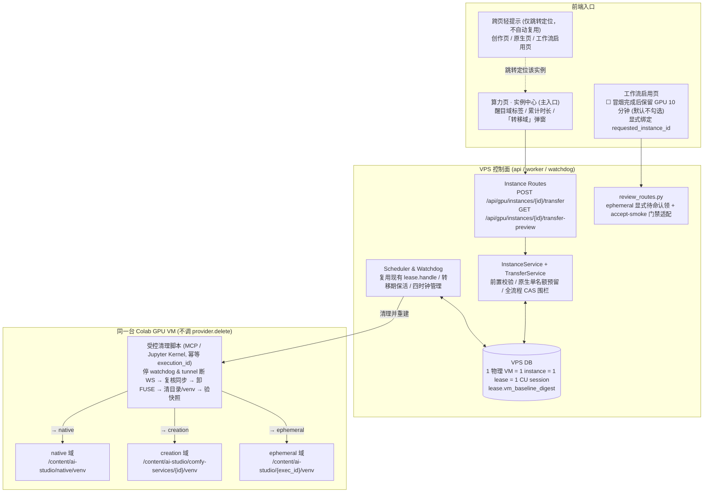
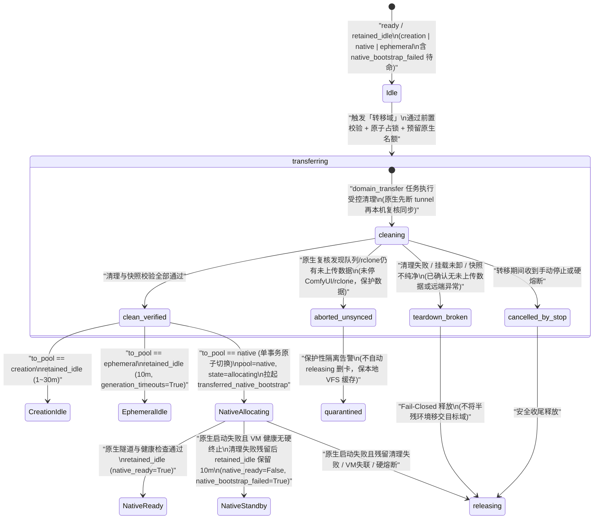

# GPU 实例域展示与显式域转移（保留 GPU 重建环境）设计方案

> **基线版本**：本文档基于 `main` 分支提交 `2fd4bae` 编写，建立在既有的[三域硬隔离模型](GPU_INSTANCE_ISOLATION_AND_REUSE.md)与[主动保活和自动恢复机制](GPU_AUTO_RECOVERY.md)之上，**不破坏三域隔离，不引入自动跨域复用**。

---

## 1. 背景、目标与已确认决策

### 1.1 背景痛点

在 Colab 上游算力紧张、申请 GPU 排队耗时长的场景下，用户经常需要在同一张已抢到的 GPU 上依次完成不同阶段的工作，例如：

- 在**创作池（`creation`）**出图后，发现需要调工作流，想切到**原生 ComfyUI（`native`）**可视化编辑；
- 在**原生 ComfyUI（`native`）**改完并导出工作流后，想切到**冒烟域（`ephemeral`）**跑一次真实冒烟并发布；
- **冒烟发布**通过后，想切回**创作池（`creation`）**立刻使用刚发布的新工作流出图。

在现有三域硬隔离约束下，上述每次切换都必须先释放旧卡再重新抢卡，既浪费等待时间，也容易在算力紧张期直接抢不到卡。

### 1.2 核心目标

1. **保持三域硬隔离**：三个域（`creation` / `native` / `ephemeral`）的自动调度仍然严格隔离、互不复用、互不阻塞。
2. **显式域展示与转移**：在「算力 → 实例中心」清晰展示每张 GPU 当前所属域，并提供人工触发的**「转移域」**功能——保留底层物理 Colab GPU 运行时（不释放重抢），在 VM 内彻底清理旧域环境并校验纯净度后，将物理租约原子移交至目标域并按目标域重建环境。
3. **真正的 Python 环境洁净重建**：将三域依赖安装统一切换至域隔离的 `venv --system-site-packages`，结合全局包轻量快照校验与 `PYTHONNOUSERSITE=1`，确保任意方向互转（尤其是 `native → ephemeral / creation`）不遗留第三方插件依赖，杜绝冒烟“假通过”与 `env-cache` 失配。
4. **工作流冒烟可选保留与闭环流转**：支持在工作流真实冒烟勾选「完成后保留 10 分钟」，并打通冒烟验收与转回创作/原生的完整闭环。

### 1.3 已确认产品与架构决策矩阵

| 维度 | 确认决策 |
| :--- | :--- |
| **三域隔离原则** | 严格维持三域硬隔离；绝不自动跨域复用。域转换仅通过**实例中心显式「转移域」**执行。 |
| **Python 环境隔离** | **一步到位改造为 `venv --system-site-packages`**（三域各自独立 venv，继承 Colab 基础镜像的 PyTorch/CUDA）；转移时直接删除旧域目录、venv 与用户级包，并以轻量 `site_snapshot` 校验全局包未被改写。 |
| **本地模型权重（`local` 模式）** | **严格纯净**：转移时连同旧域本地模型权重目录、ComfyUI checkout、`.warm`、临时目录一并清空，目标域按需重新校验下载。 |
| **冒烟后 10 分钟保留** | **仅在工作流真实冒烟**（`WorkflowActivation`）增加勾选框：**默认不勾选**；勾选后无论冒烟**成功还是失败**（硬终止除外）均在冒烟域保留 **10 分钟**（不加到算力页 CUDA 系统冒烟）。 |
| **转入 `native` 启动失败兜底** | 清理旧域成功后若原生 ComfyUI 启动（bootstrap）失败，且远端 VM 仍健康、未触发 CU 熔断/手动停止：**不立即销毁 GPU**，清理失败残留后保留 **10 分钟干净待命**，支持原生页换参原地重试或直接转回其他域。 |
| **忙碌 / 同步中触发转移** | **直接报错拦截**，提示「请等待当前任务/同步完成」，不做自动排队等待或隐式排空；且若拆除阶段意外发现 `rclone` 仍有未上传 VFS 缓存，**绝不自动销毁 VM**。 |
| **跨页交互引导** | 原生页、创作页、工作流启用页在当前域无可用卡而其他域有空闲可转移卡时，展示**轻提示按钮**直接跳转实例中心并定位到该卡发起转移（绝不自动跨域复用）。 |

---

## 2. 总体架构与核心不变量

### 2.1 系统协作与数据流



### 2.2 八条核心不变量

1. **物理 VM 与控制面记录严格 1:1 绑定**：域转移在**同一条 `instance` + `lease` + 权威 CU 账本分段**上原位流转（通过 `transfer_history` 与 `domain_generation` 记录审计轨迹），**不拆分新 `instance_id`、不提前闭合 CU 会话**，直至物理 VM 真正被 Colab 删除。
2. **贯穿全流程的并发围栏与原生名额独占**：所有状态机校验、占锁切入、原生单名额预留、清理结果落盘与域切换均在短事务 `dispatch_lock → admission_lock → DB BEGIN IMMEDIATE` 内通过 `transfer_id` + `expected_version` CAS 推进；远端探活与清理执行均在锁外进行；`transferring` 期间禁止修改保留策略，且与手动停止（`POST /stop`）协调收敛。
3. **保护未落盘用户数据（FUSE 与 VFS 双红线）**：
   - 任何递归删除前，必须检查 `/proc/self/mountinfo` 确认**整个待删目录树下没有任何挂载点**（先 `fusermount3 -u` 确认卸载成功）；
   - 拆除原生域时，若在停止 `ComfyUI`/`rclone` 前的本机复核阶段发现 `rclone` 仍有未上传 VFS 缓存或活跃写入，**立即中止清理并保护 VM 不被自动 `releasing` 销毁**，避免未上传数据随 VM 丢失。
4. **清理验证 Fail-Closed**：只有远端清理脚本确认旧进程全退出、8188/5572 端口空闲、GPU 显存无残留计算进程、旧域目录/凭据/用户级包已清空、且全局 `site_snapshot()` 摘要与 VPS 端记录的 `lease.vm_baseline_digest` 一致后，才允许切换 `instance_pool`。
5. **四时钟严格分离**：物理卡出生时间（`vm_allocated_at`）、原生会话上限（`hard_deadline_at`）、空闲待命截止（`idle_deadline_at`）与单次任务执行超时（`task_deadline_epoch` / `lease.deadline_epoch`）各司其职，避免把短待命倒计时误锁成后续任务的硬超时。
6. **存量非隔离旧 VM 禁止转移**：仅标记 `venv_isolated == True` 且记录了 `vm_baseline_digest` 的新建实例允许发起域转移；升级部署前已在运行的全局安装老实例按 Fail-Closed 处理，不可转移。
7. **显式绑定待命卡防静默开卡**：工作流冒烟页承诺使用某张 `ephemeral` 待命卡时必须显式传入 `requested_instance_id`，若提交瞬间待命卡已失效/被转走，直接返回 `409` 由用户决定是否新开，绝不静默申请新付费卡。
8. **L3 自动恢复严格守约**：`transferring` 期间、`ephemeral` 域（含保留 10 分钟待命态）以及 `native_bootstrap_failed` 待命态均**不触发** L3 跨机自动恢复；转移完成进入 `creation` 或 `native`（`native_ready == True`）后，若后续被 Colab 意外回收，L3 按**新域**规则生效。

---

## 3. 底层基石：三域 `venv --system-site-packages` 隔离改造

### 3.1 现状问题

当前 [runtime_worker.py](../../api/app/gpu/runtime_worker.py#L1027-L1042) 与 [native_runtime.py](../../api/app/gpu/native_runtime.py#L1043-L1055) 均使用 `uv pip install --system` / `sys.executable -m pip` 向 Colab 全局 `/usr/local/lib/python3.x/dist-packages` 装包：
- 原生域 Manager 安装的第三方节点依赖会污染全局包，转去冒烟会导致“依赖残留引发的假通过”；
- 创作域装过包后会改变全局包集合哈希（`base_pkg_sha`），导致原生域 [node_persistence.py](../../api/app/gpu/node_persistence.py#L1426-L1454) 的 `env-cache` 无法命中。

### 3.2 统一目录与虚拟环境布局

在 Colab 运行时 `/content/ai-studio/` 下按域隔离目录与 venv：

```text
/content/ai-studio/
  .vm-baseline.json                  # VM 首次启动记录的全局 site-packages 快照与受保护包列表（同时上送摘要存 VPS DB）
  native/
    venv/                            # 原生域专用 venv (--system-site-packages)
    ComfyUI/                         # 原生 ComfyUI checkout + custom_nodes + (local) models
    drive/                           # rclone FUSE 挂载点（清理前必须确认已卸载）
    vfs-cache/ temp/ state.json ...
  comfy-services/
    <instance_hash>/
      venv/                          # 创作池实例常驻 venv (--system-site-packages)
      ComfyUI/                       # 创作池常驻 ComfyUI + 本地权重
      state.json env-state.json ...
  <execution_id>/                    # 单次任务执行目录（status.json / meta.json / outputs）
    venv/                            # 仅 ephemeral 冒烟任务使用，跑完立即清除
    ComfyUI/                         # 仅 ephemeral 冒烟任务使用，跑完立即清除
```

> **Kernel Python 保持纯净**：Colab Jupyter Kernel 本身始终运行系统 Python，仅负责用标准库拉起 `runtime_worker.py` 与执行轻量控制面脚本；所有 `pip` / `uv` / `ComfyUI` / `Manager` / `install.py` 均运行在对应域的 `<venv>/bin/python` 下。

### 3.3 创建、安装、轻量基线守卫与非目标边界

1. **快速创建 venv**：
   - 优先使用 `uv venv --system-site-packages --python <sys.executable> <venv_dir>`（耗时通常 `< 0.5s`），无 `uv` 时回退 `sys.executable -m venv --system-site-packages <venv_dir>`。
2. **依赖安装与子进程环境变量**：
   - `uv pip install --python <venv_python> --constraint <constraints> -q ...`（**移除 `--system`**）；
   - 回退 `pip` 时使用 `[<venv_python>, "-m", "pip", "install", "--disable-pip-version-check", "-q", "-c", str(constraints), ...]`；
   - 运行 ComfyUI、Manager CLI、`install.py` 及全部依赖安装命令时，子进程环境变量统一设置：
     - `VIRTUAL_ENV=<venv_dir>`，并将 `<venv_dir>/bin` 置顶 `PATH`；
     - **`PYTHONNOUSERSITE=1`**（禁止加载 `~/.local/lib/pythonX.Y/site-packages` 用户级包）；
     - 清除可能干扰导入路径的非受控 `PYTHONPATH`（保留必需的 ComfyUI 工作路径）。
3. **全局包轻量基线快照与 VPS 侧固化**：
   - VM 上**首次**运行 `runtime_worker.py`（在任何 `pip/uv` 安装之前）时，对 Colab 全局 `site-packages` 采集一份轻量元数据快照（直接复用 [node_persistence.py](../../api/app/gpu/node_persistence.py#L1457) 的 `site_snapshot()` 机制：顶层目录项名称、`.dist-info`/`.egg-info`、`.pth` 文件及 `lstat` 元数据，加上受保护的 PyTorch/CUDA 版本表，采集耗时 `< 50ms`），计算确定性摘要 `vm_baseline_digest`；
   - `runtime_worker.py` 将 `venv_isolated: true` 与 `vm_baseline_digest` 回传至 `status.json`，由调度器持久化到 **`lease.vm_baseline_digest` 与 `instance.vm_baseline_digest`**（存放在 VPS 数据库中，不单纯信任 VM 本地文件）；
   - 每次依赖安装后复核受保护包未变；每次域转移清理校验时，将远端实时计算的全局 `site_snapshot()` 摘要与 **VPS 下发的 `expected_baseline_digest`** 做全量比对，任何全局新增包、残留 `.pth`、受保护包变动或 `~/.local/lib/python*` 残留均直接 Fail-Closed 拦截。
4. **安全边界声明（非目标）**：
   - 与 [node_persistence.py](../../api/app/gpu/node_persistence.py#L4) 保持一致：Colab 运行时内所有代码均以 `root`（UID 0）运行，本系统面向单用户可信自用工作台，**并非恶意插件安全沙箱**；
   - 因此**不做** OS 级只读挂载隔离，也**不对** Colab 10GB+ 的全局 `dist-packages` 做逐文件全内容 SHA-256 哈希（冷启/转移 I/O 代价过高且收益极低）；轻量 `site_snapshot()` + VPS 端基线摘要 + `PYTHONNOUSERSITE=1` 已足以可靠拦截误装全局包、用户级包、`.pth` 注入与受保护包篡改。
5. **进程归属与健康检查适配**：
   - 改造 [runtime_worker.py](../../api/app/gpu/runtime_worker.py#L269-L290) 的 `_trusted_process_metadata` 与 [mcp.py](../../api/app/gpu/mcp.py#L874-L898) 的 `creation_process_health`：校验 `cmdline[0]` 精确解析指向该实例 `service_dir / "venv" / "bin" / "python*"`（或兼容未升级旧实例），且 `cwd` 指向对应 `ComfyUI`。
6. **Drive `env-cache` Schema 升级**：
   - [node_persistence.py](../../api/app/gpu/node_persistence.py#L1253)：将 `_ENV_CACHE_SCHEMA` 从 `3` 升至 **`4`**，缓存目标目录改为 `<native_venv>/lib/pythonX.Y/site-packages`；`base_pkg_sha` 基于基线快照计算，与旧 v3 缓存自然隔离；
   - [runtime_worker.py](../../api/app/gpu/runtime_worker.py#L1326)：创作域 env-cache 前缀从 `v2-` 升至 **`v3-`**，目标站点目录切换至 `<service_dir>/venv/lib/pythonX.Y/site-packages`。
7. **存量实例标记与兼容**：
   - `venv_isolated` 不为 `True` 或缺少 `vm_baseline_digest` 的升级前存量运行中实例，在实例中心标记为「旧版运行时环境，不支持域转移」，拒绝转移。

---

## 4. 实例域转移协议与状态机

### 4.1 统一状态机（消除 `transferring` 与 `allocating` 衔接歧义）

在 `InstanceService._INSTANCE_STATES`（[instances.py](../../api/app/gpu/instances.py#L248)）中新增 **`transferring`**（不纳入 `_IDLE_STATES` 与 `_ACTIVE_CREATION_STATES`，天然与三域自动调度互斥）。

**状态归属统一约定**：
- **阶段 1（环境拆除与纯净校验）**：`instance.state == "transferring"`、`lease.state == "active"`、由 `domain_transfer` 系统任务持有租约；`instance.transfer_state` 持久记录 `{transfer_id, from_pool, to_pool, phase: "cleaning", transfer_job_id, ...}`。
- **阶段 2（仅当 `to_pool == "native"`）**：阶段 1 校验通过后，在**同一次短锁原子事务**内将 `instance.instance_pool` 切为 `"native"`、`instance.state` 切为 `"allocating"`、`transfer_state.phase` 切为 `"native_bootstrapping"`，同时创建并绑定 `transferred_native_bootstrap` 原生启动任务（接手 `lease.owner_job_id` / `current_job_id`）。由于该切换是单事务原子的，且原生启动任务随即处于活跃非终态，离线写锁（[native.py](../../api/app/gpu/native.py#L241-L275)）与 L3 恢复判定在两阶段衔接处**零缝隙、绝不提前放行**。



### 4.2 前置校验、全流程并发围栏与双出口分支

#### 1) 同步前置校验矩阵（全部在入口严格校验，不满足直接 `409/422` 拦截）

| 校验维度 | 通过条件 | 不通过错误码与提示 |
| :--- | :--- | :--- |
| **实例状态与隔离能力** | `state in {"ready", "retained_idle"}`；`provider == "colab"`（测试环境允许 `mock`）；`variant == "VARIANT_GPU"`（禁止 CPU Prep）；`venv_isolated is True` 且存在 `vm_baseline_digest`；`not manual_stop_requested`、`not force_stop`、`not runtime_deleted`、`not cleanup_claim_token` | `409 INSTANCE_TRANSFER_UNAVAILABLE`（老环境提示「旧版实例不支持域转移」） |
| **源域无任务/排队** | `instance.current_job_id is None`、`lease.state == "idle"`、`lease.current_job_id is None`；且 DB 中无任何非终态 `job` 的 `instance_id` 或 `requested_instance_id` 指向该实例 | `409 INSTANCE_TRANSFER_BUSY`：「请等待当前任务/同步完成」 |
| **无恢复计划 & 未熔断** | 该实例无活跃 L3 恢复计划；`CuGuardService` 未触发每日上限软熔断或余额底线硬熔断；未超出 `hard_deadline_at` | `409 INSTANCE_TRANSFER_BLOCKED` / `409 CU_GUARD_TRIPPED` |
| **目标域合法性** | `target_pool in {"creation", "native", "ephemeral"}` 且 `target_pool != current_pool` | `422 INVALID_TRANSFER_TARGET` |
| **源域为 `native`（正常就绪态：`native_ready == True`）** | ① `not lease.native_draining`、`not restart_active(lease)`、`not active_writes(lease)`；<br>② 锁外实时探测 `/queue` 与 `/studio_native/state?fresh=1`：必须明确返回 `status == "idle"`（队列空、Manager 空闲、插件 `durable == True` 且无错误、`rclone` 无 `uploadsQueued`/`uploadsInProgress`/`transferring`/`open_writes`）。探测失败（`unknown`）按忙处理直接拒绝。 | `409 INSTANCE_TRANSFER_BUSY`：「请等待当前任务/同步完成」 |
| **源域为 `native`（失败待命态：`native_bootstrap_failed == True`）** | **走独立待命转出分支**：该卡未建隧道且已于失败收尾时完成残留清理，**跳过** `/queue` 与 `/studio_native/state` 隧道探测，仅校验无活跃任务、未过期、未停止，并在进入目标域前仍做一次轻量 VM 纯净度校验（`clean_verify`）。 | 同上常规状态拦截 |
| **目标域为 `native` 专属检查（含并发名额预留）** | ① 当前 owner 无任何活跃/启动中/释放中的原生 `lease`、`instance` 或 `job`；<br>② **当前 owner 无其他 `state == "transferring"` 且 `transfer_state.to_pool == "native"` 的实例**（在原子锁事务内直接完成原生单名额占坑，彻底阻断两张卡并发争抢同一隧道）；<br>③ 无活跃的 `native` 域 L3 恢复计划；<br>④ 无活跃的 `workspace_write_lock`（离线插件管理写锁）；<br>⑤ 原生隧道配置就绪，且该实例 `account_id` 解析出的 `drive_account_id` 已授权 Google Drive。 | `409 NATIVE_ACTIVE` / `409 NATIVE_WORKSPACE_LOCKED` / `503 NATIVE_CONFIG` / `409 DRIVE_NOT_CONNECTED` |

#### 2) 贯穿全流程的并发围栏与崩毁收口规则

1. **入口单事务原子立项**：
   - 在 `dispatch_lock → admission_lock → DB BEGIN IMMEDIATE` 单事务内完成：二次复核版本与 `native_last_write`/`active_writes`（防 TOCTOU） → 校验原生名额独占 → 生成唯一 `transfer_id` → 创建 `domain_transfer` 系统任务 → 原子将 `instance.state` 置为 `"transferring"`、`current_job_id = transfer_job.id`、`transfer_state` 写库 → 将 `lease.state` 置为 `"active"`、`owner_job_id = current_job_id = transfer_job.id`、`idle_deadline_at = None`；若源域为 `native` 同步置 `lease.native_ready = False, native_draining = True` 立刻拦截所有新代理写入。
2. **`retention()` 与 `stop()` 并发协同**（修补 [instances.py](../../api/app/gpu/instances.py#L2034-L2125)）：
   - `InstanceService.retention()`：将 `"transferring"` 加入拒绝集合，返回 `409 INSTANCE_CONFLICT`（「实例正在执行域转移，暂不可修改保留策略」）。
   - `InstanceService.stop()`：若实例处于 `state == "transferring"`，**不直接覆写 `state = "releasing"`**（避免在清理或 VFS 保护期间被看门狗强杀），而是仅置 `manual_stop_requested = True`、`retention_mode = "save"`、`idle_deadline_at = None`，并标记关联的 `domain_transfer` 任务 `cancel_requested = True`；转移推进者在下一次 CAS 提交前检查到 `manual_stop_requested == True`，立即中止域切换，待确认无未同步 VFS 缓存后收敛至 `releasing`。
3. **每次状态推进的 CAS 令牌校验**：
   - `domain_transfer` 任务的每个阶段推进都复用调度器的 `claim_token` + `claim_until` 租约锁，且最终提交域切换或失败收口时，在 `dispatch_lock → admission_lock` 事务内严格校验：
     - `instance.state == "transferring"` 且 `instance.transfer_state.transfer_id == transfer_id`；
     - `instance.version == expected_version` 且 `lease.id == expected_lease_id`；
     - `not instance.manual_stop_requested` 且 `not instance.force_stop` 且 `not lease.force_stop`。
4. **Worker 崩溃 / 远端超时但实际已执行的幂等收口**：
   - 远端清理脚本通过现有 [mcp.py](../../api/app/gpu/mcp.py#L139-L312) 的固定 `execution_id` + `O_EXCL` `.worker.lock` + `status.json` 协议运行；
   - 若 `worker` 进程在提交清理脚本后重启、或 HTTP/WS 回执丢失，调度器下次 tick 自动按同一 `execution_id` 轮询远端 `status.json` 恢复结果，绝不重复触发第二份清理进程；
   - `domain_transfer` 任务自带硬超时（默认 **3 分钟**）；若超时仍未拿到 `cleaned: true` 的终态回执：
     - 若源域为 `native` 且无法确认 `rclone` 缓存是否已同步 → 置入 `quarantined`（保护性隔离并告警，不盲删 VM）；
     - 否则按 Fail-Closed 走 `releasing` 释放收尾。

#### 3) `native_bootstrap_failed` 待命卡原地重试出口

在 [native.py](../../api/app/gpu/native.py#L523-L643) 的 `_admit_locked` 中，当 `live = active_lease(repo, owner)` 命中一张处于 **`native_bootstrap_failed == True` 且 `native_ready == False`、`lease.state == "idle"`、`instance.state == "retained_idle"`** 的同域待命卡时：
- 若本次 `/api/gpu/native/start` 请求的 `account_id`（含自动选择）与 `spec` 与该待命卡一致：
  - **允许携带全新的启动参数**（`model_storage_mode`、`cache_gb`、`cache_max_age_minutes`、`retain_idle_minutes`、`max_runtime_minutes`、`plugin_generation`）直接认领该 `instance_id` + `lease_id`，清除 `native_bootstrap_failed` 标记，按新参数重算 `hard_deadline_at` 并创建新的原生 bootstrap 任务原地重试（跳过 `provider.create()`）；
- 若用户请求了不同的账号或不同的 GPU 规格，仍返回 `409 NATIVE_ACTIVE` 提示「原生域已有失败待命实例（规格 X），请先在实例中心停止或转移后再切换规格」。

---

### 4.3 远端 VM 受控清理与纯净度验收协议

清理脚本固定内置于仓库（通过 `build_teardown_code(execution_id, payload)` 生成，绝不执行外部任意命令）：

#### 步骤 1：按源域严格顺序断流、复核与停进程

- **从 `native`（正常就绪态）转出（严格顺序不可颠倒）**：
  1. **控制面已先行封新写入**（`native_ready=False, native_draining=True`，所有新 HTTP/WS 已被拒）；
  2. **先停 `watchdog.py` 与 `cloudflared`**：
     - 先按 PID/命令行终止 `/content/ai-studio/native/watchdog.py`（防止重启子进程或 20 分钟后调 `runtime.unassign()` 杀卡）；
     - 立即终止 `cloudflared`（校验 `tunnel_pid` + `tunnel_start_id`），**从边缘瞬间切断所有已建立的外部 WebSocket 长连接与 HTTP 流量**，确保此时刻起不再有任何新请求到达 ComfyUI；
  3. **停 `ComfyUI`/`rclone` 之前的本机二次复核（保护未落盘数据）**：
     - 通过本机回环复核 `http://127.0.0.1:8188/queue`、`http://127.0.0.1:8188/studio_native/state?fresh=1`（或本地 `probe()`）与 `http://127.0.0.1:5572/vfs/stats`、`core/stats`；
     - 若检测到任何队列运行/排队中、Manager 忙、插件归档未 `durable`、`open_writes()` 为真、`rclone` 仍有 `uploadsQueued`/`uploadsInProgress`/`transferring`，或探测异常（`unknown`）：
       - **立即停止继续拆除**（保持 `ComfyUI` 与 `rclone` 原状运行以便写回，**绝不删目录、绝不自动释放 VM**），向 `status.json` 写入 `state="aborted_unsynced"` 及具体原因；
       - 控制面收到 `aborted_unsynced` 后，将实例置为保护性隔离态 `quarantined`（记录明确告警事件与错误详情，保持 VM 存活等待同步/人工确认后再决定停止，绝不自动 `releasing` 丢数据）。
  4. **确认全部空闲归零后正式停机与卸载**：
     - 终止后台 `upload-env-cache`（如有）；
     - 终止原生 `ComfyUI`（校验 `pid` + `comfy_start_id` 及 `comfy-runtime.json`，`SIGTERM` → 等待 10s → `SIGKILL`）；
     - 再次确认 `127.0.0.1:5572/vfs/stats` 与 `core/stats` 上传队列仍为 0，随后向 `rclone` 发送 `SIGTERM` 等待退出；
     - 执行 `fusermount3 -u /content/ai-studio/native/drive`（兼容 `fusermount -u`），循环 10 秒检查卸载完成。
- **从 `native`（`native_bootstrap_failed` 待命态）转出**：跳过步骤 1~4，直接执行步骤 2 与步骤 3 复核目录与全局快照纯净度。
- **从 `creation` 转出**：
  1. 读取 `/content/ai-studio/comfy-services/<hash>/state.json`，复核 `_trusted_process_metadata` 后向常驻 ComfyUI 进程组发送 `SIGTERM` → 等待 10s → `SIGKILL`；
  2. 扫描 `/proc` 确认无指向 `/content/ai-studio/comfy-services/` 或 `/content/ai-studio/.warm` 的残留子进程。
- **从 `ephemeral` 转出**：
  1. 扫描 `/proc` 确认无指向 `/content/ai-studio/<exec_id>/` 的残留 ComfyUI/worker 子进程（如有则安全终止）。

#### 步骤 2：全树挂载安全检查 + 清空旧域目录、本地权重、venv 与敏感凭据

1. **全树挂载红线检查**：解析 `/proc/self/mountinfo`，校验**整个 `/content/ai-studio` 目录树下不存在任何挂载点**（不仅是 `/content/ai-studio/native/drive`，包括任何子目录或 FUSE/网络挂载）。一旦发现任何残留挂载，立即返回 `error_code="mount_still_active"` 并中止，**严禁执行 `rmtree`**。
2. **严格清空（零权重残留、零凭据残留）**：
   - 删除 `/content/ai-studio/native`（含 `rclone.conf`、`tunnel.token`、`local-model-config.json`、`ComfyUI/models`、`vfs-cache`、`venv`）；
   - 删除 `/content/ai-studio/comfy-services` 与 `/content/ai-studio/.warm`（含创作池本地权重、LoRA、hash cache、`venv`）；
   - 删除 `/content/ai-studio/` 下除当前转移 `execution_id` 与 `.vm-baseline.json` 外的所有历史任务目录；
   - 删除用户级 Python 包目录 `~/.local/lib/python*`（如有）。

#### 步骤 3：纯净度强校验（全部通过才返回 `cleaned: true`）

1. **挂载校验**：`/proc/self/mountinfo` 中 `/content/ai-studio` 下无任何挂载点；
2. **端口校验**：`127.0.0.1:8188` 与 `127.0.0.1:5572` 均可成功临时 bind；
3. **显存校验**：`nvidia-smi --query-compute-apps=pid --format=csv,noheader` 无残留 GPU 计算进程；
4. **全局 Python 完整快照校验**：实时计算 Colab 全局 `site-packages` 的 `site_snapshot()` 摘要，必须与 **VPS 通过 payload 下发的 `expected_baseline_digest`** 完全一致（同时覆盖顶层目录项、`.dist-info`/`.egg-info`、`.pth` 及受保护 PyTorch/CUDA 包），且 `~/.local/lib/python*` 不存在第三方包；
5. **硬件存活校验**：`nvidia-smi` 正常返回 GPU 型号与总显存；
6. **可选 Kernel 复位**：控制面收到 `cleaned: true` 后，可对 Colab Runtime Proxy 调一次 `POST /api/kernels/{kernel_id}/restart` 释放 Kernel 内存。

---

### 4.4 四时钟语义与目标域切换规则

为彻底避免待命截止被误当成任务硬超时（如第 9 分钟认领冒烟只剩 1 分钟）以及各域超时字段混用，明确四类时间字段的职责与同步规则：

| 字段 | 存储位置 | 职责定义 | 转移/认领时的更新规则 |
| :--- | :--- | :--- | :--- |
| **`vm_allocated_at`** | `instance` / `lease` | 物理 Colab VM 首次分配成功的只读时间戳 | 首次分配确认时写入，**跨转移永不修改**；用于 UI 提示「物理卡已累计运行 X 分钟（Colab 上游总时长不重置）」。 |
| **`hard_deadline_at`** | `instance` / `lease` | 域级长驻会话上限（仅 `native` 域使用，如默认 720m） | 转入 `native` 时按用户所选 `max_runtime_minutes` 设为 `now + max_runtime_minutes * 60`；转入 `creation` 或 `ephemeral` 时**明确置 `None`**（费用由全局 CU 每日上限与余额底线双熔断兜底）。 |
| **`idle_deadline_at`** | `instance` / `lease` | 空闲待命回收倒计时 | 进入 `retained_idle` 时设置（`creation` 1~30m、`ephemeral` 待命 10m、`native_bootstrap_failed` 待命 10m）；被新任务认领时**立即置 `None`**。 |
| **`task_deadline_epoch` & `lease.deadline_epoch`** | `job` / `lease` | 单次作业执行超时 / Watchdog 租约硬兜底 | `creation` 与 `ephemeral` 待命租约均设置 **`generation_timeouts = True`**。空闲待命时 `lease.deadline_epoch = idle_deadline_at` 供 watchdog 兜底回收；**一旦被新任务（创作或冒烟）认领，在 `_claim_existing` / `_advance` 中按本次任务的 `max_runtime_minutes` 重算 `task_deadline_epoch` 并同步刷写 `lease.deadline_epoch = task_deadline_epoch`**，绝不沿用旧待命截止，也绝不将其固化为 `instance.hard_deadline_at`！ |

#### 目标域后续动作

在清理验证通过后的短锁原子事务内，完成通用清理（`instance_pool = target_pool`、`domain_generation += 1`、追加 `transfer_history`、清空旧域 `creation_runtime` / `native_*` 残留字段），并按目标域分支收口：

- **分支 A：目标域 = `creation`**
  - `hard_deadline_at = None`、`retention_mode = "retain"`、`retain_idle_minutes = target_idle_minutes`（1~30，默认 15）、`idle_deadline_at = now + minutes * 60`；
  - `lease`: `state = "idle"`、`generation_timeouts = True`、`hard_deadline_at = None`、`idle_deadline_at = deadline`、`deadline_epoch = deadline`、`current_job_id = None`；
  - `instance.state = "retained_idle"`，转移完成。
- **分支 B：目标域 = `ephemeral`（冒烟域待命）**
  - `hard_deadline_at = None`、`retention_mode = "retain"`、`retain_idle_minutes = 10`、`idle_deadline_at = now + 600`、`ephemeral_standby = True`；
  - `lease`: `state = "idle"`、`generation_timeouts = True`、`hard_deadline_at = None`、`idle_deadline_at = now + 600`、`deadline_epoch = now + 600`、`current_job_id = None`；
  - `instance.state = "retained_idle"`，转移完成，等待用户在 10 分钟内提交工作流真实冒烟。
- **分支 C：目标域 = `native`（单事务切换 + 原地拉起原生 ComfyUI）**
  - 在同一原子事务内：`instance.instance_pool = "native"`、`instance.state = "allocating"`、`native_comfy = True`、`native_ready = False`、`native_bootstrap_failed = False`、`hard_deadline_at = now + max_runtime_minutes * 60`、`transfer_state.phase = "native_bootstrapping"`；
  - 同事务创建绑定该 `instance_id` & `lease_id` 的原生 bootstrap 任务（标记 `transferred_native_bootstrap = True`、`selection_reason = "domain_transfer"`），`lease` 保持 `state = "active"`、`generation_timeouts = False`、`hard_deadline_at = hard`、`deadline_epoch = hard`、`owner_job_id = current_job_id = boot_job.id`；
  - **成功时**：健康检查通过，写 `native_ready = True`、`transfer_state.phase = "succeeded"`、`instance.state = "retained_idle"`；
  - **失败兜底**：若 `transferred_native_bootstrap` 失败且未命中硬终止条件（VM 仍在、未触发 CU 熔断、未手动停止、未超硬截止）：
    1. 调度器在收尾前对该 VM 执行一次**轻量原生失败残留清理 + 快照纯净校验**（先停可能半启的 `watchdog.py`/`cloudflared`/`ComfyUI`/`rclone`，确认 FUSE 全树无挂载后删 `/content/ai-studio/native`，复核 `vm_baseline_digest`）；
    2. 残留清理验证通过 → **不删除物理 GPU**，收敛为 `instance.state = "retained_idle"`（`instance_pool = "native"`、`native_comfy = True`、`native_ready = False`、`native_bootstrap_failed = True`、`retention_mode = "retain"`、`retain_idle_minutes = 10`、`idle_deadline_at = now + 600`，`lease.state = "idle"`、`generation_timeouts = True`、`idle_deadline_at = deadline`、`deadline_epoch = deadline`），保留 **10 分钟干净待命**；用户可经 §4.2(3) 在原生页换参原地重试，或在实例中心直接转回其他域；
    3. 若连残留清理或纯净度校验也失败（或发现未同步 VFS 缓存）→ 存在未同步缓存则入 `quarantined` 保护告警，否则 Fail-Closed 走 `releasing` 销毁。

---

## 5. 冒烟域待命、10 分钟可选保留与验收门禁改造

### 5.1 工作流真实冒烟 10 分钟保留勾选框

- **作用范围**：**仅工作流真实冒烟**（[WorkflowActivation.tsx](../../web/src/components/WorkflowActivation.tsx) → `POST /api/gpu/workflows/{workflow_id}/real-smoke`），算力页 `POST /api/gpu/admin/compute/smoke`（CUDA 系统冒烟）不加勾选框。
- **请求体扩展**（[review_routes.py](../../api/app/review_routes.py#L665-L845)）：
  - 新增可选布尔字段 `retain_after_smoke: bool = False`（**默认 `False`**，前端勾选框默认不勾选）；
  - 新增可选字符串字段 `requested_instance_id: str | None = None`（用于显式绑定冒烟域待命卡）；
  - 两者均计入幂等请求哈希 `raw`；
  - `execution_policy` 映射：
    - `retain_after_smoke == False`：`lifecycle = "save"`、`shutdown_after_job = True`、`retain_idle_minutes = 0`；
    - `retain_after_smoke == True`：`lifecycle = "retain"`、`shutdown_after_job = False`、`retain_idle_minutes = 10`。
- **任务结束保留与洁净前提**（[instances.py](../../api/app/gpu/instances.py#L1902-L1960) `InstanceService.complete`）：
  - 对 `POOL_EPHEMERAL` 中的 `workflow_smoke`：
    - 勾选 `retain_after_smoke == True` 且未命中硬终止条件（`remote_missing` / `unstarted_vm` / `unconfirmed_allocation` / `force_stopped` / `soft_tripped` / `manual_stop` / `past_hard`）→ **无论本次冒烟成功还是失败**，在确认本次冒烟子进程已终止且工作区/venv 清理干净（全局 `site_snapshot` 校验通过）后，进入 `retained_idle` 保留 **10 分钟**（`generation_timeouts = True`、`idle_deadline_at = now + 600`、`lease.state = "idle"`）；
    - 若冒烟异常导致进程/环境未能通过洁净收尾校验，按 Fail-Closed 放弃保留直接走 `releasing`。

### 5.2 冒烟域待命卡显式认领与每次纯净冷启

- **显式绑定防静默新开付费卡**：
  - 打开工作流启用面板（`GET /api/gpu/workflows/{workflow_id}/activation`）时，后端返回：
    - `standby_ephemeral_instance`：冒烟域中与当前草稿 `manifest.compute_spec` **精确匹配**的最优空闲实例摘要（含 `instance_id`、`account_id`、`account_alias`、`spec`、`idle_deadline_at`）；
    - `transferable_other_instances`：其他域（`creation`/`native`）中与当前草稿规格精确匹配的空闲可转移实例列表。
  - 前端若命中 `standby_ephemeral_instance`：自动选中该卡所在 `account_id`，展示提示「将使用冒烟域待命实例 `#xxx`（账号 · 规格，剩余 X 分钟），无需重新抢卡」，并在提交 `POST /real-smoke` 时**显式携带 `requested_instance_id = standby.instance_id`**；
  - 后端准入（[review_routes.py](../../api/app/review_routes.py#L753-L845)）收到 `requested_instance_id` 时：
    - 仍在 `_reusable_smoke_job` 幂等/续接未验收冒烟检查之后生效；
    - 在 `dispatch_lock → admission_lock` 事务内校验该实例仍存在、属于 `POOL_EPHEMERAL`、`state in {"ready", "retained_idle"}`、`current_job_id is None`、未过期、未停止、账号匹配且实际 GPU 规格与草稿 `manifest.compute_spec` **精确一致**；
    - 若校验通过：记录 `requested_instance_id` 并在 `InstanceService.allocate` 中走原子 `_claim_existing`（`selection_reason = "requested_ephemeral_standby"`），**同步按本次冒烟 `max_runtime_minutes` 重算 `lease.deadline_epoch`（不继承 10 分钟待命截止）**；
    - 若该待命卡在提交瞬间已过期、被占用或被转走：**直接返回 `409 EPHEMERAL_INSTANCE_UNAVAILABLE`**（提示「冒烟域待命实例已失效或被占用，未自动新开 GPU，请刷新后确认是否新开实例」），绝不静默申请新付费卡！
  - 若前端未传 `requested_instance_id`：保持原逻辑直接申请新冒烟实例（不隐式复用）。
- **强制冷启动纯净保证**：
  - 在 [runtime_worker.py](../../api/app/gpu/runtime_worker.py#L2471-L2647) 中，当 `snapshot.get("workflow_smoke") is True` 时：
    - 禁用 `_warm_take` 与 `_warm_put`；
    - 每次冒烟运行前自动清理 `/content/ai-studio/` 下历史冒烟目录与 `.warm`、校验 `expected_baseline_digest`；
    - 使用独立的 `<execution_dir>/venv`（`--system-site-packages` + `PYTHONNOUSERSITE=1`）；
    - `finally` 中确保 ComfyUI 子进程已退出，删除本次 `ComfyUI/` 与 `venv/`（仅保留已验证产物目录供控制面拉取），并在 `status.json` 中回传 `clean_after_smoke: true` 与 `vm_baseline_digest`。

### 5.3 `accept-smoke` 验收门禁与诊断证据固化

改造 [review_routes.py](../../api/app/review_routes.py#L939-L1039)：

1. **租约定位**：优先按 `job.get("lease_id")` 精确查找该冒烟任务所使用的租约，兼容历史数据再回退 `owner_job_id == job["id"]`；
2. **安全释放/脱离判定**：满足以下**任一条件**即可通过验收：
   - 该租约 `state == "deleted"`；**或**
   - 该冒烟任务对应的 `execution` 记录已处于 `completed`，且该租约与关联实例均**不再由本次冒烟任务持有**（`lease.current_job_id != job["id"]` 且 `instance.current_job_id != job["id"]`；若 `lease.state == "active"` 则还要求 `lease.owner_job_id != job["id"]`，即已被后续转移/任务合法接管）。
3. **硬件诊断证据固化到 `job`**：
   - `_job_gpu_diagnostics()` 对新任务优先且严格采信固化在 `job.gpu_diagnostics`（由 [scheduler.py](../../api/app/gpu/scheduler.py#L1275) 在运行期采集落盘）中的真实硬件诊断证据，避免依赖后续可能被转移/复用的可变 `lease` 字段（仅对缺失 `job.gpu_diagnostics` 的历史老任务保留兼容回退）。

---

## 6. 控制面联动、CU 账本与看门狗协调

### 6.1 Watchdog 与保活心跳协调

改造 [native.py](../../api/app/gpu/native.py#L803-L836) 与 [scheduler_watchdog.py](../../api/app/gpu/scheduler_watchdog.py#L537-L604)：

1. **`transferring` 期间 L0 活跃保活与防误回收**：
   - 转移任务执行期间 `lease.state == "active"` 且关联非终态 `domain_transfer` job；Watchdog 自动发送 `keepalive_active_lease`（60s TFE 保活），且不会触发 `_cleanup_orphan_lease`。
2. **统一受控待命保活**：
   - 扩展 `_smart_keepalive_allowed`，统一覆盖三类处于 `retained_idle` 的 Colab 租约：
     - `creation` 域（`retention_mode in {"smart", "retain"}`）；
     - `ephemeral` 域（`retention_mode == "retain"`，即转入冒烟或勾选冒烟后保留 10 分钟）；
     - `native` 域启动失败待命态（`native_ready is False` 且 `native_bootstrap_failed is True` 且 `retention_mode == "retain"`）；
   - 以上状态在 `now < min(idle_deadline_at, deadline_epoch, hard_deadline_or_inf)` 且未触发 CU 熔断/手动停止前按 60s/240s 发送保活心跳；到期后由 `_cleanup_orphan_lease` 自动回收并确认删除。
3. **保护性隔离态 `quarantined`（原生 `aborted_unsynced`）**：
   - Watchdog 不自动调用 `provider.delete()` 销毁处于“未同步缓存保护隔离态”的实例，直到用户在实例中心确认强停或同步告警处理完毕；同时记录醒目告警提示持续计费风险。

### 6.2 权威 CU 账本多域连续记账（[ccu.py](../../api/app/gpu/ccu.py)）

- 物理 VM 未删除期间，始终保持同一条 `instance-lifetime:{instance_id}` 账本分段处于 `open` 状态，总额严格按 Google 账户余额实扣对平（沿用现有单实例/同账号多实例加权归因口径）；
- 实例首次发生域转移时：
  - 将分段 `session_kind` 标记为 `"multi_domain"`，并在分段 `data.domain_transfers` 中追加转移时间线记录（`at`、`from_pool`、`to_pool`）；
  - `_refresh()` 中 `proportional = data["session_kind"] in {"smart_reuse", "multi_domain"}`，各创作/冒烟 `job` 仍按 `execution_seconds` 占物理卡总运行时长比例分摊实际 CU，其余部分（原生交互、待命空闲、短暂清理）统一计入会话余额 `idle_cu`；
- **V1 明确不做逐域子账本切片**：总额对平 + 任务比例分摊 + 转移时间线标注已满足个人算力核对需求，避免把 `ccu.py` 记账状态机过度复杂化。

### 6.3 原生状态页、代理与离线管理锁联动

- **原生 `/status` 修正**（[native_routes.py](../../api/app/native_routes.py#L357-L476)）：
  - 当 `active_lease(repo, owner)` 为空、但最近原生任务关联实例仍在运行且 `instance_pool != "native"`（已转出原生域）时，明确归口 `state: "stopped"`、`ready: False`，附带 `transferred_out` 摘要；
  - 当存在 `native_bootstrap_failed == True` 的 10 分钟待命原生卡时，返回 `standby_instance` 摘要（含剩余倒计时与失败原因），前端提示可直接修改配置后原地重试启动，或去实例中心转移/停止；
  - 当存在 `state == "transferring"` 且 `to_pool == "native"` 的实例时，返回 `transferring_in` 进度提示，阻止用户在原生页重复点启动。
- **离线工作流/插件管理锁互斥**（[native.py](../../api/app/gpu/native.py#L241-L275)）：
  - `workspace_offline_status` 必须同时拦住：
    - 任何 `state == "transferring"` 且（`from_pool == "native"` 或 `to_pool == "native"`）的实例；
    - 任何 `instance_pool == "native"` 且处于 `allocating` / `retained_idle`（含 `native_bootstrap_failed` 待命态）/ `quarantined` 的实例。
- **原生代理即时熔断**（[native_proxy.py](../../api/app/native_proxy.py)）：
  - 从 `native` 发起转移的原子事务瞬间置 `native_ready = False, native_draining = True`（阻断所有新 HTTP 写入与新 WS 握手），并由 VM 内停 `cloudflared` 立即切断存量 WS 连接。

---

## 7. HTTP API 与前端交互设计

### 7.1 新增/扩展 API 契约

#### 1) 实例公共字段扩展（`GET /api/gpu/instances`、`GET /api/gpu/instances/{id}`）

在 `InstanceService._PUBLIC`（[instances.py](../../api/app/gpu/instances.py#L254-L262)）新增：
- `venv_isolated: bool`
- `vm_allocated_at: float | None`
- `domain_generation: int`
- `transfer_state: dict | None`（`transfer_id`、`from_pool`、`to_pool`、`phase`、`transfer_job_id`、`started_at`、`error_code`、`error_message`）
- `transfer_history: list[dict]`
- `native_bootstrap_failed: bool`

#### 2) 转移预检接口（`GET /api/gpu/instances/{instance_id}/transfer-preview`）

供实例中心打开「转移域」弹窗时调用，一次返回全部可选目标域、禁用原因、物理卡已运行时长与默认参数：

```json
{
  "instance_id": "inst-xxx",
  "current_pool": "creation",
  "venv_isolated": true,
  "vm_allocated_at": 1764000000,
  "vm_elapsed_seconds": 3620,
  "account_id": "acct-1",
  "account_alias": "主账号",
  "spec": {"variant": "VARIANT_GPU", "accelerator": "L4", "shape": "SHAPE_STANDARD"},
  "transferable": true,
  "blocked_reason": null,
  "targets": {
    "native": {
      "allowed": true,
      "reason": null,
      "defaults": {
        "model_storage_mode": "local",
        "cache_gb": 20,
        "cache_max_age_minutes": 60,
        "retain_idle_minutes": 120,
        "max_runtime_minutes": 720
      }
    },
    "ephemeral": {
      "allowed": true,
      "reason": null,
      "defaults": {"retain_idle_minutes": 10}
    }
  }
}
```

#### 3) 发起域转移接口（`POST /api/gpu/instances/{instance_id}/transfer`，`202 Accepted`）

- **鉴权对齐既有入口**：
  - `target_pool in {"creation", "native"}`：要求已登录且为实例 owner（`Depends(current_user)`，与 `/api/gpu/jobs` 及 [native_routes.py](../../api/app/native_routes.py#L488) `/api/gpu/native/start` 保持一致）；
  - `target_pool == "ephemeral"`：额外要求管理员权限 `admin(user)`（与 [review_routes.py](../../api/app/review_routes.py#L665) `/real-smoke` 保持一致）。
- 必填头：`Idempotency-Key`（或请求体 `key`）；
- 请求体：
  ```json
  {
    "target_pool": "native",
    "confirmed": true,
    "expected_version": 7,
    "key": "transfer-inst-xxx-1764003600",
    "creation_options": {
      "retain_idle_minutes": 15
    },
    "native_options": {
      "model_storage_mode": "local",
      "cache_gb": 20,
      "cache_max_age_minutes": 60,
      "retain_idle_minutes": 120,
      "max_runtime_minutes": 720,
      "plugin_generation": null
    }
  }
  ```
- 响应：`202 Accepted`，返回更新后的 `instance`（`state: "transferring"`）及 `transfer_job_id`。

#### 4) 工作流真实冒烟扩展（`POST /api/gpu/workflows/{workflow_id}/real-smoke`）

- 请求体新增可选字段：
  - `"retain_after_smoke": false`（默认 `false`）
  - `"requested_instance_id": null`（显式绑定冒烟域待命卡；若该卡已失效返回 `409 EPHEMERAL_INSTANCE_UNAVAILABLE`）
- `GET /api/gpu/workflows/{workflow_id}/activation` 响应新增：
  - `standby_ephemeral_instance`
  - `transferable_other_instances`

### 7.2 前端交互规范

#### 1) 算力页 · 实例中心（[InstanceCenter.tsx](../../web/src/components/InstanceCenter.tsx)）

- **醒目域标签**：每张实例卡片顶部徽章区新增域 Badge（`创作池` / `原生 ComfyUI` / `冒烟域` / `一次性（CPU）`）；
- **元信息与状态反馈**：
  - 详情网格新增「所属域」与「物理卡已运行」（基于 `vm_allocated_at`）；
  - `transferring` 状态展示阶段进度（`清理旧域环境 → 校验环境纯净度 → 拉起原生 ComfyUI`），同时禁用「保留」按钮，停止按钮提示“将中止转移并释放实例”；
  - `native_bootstrap_failed` 待命态展示醒目提示条（剩余倒计时 + 前往原生页重试或转移至其他域）；
  - 原生未同步缓存保护隔离态（`quarantined` + `aborted_unsynced`）展示醒目告警，提醒存在未上传 Drive 缓存并避免误删。
- **「转移域」按钮与弹窗**：
  - 仅对 `ready / retained_idle` 且 `variant == VARIANT_GPU` 的实例展示（`venv_isolated === false` 时置灰并说明原因）；
  - 弹窗内拉取 `transfer-preview`，选择目标域并填写对应参数，明确展示三条提醒（清空旧域全部进程/venv/本地权重、账号与规格不变、Colab 上游总时长不重置），携带固定幂等键与 `expected_version` 提交。

#### 2) 跨页轻提示联动（仅引导跳转，绝不自动跨域复用）

- 在 [App.tsx](../../web/src/App.tsx) 与 [ComputePage.tsx](../../web/src/pages/ComputePage.tsx) 透传 `focusTransferTarget: { instanceId, targetPool }` 状态，点击任意页轻提示按钮后切换至「算力」页、定位该实例并自动打开「转移域」弹窗且预选目标域：
  1. **原生 ComfyUI 页（[NativeComfyPage.tsx](../../web/src/pages/NativeComfyPage.tsx)）**：原生域无活跃实例、无恢复计划、无转入中任务，但创作池/冒烟域有空闲可转移 GPU 时展示轻提示按钮；若存在 `native_bootstrap_failed` 待命卡则优先展示「原地修改参数重试启动」引导。
  2. **创作页（[CreatePage.tsx](../../web/src/pages/CreatePage.tsx)）**：创作池无活跃实例，但原生域/冒烟域有满足当前工作流硬件要求的空闲可转移 GPU 时展示轻提示按钮。
  3. **工作流启用页（[WorkflowActivation.tsx](../../web/src/components/WorkflowActivation.tsx)）**：
     - 付费确认勾选框下方新增（**默认不勾选**）：`☐ 冒烟结束后保留此 GPU 10 分钟（失败时也保留，便于继续冒烟或前往实例中心转移域）`；
     - 若存在精确匹配规格的 `standby_ephemeral_instance`，优先锁定该卡（自动选定账号并提交 `requested_instance_id`）；若提交返回 `409 EPHEMERAL_INSTANCE_UNAVAILABLE`，弹窗/提示用户待命卡已失效并让其刷新确认是否改开新卡；
     - 若冒烟域无待命卡、但其他域有**精确匹配规格**的空闲可转移 GPU，展示轻提示按钮「去实例中心转移到冒烟域」。

---

## 8. 涉及模块与分阶段实施清单

### 阶段 1：三域 `venv --system-site-packages` 隔离底座
- [runtime_worker.py](../../api/app/gpu/runtime_worker.py)：
  - 首次启动采集轻量 `site_snapshot()` 写入 `.vm-baseline.json` 并通过 `status.json` 上送 `venv_isolated: true` + `vm_baseline_digest`；
  - 创作池与冒烟域统一创建并使用域隔离 `venv --system-site-packages` + `PYTHONNOUSERSITE=1`；
  - 冒烟任务禁用 `_warm_take`/`_warm_put`，执行前后清理工作区/venv 与校验基线摘要；
  - 更新 `_trusted_process_metadata`；创作 env-cache 升至 `v3-`。
- [native_runtime.py](../../api/app/gpu/native_runtime.py) & [node_persistence.py](../../api/app/gpu/node_persistence.py)：
  - 原生域切换至 `/content/ai-studio/native/venv` + `PYTHONNOUSERSITE=1`，Manager / `install.py` / `WATCHDOG` 统一指向 venv Python；
  - `_ENV_CACHE_SCHEMA` 升至 `4`；补全 `rclone-state.json` / `state.json` 进程标识。
- [mcp.py](../../api/app/gpu/mcp.py)：更新 `creation_process_health` 兼容 venv Python 路径；新增受控远端清理脚本构造器 `build_teardown_code`（含断 `watchdog`/`cloudflared` → 本机复核同步 → 卸 FUSE → 全树挂载检查 → 清目录与 `~/.local` → 核对 VPS 基线摘要）。

### 阶段 2：实例域转移状态机与并发围栏
- 新增 `api/app/gpu/transfer.py`：封装转移预检、前置校验、原生单名额原子占坑、全流程 CAS 推进、`aborted_unsynced` 保护隔离、以及 `→ native` 启动失败残留清理与 10 分钟待命兜底。
- [instances.py](../../api/app/gpu/instances.py)：
  - 新增 `transferring` 状态与扩展公共字段；
  - `retention()` 拦截 `transferring`；`stop()` 与 `transferring` 协调收敛而不直接覆写脏状态；
  - `complete()` 支持工作流冒烟 `retain_after_smoke`（含失败且洁净时留 10 分钟）与 `transferred_native_bootstrap` 失败留 10 分钟；
  - `allocate()` 与 `_claim_existing()` 支持 `ephemeral` 显式待命认领（按任务时长重算 `deadline_epoch`，配合 `generation_timeouts = True`）及 `native_bootstrap_failed` 待命卡认领。
- [scheduler.py](../../api/app/gpu/scheduler.py)、[scheduler_instances.py](../../api/app/gpu/scheduler_instances.py) & [scheduler_watchdog.py](../../api/app/gpu/scheduler_watchdog.py)：
  - 推进 `domain_transfer` 系统任务（复用 `execution_id` 幂等轮询与 3 分钟硬超时收口）；
  - 落盘 `venv_isolated`、`vm_baseline_digest` 与 `vm_allocated_at`；
  - 扩展 Watchdog 保活覆盖 `ephemeral` 与 `native_bootstrap_failed` 待命卡，保护 `quarantined(aborted_unsynced)` 不被自动删除。
- [native.py](../../api/app/gpu/native.py)、[native_routes.py](../../api/app/native_routes.py)、[ccu.py](../../api/app/gpu/ccu.py)、[recovery.py](../../api/app/gpu/recovery.py)：
  - `_admit_locked` 支持认领 `native_bootstrap_failed` 待命卡并应用新参数；
  - `workspace_offline_status` 互斥 `transferring` 与 `native_bootstrap_failed`；
  - `/api/gpu/native/status` 修正原生转出归口并暴露失败待命与转入中状态；
  - `ccu.py` 兼容 `multi_domain` 连续记账；`recovery.py` 排除 `transferring` / `ephemeral` / `native_bootstrap_failed`。

### 阶段 3：冒烟验收改造与转移 HTTP 接口
- [instance_routes.py](../../api/app/instance_routes.py)：新增 `GET /api/gpu/instances/{id}/transfer-preview` 与 `POST /api/gpu/instances/{id}/transfer`（按目标域对齐权限）。
- [review_routes.py](../../api/app/review_routes.py)：
  - `real-smoke` 支持 `retain_after_smoke`（默认 `False`）与 `requested_instance_id`（失效报 `409 EPHEMERAL_INSTANCE_UNAVAILABLE`）；
  - `accept-smoke` 按 `job.lease_id` 查租约并严格优先采信固化在 `job.gpu_diagnostics` 的证据；
  - `workflow_activation` 返回 `standby_ephemeral_instance` 与 `transferable_other_instances`。

### 阶段 4：前端 UI 与跨页轻提示联动
- [gpu-api.ts](../../web/src/lib/gpu-api.ts) & [AccountDirectory.tsx](../../web/src/components/AccountDirectory.tsx)：补充转移类型与接口。
- [InstanceCenter.tsx](../../web/src/components/InstanceCenter.tsx)：醒目域 Badge、物理卡累计运行时长、转移阶段进度、失败待命与隔离告警条、「转移域」弹窗及焦点自动打开。
- [WorkflowActivation.tsx](../../web/src/components/WorkflowActivation.tsx)：默认不勾选的「冒烟后保留 10 分钟」勾选框、显式 `requested_instance_id` 绑定与失效提示、精确匹配轻提示跳转按钮。
- [NativeComfyPage.tsx](../../web/src/pages/NativeComfyPage.tsx)、[CreatePage.tsx](../../web/src/pages/CreatePage.tsx)、[ComputePage.tsx](../../web/src/pages/ComputePage.tsx)、[App.tsx](../../web/src/App.tsx)：跨页轻提示按钮、目标域预选跳转与原生失败待命重试提示。

---

## 9. 重点验收与回归测试清单

### 9.1 后端自动化测试（离线模拟，零真实 GPU 消耗）

1. **`venv --system-site-packages` 隔离与快照守卫**（新增 `tests/gpu/test_venv_isolation.py`）：
   - 创作、原生、冒烟均在各自域 venv 中安装依赖，且注入 `PYTHONNOUSERSITE=1`；
   - 模拟向全局 `site-packages` 新增非受保护包、注入 `.pth`、写入 `~/.local/lib/python*` 或篡改受保护包时，与 VPS `vm_baseline_digest` 比对均 Fail-Closed 拦截；
   - 原生 `env-cache` v4 打包/恢复与旧 v3 缓存隔离校验；
   - 冒烟域禁用 `.warm`，连续两次冒烟互不残留目录与依赖。
2. **域转移全路径、并发围栏与故障收口**（新增 `tests/gpu/test_instance_domain_transfer.py`）：
   - 6 条转移路径全覆盖：`creation ↔ native`、`creation ↔ ephemeral`、`native ↔ ephemeral`；
   - **并发场景 1 — 两张卡同时转入 `native`**：仅第一张原子占坑成功进入 `transferring`，第二张立即返回 `409 NATIVE_ACTIVE`，绝不争抢隧道；
   - **并发场景 2 — 停止请求 / 保留策略修改与域转移并发**：`transferring` 期间 `PATCH /retention` 返回 `409`；`POST /stop` 置 `manual_stop_requested=True` 使转移安全中止并收敛至 `releasing`，绝不把已停实例复活；
   - **故障场景 3 — 清理在远端实际已完成但回执丢失 / worker 重启**：重启后按同一 `execution_id` 幂等轮询 `status.json` 正常收敛；超过 3 分钟硬超时则 Fail-Closed 收口；
   - **原生数据保护场景**：原生拆除必须先停 `watchdog.py` 与 `cloudflared`（切断存量 WS）再本机复核同步；若发现 `rclone` 仍有待上传文件，立即中止并进入保护隔离态 `quarantined`（**绝不自动 `releasing` 删卡**）；全树存在任何残留挂载点时严禁 `rmtree`；
   - **原生失败待命双出口场景**：`→ native` bootstrap 失败后清理残留并保留 10 分钟；验证**出口 1（免隧道探测直接转出到创作池/冒烟域）**与**出口 2（原生页带新参数原地重试启动）**均能走通，10 分钟到期无人操作则自动释放；
   - 鉴权校验：转 `creation`/`native` 仅要求 owner 登录，转 `ephemeral` 要求管理员；
   - CU 账本校验：多次域转移全程复用同一 `instance-lifetime:{id}` 分段（`multi_domain`），总额对平且不提前闭合。
3. **冒烟 10 分钟保留、四时钟与显式待命认领**（更新 `tests/test_review_smoke.py` / `tests/gpu/test_instance_pool_isolation.py`）：
   - 默认不勾选 `retain_after_smoke` 时行为与原版 100% 一致；勾选后成功与失败（洁净收尾时）均保留 10 分钟并获 watchdog 保活；
   - **第 9 分钟认领场景**：冒烟待命卡在第 9 分钟被 5 分钟冒烟任务认领，`lease.deadline_epoch` 正确重算为 `now + 300`，不被旧待命截止提前超时杀死；
   - **待命卡付费确认后失效场景**：提交 `POST /real-smoke` 时携带的 `requested_instance_id` 若已过期或被转走，严格返回 `409 EPHEMERAL_INSTANCE_UNAVAILABLE`，绝不静默新开付费 GPU；
   - `accept-smoke` 在保留待命期与转去创作域后均能按 `job.lease_id` 与固化的 `job.gpu_diagnostics` 正常验收。

### 9.2 前端自动化测试

- 扩展 `web/tests/` 契约与组件测试：域 Badge 渲染、`venv_isolated=false` 禁用态、转移弹窗参数与幂等提交、冒烟勾选框默认不勾选、显式 `requested_instance_id` 传递与失效 `409` 处理、跨页轻提示仅在规格兼容且本域无卡时出现。

### 9.3 真实 Colab 端到端验收清单（上线前实测）

| 序号 | 真实 GPU 验收场景 | 期望结果 |
| :---: | :--- | :--- |
| 1 | 创作池 L4 出图 → 转移到原生 ComfyUI | 同一 Colab endpoint 保留；创作 ComfyUI/权重/venv 清空；原生 ComfyUI + Manager + Tunnel 正常拉起并进入编辑 |
| 2 | 原生 ComfyUI 装新插件并改工作流 → 同步中点转移 → 同步完成后转冒烟域 | 同步中直接报错拦截；同步完成后安全断隧道、停守护并卸载 FUSE（Drive 数据完好无损），原卡干净进入冒烟域 10 分钟待命 |
| 3 | 冒烟待命卡第 8~9 分钟跑通草稿冒烟（勾选保留 10 分钟）→ 一键验收发布 | 未重抢新卡；原生插件依赖未泄漏；不被旧待命截止截断超时；`accept-smoke` 与发布一步成功；卡继续保留 10 分钟 |
| 4 | 将冒烟后保留的卡转回创作池 → 用刚发布的新工作流立即出图 | 未重抢新卡；创作池冷启动新工作流并出图成功；CU 账单整段连续准确 |
| 5 | 模拟转入原生启动失败 → 原生页改配置原地重试 / 或直接转回创作池 | GPU 未被销毁，进入 10 分钟待命；原地重试与转回创作池两条出口均正常走通 |
| 6 | 冒烟不勾选保留（默认） | 跑完冒烟立刻释放 GPU，与原有行为完全一致 |
