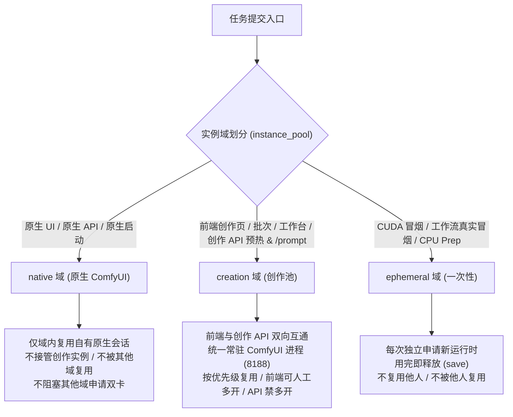
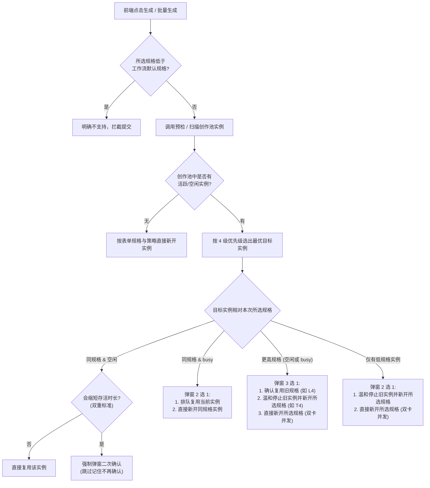

# GPU 实例三域隔离与创作池互通复用改造方案

> **基线版本**：本文档基于提交 `a19894b18e194073520b333cc3dee76d9c53af04` 编写（逻辑与 `1f8f7474` 一致，文件路径与行号已同步至最新拆分子模块）。

---

## 1. 改造背景与目标

当前版本（`a19894b1`）中，原生 ComfyUI、普通前端创作页、创作 API、冒烟测试与 CPU 缓存准备共用同一套 `InstanceService._compatible` 复用判断，存在以下结构性问题：

1. **职责边界混乱**：原生模式尝试与普通创作共享实例（引入 `shared_native`、`_studio_native_storage_conflict`、`_prepare_native_weights`、`native.admit` 绑定旧实例、`guard_generation` 重启阻塞普通任务等复杂耦合），同时全局单卡拦截又阻塞其他独立任务。
2. **创作模式与创作 API 割裂**：创作 API 实例带有 `creation_runtime` 标记，前端创作页无法复用它；反之创作页的常规任务没有统一常驻进程与宽松规格匹配，导致“API 页开长驻卡 → 酒馆跑图 → 前端手修提示词重跑”的核心路径必然另开第二台 GPU。
3. **冒烟污染与误删风险**：冒烟任务未设置 `compatibility_signature`，在 `_compatible` 中会意外命中已有空闲实例，既污染验证环境，又因默认 `save` 策略在结束后顺手销毁用户保留中的长驻实例。
4. **生命周期与并发缺陷**：`allocate()` 与 `_reuse_instance_lease()` 分处两次 `admission_lock`；非创作 API 任务在 lease 接管失败时会静默新开第二台 VM；任务失败/取消会无条件销毁长驻实例；`retain` 模式缺失 Colab 保活心跳。

### 改造目标

1. **三域硬隔离**：明确划分为 `native`（原生域）、`creation`（创作池：前端创作页 + 创作 API）、`ephemeral`（一次性域：冒烟 + CPU Prep），三域互不复用、互不阻塞。
2. **创作池双向互通**：前端创作页与创作 API 共享实例池、统一 VM 内常驻 ComfyUI 服务（`hot_reuse` + 跨工作流切换）、统一由**最后一次任务**决定实例生命周期，且统一 `smart`/`retain` 保活心跳。
3. **可配置的 GPU 规格顺序表**：内置默认档位顺序，支持在「设置」页编辑顺序，并自动收纳从 Colab 上游新探测到的 GPU 型号；明确禁止低于工作流默认规格的选卡与复用。
4. **明确的多卡与防误操作边界**：前端创作页支持人工确认后的多开与“温和停旧开新”；创作 API 严格禁止自动多开；任何缩短实例存活时长的操作在前端强制二次确认。

---

## 2. 总体架构：三域硬隔离模型



### 2.1 三域边界矩阵

| 实例域 (`instance_pool`) | 包含的任务入口 | 是否复用域内实例 | 是否复用其他域实例 | 是否允许与其他域并行申请多卡 | 任务结束后保留规则 |
| :--- | :--- | :--- | :--- | :--- | :--- |
| **`native`** | `/api/gpu/native/start`、原生网关自动开机与反代 | 是（同参数重复启动返回原会话；运行中反代共享） | **否** | **是**（互不管，能否双卡由 Colab 上游决定，失败则报错停任务） | 原生独立生命周期（`retain` + `protect_lease`） |
| **`creation`** | 前端创作页 `/api/gpu/jobs`、`/api/gpu/batches`、工作台 `queue_reviewed_workflow`、创作 API `/warmups` 与 `/prompt` | **是**（前端与创作 API 双向互通） | **否** | **是**（前端支持人工确认多开；创作 API 严禁自动多开） | **由最后一次任务的策略决定**（失败/取消不销毁长驻卡） |
| **`ephemeral`** | `/api/gpu/admin/compute/smoke`、`/workflows/{id}/real-smoke`、`/workflows/{id}/prepare`、`/loras/prepare`、自动 CPU Prep | **否**（工作流冒烟仅保留准入层未验收记录去重，不复用 GPU 实例） | **否** | **是**（独立申请，上游拒绝即报错） | 固定 `save`，完成后立即释放 |

> **兼容历史数据迁移**：对于升级前已存在的 `instances` 记录，按以下规则推导默认 `instance_pool`：
> - `native_comfy == True` → `native`
> - 关联任务为 `system_smoke` / `workflow_smoke` / `prep` → `ephemeral`
> - 其余历史普通/创作 API 实例 → `creation`

---

## 3. GPU 规格顺序表设计

### 3.1 规格键归一化

沿用 [specs.py](../../api/app/gpu/specs.py) 与 [colab.py](../../api/app/gpu/colab.py) 的三元组规格键：

```json
{"variant": "VARIANT_GPU", "accelerator": "L4", "shape": "SHAPE_STANDARD"}
```

- 保持 `_HIGH_MEM_ONLY_ACCELERATORS = {"L4", "V5E1", "V6E1"}` 的 `SHAPE_STANDARD` 归一化约定；
- 为顺序表生成稳定的规格标识字符串 `spec_id`，格式建议为 `"{accelerator}:{shape}"`（如 `T4:SHAPE_STANDARD`、`T4:SHAPE_HIGHMEM`、`L4:SHAPE_STANDARD`、`A100:SHAPE_STANDARD`、`A100:SHAPE_HIGHMEM`）。

### 3.2 默认顺序表（从低到高）

项目内置默认 GPU 档位顺序表（低 → 高，越靠后规格越高、默认 CU 费率越高）：

| 序位 | `spec_id` | 显示名称 | 说明 |
| ---: | :--- | :--- | :--- |
| 1 | `T4:SHAPE_STANDARD` | T4 标准内存 | 如 `moss-image-sft-t2i` 默认规格 |
| 2 | `T4:SHAPE_HIGHMEM` | T4 高内存 | 如 `krea2-moss-dual-t2i` 默认规格 |
| 3 | `L4:SHAPE_STANDARD` | L4 | 如 `minimax-h3` 默认规格（Colab 默认高 RAM） |
| 4 | `A100:SHAPE_STANDARD` | A100 标准内存 | — |
| 5 | `A100:SHAPE_HIGHMEM` | A100 高内存 | — |
| 6 | `G4:SHAPE_STANDARD` | G4 | 预置常见高档卡 |
| 7 | `H100:SHAPE_STANDARD` | H100 | 预置常见高档卡 |

> 仅比较 `VARIANT_GPU` 规格；`VARIANT_CPU`（Prep 专用）与 `VARIANT_TPU` 不纳入 GPU 规格高低比较。

### 3.3 持久化、设置页编辑与上游自动发现

1. **存储位置**：存入现有 `settings` 表，记录 ID 为 `gpu-spec-order:{owner_id}`（owner 级），数据结构：
   ```json
   {
     "ordered_specs": [
       {"variant": "VARIANT_GPU", "accelerator": "T4", "shape": "SHAPE_STANDARD"},
       {"variant": "VARIANT_GPU", "accelerator": "T4", "shape": "SHAPE_HIGHMEM"},
       {"variant": "VARIANT_GPU", "accelerator": "L4", "shape": "SHAPE_STANDARD"},
       {"variant": "VARIANT_GPU", "accelerator": "A100", "shape": "SHAPE_STANDARD"},
       {"variant": "VARIANT_GPU", "accelerator": "A100", "shape": "SHAPE_HIGHMEM"},
       {"variant": "VARIANT_GPU", "accelerator": "G4", "shape": "SHAPE_STANDARD"},
       {"variant": "VARIANT_GPU", "accelerator": "H100", "shape": "SHAPE_STANDARD"}
     ],
     "discovered_specs": [
       {"spec": {"variant": "VARIANT_GPU", "accelerator": "RTXPRO6000", "shape": "SHAPE_STANDARD"}, "discovered_at": 1763820000}
     ],
     "updated_at": 1763820000
   }
   ```
2. **上游探测自动新增**：
   - 在调用 `GET /api/gpu/compute/specs`（[main.py](../../api/app/main.py#L731)）或设置页触发「探测上游 GPU」时，遍历 [colab.py](../../api/app/gpu/colab.py#L186) 返回的所有 `eligible=True` 且 `variant == "VARIANT_GPU"` 的规格；
   - 若某规格既不在 `ordered_specs` 中也不在 `discovered_specs` 中，自动登记到 `discovered_specs`（并在 UI 上高亮提示「新探测到的 GPU」，支持用户一键插入并拖到合适档位保存）；
   - **未排入 `ordered_specs` 的新探测 GPU 的安全行为**：在用户将其排入 `ordered_specs` 之前，视为“档位未知”——**仅当与工作流默认规格/实例规格完全一致时允许匹配**，不参与自动高低比较（避免把一张未知卡误判为高配或低配）。
3. **新增管理接口**（挂载在 [compute_routes.py](../../api/app/compute_routes.py)）：
   - `GET /api/gpu/settings/gpu-order`：返回当前 `ordered_specs`、默认顺序表 `defaults` 与未排序的 `discovered_specs`。
   - `PUT /api/gpu/settings/gpu-order`（管理员权限）：校验规格格式、去重后原子保存自定义顺序。
   - `POST /api/gpu/settings/gpu-order/reset`（管理员权限）：恢复内置默认顺序（保留已探测记录）。
   - `POST /api/gpu/settings/gpu-order/discover`（管理员权限）：主动轮询所有已授权 Colab 账号的 `list_specs()`，把新探测到的上游 GPU 合并写入 `discovered_specs` 并返回最新列表。
4. **前端设置页**：在 [SettingsPage.tsx](../../web/src/pages/SettingsPage.tsx) 新增 `GpuOrderSettings` 卡片，支持上移/下移调整顺序、探测新增上游 GPU、一键将新 GPU 加入排序、以及恢复默认顺序。

### 3.4 规格比较与准入底线

定义统一函数 `compare_specs(actual_spec, required_spec, order_table) -> Literal["lower", "equal", "higher", "unknown"]`：

1. **硬性前置校验**：先执行 `check_requirements(manifest, candidate_spec)`（校验 `accelerators`、`min_vram_gb`、`min_ram_gb`），不通过直接判定不兼容。
2. **低于工作流默认规格明确不支持**：
   - 若工作流定义了 `manifest.compute_spec`（记作 `workflow_default`）：
     - 用户在前端创作页手动选择的 `compute_spec` 若 `compare_specs(selected, workflow_default) == "lower"` → **前端禁用/提示，后端准入直接返回 `422 GPU_SPEC_BELOW_WORKFLOW_DEFAULT`**。
     - 创作 API 无可用实例需自动开机或预热时，若 API 设置页的 `config.gpu` 满足 `compare_specs(config.gpu, workflow_default) == "lower"` → **明确报错 `422 GPU_SPEC_BELOW_WORKFLOW_DEFAULT`**，绝不降配硬跑，也不静默升配。
     - 复用判定时，任何 `compare_specs(instance_spec, workflow_default) == "lower"` 的实例均视为**低规格不兼容**。

---

## 4. 创作池复用与调度规则（核心）

### 4.1 统一多实例排序优先级（创作模式与创作 API 共用）

在账号范围（用户指定了账号则仅限该账号；未指定则遍历当前 owner 下所有合法且通过 CU 守卫的账号）内，筛选所有活跃的 `creation` 池实例（状态 ∈ `{"retained_idle", "ready", "allocating", "busy"}`，未标记 `manual_stop_requested` 且未过截止时间）。

将满足工作流硬件底线（`check_requirements` 通过且 `compare_specs(instance_spec, target_baseline) in {"equal", "higher"}`）的候选实例按以下 **4 级优先级** 排序：

1. **第一优先：工作流已预热/常驻命中**
   - `instance.resident_runtime.fingerprint == job.creation_fingerprint` 且常驻进程有效（含处于就绪态或正在跑同工作流）。
   - *说明*：已预热好的 L4 永远优先于未预热的 T4，避免冷启动与重新加载显存。
2. **第二优先：规格与基准精确匹配（`equal`）**
   - 对创作 API：`target_baseline` = **工作流默认规格**（API 设置页的 `gpu` 仅控制开新机，不影响复用判定）。
   - 对前端创作页：`target_baseline` = **用户本次表单所选规格**（未选则取工作流默认规格）。
3. **第三优先：更高规格实例（`higher`），按省 CU 原则优先低档**
   - 按 `ordered_specs` 中的档位下标**升序**排列（如优先选 L4，再选 A100）。
4. **同档位平局裁决**：
   - 优先**空闲实例**（`retained_idle` / `ready`）高于忙碌/启动中实例（`busy` / `allocating`）；
   - 同状态再按 **`updated_at` 降序**（最近活跃优先）。

> **忙碌与高规格空闲的取舍**：由于优先层级为 `已预热 > 匹配规格 > 更高规格`，如果池中有一台**已预热好但正 `busy` 的 L4** 和一台**未预热空闲的 A100**，按上述严格优先级会优先命中已预热的 L4（排队等待其空闲后热复用）；如果用户不希望等待，前端创作页弹窗允许人工选择「直接新开实例」。

### 4.2 创作模式（前端创作页）交互与多开决策



#### 前端 4 种动作契约（提交时透传给后端）

建议在 `execution_policy` 中增加可选意图字段 `reuse_action`（默认值 `"auto"`）与 `replace_instance_id`：

| 用户选择 | `reuse_action` | 后端执行行为 |
| :--- | :--- | :--- |
| **确认复用（同规格或更高规格）** | `"reuse"`（带 `instance_id`） | 绑定指定实例；若该实例空闲则原子接管 lease 立即执行；若该实例正 `busy`/`allocating`，允许任务进入 `waiting_for_capacity` 排队等待该实例空闲后接力复用（**不再像当前 [admission.py](../../api/app/admission.py#L92) 那样在准入层因 `busy` 直接报 409**）。 |
| **温和停止旧实例并新开** | `"replace"`（带 `replace_instance_id`） | ① 对旧实例下发**温和停止**（置 `manual_stop_requested=True`，空闲则立即 `releasing`，忙碌则等其当前任务完成后再 `releasing`，不强杀正在跑的任务）；② 新任务入队并标记 `wait_for_deleted_instance_id = replace_instance_id`，在 `waiting_for_capacity` 等待旧实例确认 `deleted` 后再按新规格新开实例（防旧卡未删完时撞 Colab `NO_RUNTIMES`）。 |
| **直接新开实例（多卡并发）** | `"new"` | 跳过创作池已有实例复用检查，直接走新实例创建（若未指定账号且多账号池有空闲账号，优先轮询其他账号；同账号则直接向 Colab 申请双卡，上游拒绝则任务报错停止）。 |
| **自动（API 或无冲突直提）** | `"auto"` | 按创作池自动复用规则执行。 |

#### 预检接口（推荐新增）

- `POST /api/gpu/jobs/reuse-preview`：前端点击生成时先用当前表单参数（`workflow_key`、`workflow_version`、`account_id`、`compute_spec`、`lifecycle`、`retain_idle_minutes`）请求后端，由后端基于数据库最新状态返回权威预检结果：
  - `decision`：`create_new` | `reuse_direct` | `confirm_shorten` | `confirm_busy_same_spec` | `confirm_higher_spec` | `confirm_lower_spec` | `unsupported_spec`
  - `target_instance`：按 4 级优先级选出的推荐实例摘要（id、GPU 规格、状态、当前加载工作流、剩余到期时间、当前 `retain_idle_minutes`、`retention_mode`）
  - `shortens_lifetime`：布尔值及原因详情（同时检查实际到期时间与空闲保留时长配置）
  - `allowed_actions`：前端渲染对应 2 个或 3 个按钮。

> 服务端做预检可以避免前端轮询缓存延迟（例如酒馆刚在 2 秒前触发了出图或实例刚好过期），保证弹窗提示与后端真实调度一致。

### 4.3 创作 API 复用与开机规则（严禁自动多卡）

1. **复用判定基准**：严格以 **工作流默认规格（`manifest.compute_spec` + `compute_requirements`）** 为基准；API 设置页的 `config.gpu` **仅在无实例需要启动新机时生效**，绝不影响已有实例的复用判定。
2. **存在创作池实例时**：
   - 扫描创作池中当前合法账号下的所有未删除实例（含前端创作页启动的实例与创作 API 启动的实例）：
     - 若存在满足工作流默认规格的兼容实例（预热命中 → 匹配工作流规格 → 更高规格最低档）：
       - 优先选定最优实例；若其空闲则原子接管复用；若其处于 `allocating / busy / releasing` 则抛 `CreationInstancePending` 排队等待，**绝不开第二台**。
     - 若创作池中**存在实例，但全部都是低规格不兼容实例**（如池中仅有 T4，API 请求需要 L4）：
       - **不管 `auto_start` 为 `True` 还是 `False`，一律明确报错拒绝**（如 `409 CREATION_INSTANCE_SPEC_TOO_LOW`：“当前创作实例规格低于该工作流要求，API 不自动多开显卡，请先在算力页停止低规格实例或由前端手动启动高规格实例”），防止误烧 CU。
3. **创作池无任何实例时**：
   - 若 `auto_start == False`：返回 `409 CREATION_START_REQUIRED`（准入层 `creation_capacity` 同步识别前端创作页正在执行中且策略为 `smart`/`retain` 的兼容任务，避免“前端刚开智能卡还在跑、酒馆立刻请求却被误拒”）。
   - 若 `auto_start == True`：校验 `compare_specs(config.gpu, workflow_default) != "lower"` 且满足 `check_requirements` 后，按 `config.gpu` 与 API 设置的策略启动新实例。

---

## 5. 实例生命周期、二次确认与保活统一

### 5.1 实例生命周期由「最后一次任务」决定

在 `InstanceService.complete`（[instances.py](../../api/app/gpu/instances.py#L573-L621)）中，创作池实例在每次任务结束时按以下统一规则收敛状态：

1. **优先级最高的硬终止条件**（满足任一则必须释放/标记删除，不再保留）：
   - 远端运行时已被 Colab 回收（`RUNTIME_MISSING`）；
   - 实例尚未真正创建出远端 VM（`lease` 无 `handle` 且 `create_attempts == 0`）；
   - 触发 CU 余额底线硬熔断（`force_stop=True`）或每日 CU 上限软熔断（`soft_tripped=True`）；
   - 已收到用户手动停止请求（`manual_stop_requested=True`，含“温和停止旧实例并新开”触发的停止）；
   - 已超过实例 `hard_deadline_at`（如有）。
2. **策略判定（以本次结束的任务的 `execution_policy` 为准）**：
   - 本次任务来自前端创作页 → 使用前端提交的 `lifecycle` 与 `retain_idle_minutes`；
   - 本次任务来自创作 API → 使用提交时固化的（即 API 设置页当时的）`lifecycle` 与 `retain_idle_minutes`；
   - 若 `mode == "save"` → **无论本次任务成功、失败还是被取消**，实例转入 `releasing` 释放。
   - 若 `mode in {"smart", "retain"}` → **无论本次任务成功、失败还是被用户取消，均不销毁实例**，实例转入 `retained_idle`，并以本次任务的 `retain_idle_minutes` 重新计算 `idle_deadline_at = now + retain_idle_minutes * 60`（同步写入 `lease.idle_deadline_at` 与 `lease.deadline_epoch`）。
   - 若 `mode == "batch"` → 同批次有兼容待跑任务时优先 `handoff_lease` 交接，或在队列中存在同指纹待跑创作 API 任务时给 1 分钟短暂保留窗口；批次全部结束后释放。

> 任务执行中如果被用户取消（`POST /api/gpu/jobs/{id}/cancel`），在 [scheduler.py](../../api/app/gpu/scheduler.py#L1343-L1351) 进入 `cleaning_up` 时，也走上述 `InstanceService.complete(job, success=False)` 流程——若策略为 `smart`/`retain` 则通知或等待 ComfyUI 中断当前 prompt 后保留实例回到 `retained_idle`，**不再直接调用 `provider.delete` 销毁 VM**。

### 5.2 前端「缩短存活时长」二次确认（双重标准 + 强制弹窗）

当本次前端提交将复用某台已有创作池实例 `inst` 时，只要满足以下 **任意一条** 即触发「缩短存活时长」强制警告确认：

1. **策略配置缩短（标准 A）**：
   - `inst.retention_mode in {"smart", "retain"}` 且本次任务选择 `lifecycle == "save"`（或 `batch`）；或
   - 本次与原实例均为保留类策略，且 `new_retain_idle_minutes < inst.retain_idle_minutes`。
2. **实际到期时间缩短（标准 B）**：
   - 原实例剩余到期时间 `current_expiry = inst.idle_deadline_at`（若原实例当前 `busy`，则估算为 `now + inst.retain_idle_minutes * 60`）；
   - 按本次任务估算的新到期时间 `new_expiry`（`save` 视为立即释放，否则为 `now + new_retain_idle_minutes * 60`）满足 `new_expiry < current_expiry`。

**强制弹窗约束**：
- 只要命中「缩短存活时长」或「复用不同规格 / 忙碌多开 / 低规格替换」任一确认场景，**无视 `skipConfirmSig`（“记住不再确认”）开关，强制弹出确认框**；
- 若同时命中“规格不同”和“缩短存活时长”，在同一个弹窗中一并明确列出两条提示，避免连弹两次窗。

### 5.3 创作池统一保活心跳（`smart` + `retain`）

改造 [native.py](../../api/app/gpu/native.py#L398-L432) 的 `_smart_keepalive_allowed` 与 [scheduler_watchdog.py](../../api/app/gpu/scheduler_watchdog.py#L426-L442) 的 watchdog 循环：

- 不再反查 `associated`（最后一个 job）的 `state == "completed"` 与 `self._lifecycle(associated) == "smart"`；
- 直接以**实例和租约自身的状态**为准：
  - `instance.instance_pool == "creation"`（非 `native`）
  - `instance.state == "retained_idle"` 且 `lease.state == "idle"`
  - `instance.retention_mode in {"smart", "retain"}`
  - `not manual_stop_requested`、`not runtime_deleted`、`not cleanup_claim_token`
  - `now < min(lease.idle_deadline_at, lease.deadline_epoch, instance.idle_deadline_at, hard_deadline_or_inf)`
- 满足条件即按既有频率（`KEEPALIVE_INTERVAL_SECONDS = 60s`、`KERNEL_EXEC_INTERVAL_SECONDS = 240s`）发送 Colab TFE + Proxy/Kernel 保活，确保无论 `smart` 还是 `retain`、无论最后一条任务成功还是失败/取消，只要实例仍在保留期内都不会被 Colab 提前空闲回收。

---

## 6. VM 运行时与底层原子性改造

### 6.1 创作池统一走常驻 ComfyUI 服务

改造 [mcp.py](../../api/app/gpu/mcp.py#L653-L668) 与 [runtime_worker.py](../../api/app/gpu/runtime_worker.py#L1422-L1485)：

1. **统一常驻目录**：创作池所有任务（不再只看 `snapshot.creation_api`，而是看 `job.instance_pool == "creation"` 或显式 `payload.use_resident_service = True`）均传入 `instance_id` 并统一执行 `_run_comfy(..., service_dir=_comfy_service_dir(instance_id))`。
2. **统一热复用与切换**：
   - 酒馆出图后，前端手修提示词重跑（同一工作流 + 同一 LoRA/权重）→ `_service_fingerprint` 完全一致 → 直接命中 `hot_reuse`（复用 8188 常驻进程与显存内模型，免重启）；
   - 切换工作流或增减 LoRA → `_creation_service` 校验 PID + `start_id` 后安全停止旧进程，将旧目录移至 `previous` 复用已校验磁盘模型权重，再启动新常驻进程。
3. **统一硬件校验下放**：当创作池任务复用了一台更高规格实例（如默认 T4 复用 L4）时，[mcp.py](../../api/app/gpu/mcp.py#L660) 统一将发往 worker 的 `runtime_compute_spec` 置为 `None`，由 worker 基于实际 GPU 诊断执行 `check_requirements`，避免“期望 T4 实得 L4”误判失败。
4. **统一回写常驻运行时证据**：无论前端还是创作 API 任务完成，均回写并更新 `instance.creation_runtime`（可保留字段名兼容前端与 API，含义升级为“创作池常驻运行时状态”），并同步把该状态展示在 API 创作页（[CreationApiPage.tsx](../../web/src/pages/CreationApiPage.tsx)）与算力中心（[InstanceCenter.tsx](../../web/src/components/InstanceCenter.tsx)）。
   - 同时优化 `warm_status`（[creation_api.py](../../api/app/creation_api.py#L303-L322)）及 `/api/gpu/creation-api` 响应，增加 `pool_instances` 列表，使前端创作页开的智能实例也能在 API 创作页一眼看到“当前有可用 L4，可直接供酒馆复用”。

### 6.2 原子化「认领实例 + 接管 Lease」

修复现有 [instances.py](../../api/app/gpu/instances.py) 与 [scheduler_instances.py](../../api/app/gpu/scheduler_instances.py#L111-L177) 拆锁竞态问题：

1. 在 `InstanceService._compatible` 中，对所有需要复用的任务统一校验：`lease is not None and lease.state == "idle"` 且 `deadline_epoch`、`idle_deadline_at` 未到期。
2. 在 `InstanceService._claim_existing` 的**同一个 `admission_lock` + SQLAlchemy 事务**内，同步完成 `GpuLeaseRow` 的接管：
   - CAS 校验 `lease.state == "idle"` 与版本号；
   - 更新 `lease.state = "active"`、`owner_job_id = job["id"]`、`current_job_id = job["id"]`、`idle_deadline_at = None`、重绑 `handle.job_id / owner_job_id`；
   - 同步更新 `job.lease_id`、`job.instance_id`、`job.deadline_epoch`。
3. 在 `Scheduler._advance` 中，所有 `selection_reason in {"reuse_idle", "requested_instance"}` 的任务在进入 `allocating` 前统一 fail-closed：若未成功持有已绑定 lease，直接失败报错，**绝不落入 `_ensure_lease` + `provider.create` 偷偷开第二台卡**。

### 6.3 清理旧跨模式耦合代码

彻底移除为“原生与创作混用”引入的冗余逻辑：

- [instances.py](../../api/app/gpu/instances.py)：移除 `_studio_native_storage_conflict`、`_compatible` 内所有 `native_comfy` 跨模式分支、`allocate` 第 530–538 行的全局 `native_comfy` 阻断；
- [native.py](../../api/app/gpu/native.py)：
  - 移除 `admit()` 第 254–266 行扫描并绑定已有非原生 Colab 实例的逻辑（原生始终只复用自己的活跃原生会话，否则新开原生实例）；
  - 移除 `guard_generation()` 第 150–152 行在原生重启时拦截普通/批次/冒烟任务的判断（仅保留 `CuGuardService` 检查）；
- [scheduler.py](../../api/app/gpu/scheduler.py)：
  - 移除 `_await_prep()` 第 270 行“有空闲原生实例则跳过 Prep”的逻辑；
  - 修正第 1193 行批次交接成功事件文案（非 mock 时不再输出 `'Mock outputs verified; lease reused'`）；
- [runtime_worker.py](../../api/app/gpu/runtime_worker.py)：可下线 `shared_native` 与 `_prepare_native_weights` 路径（创作任务不再进原生 VM）。

> 关于同账号双卡（原生 + 创作/冒烟并行，或创作模式人工双开）的 CU 计费：经核对 [ccu.py](../../api/app/gpu/ccu.py#L465-L483)，现有账本已支持同账号多活实例按各自费率加权分摊（`attribution="prorated"`）与独立会话生命周期追踪，无需重写账本核心。

---

## 7. 涉及模块与分阶段改造清单

### 阶段 1：数据模型、规格顺序表与三域硬隔离（后端核心）
- [specs.py](../../api/app/gpu/specs.py)：新增默认 GPU 顺序表、`spec_id` 归一化、`compare_specs()`、低于工作流默认规格校验。
- [compute_routes.py](../../api/app/compute_routes.py) & [main.py](../../api/app/main.py)：新增 GPU 顺序表读写/重置/探测接口；在 `GET /compute/specs` 中顺带记录新发现的上游 GPU。
- [instances.py](../../api/app/gpu/instances.py)：
  - 引入 `instance_pool`（`native` / `creation` / `ephemeral`）硬隔离；
  - 实现 4 级优先级候选排序（预热命中 → 匹配规格 → 更高规格最低档 → 空闲优先/最近活跃）；
  - 合并 `_claim_existing` 与 lease 接管为单事务原子操作；
  - 实现 `reuse_action`（`auto` / `reuse` / `replace` / `new`）与 `wait_for_deleted_instance_id` 等待逻辑；
  - 改造 `complete()`：最后一次任务决定生命周期、失败/取消不销毁 `smart`/`retain` 实例；
  - 清理所有 `native_comfy` 跨模式逻辑。
- [native.py](../../api/app/gpu/native.py)：清理非原生实例接管与 `guard_generation` 非原生拦截；放开 `keepalive_lease` / `_smart_keepalive_allowed` 支持 `smart` + `retain` 按实例自身状态保活。

### 阶段 2：调度器、创作 API 与 VM 运行时统一
- [admission.py](../../api/app/admission.py) & [job_schemas.py](../../api/app/job_schemas.py)：
  - 前端创作任务统一计算 `creation_fingerprint`（用于跨前端与 API 热复用匹配）；
  - 校验所选规格不低于工作流默认规格；
  - 支持 `reuse_action` / `replace_instance_id`，允许显式复用排队指向 `busy` 的创作池实例；
  - 新增 `POST /api/gpu/jobs/reuse-preview` 预检接口。
- [creation_api.py](../../api/app/creation_api.py)：
  - 复用判定严格按工作流默认规格；只有低规格实例时无论 `auto_start` 均报错；
  - `creation_capacity` 计入前端正在运行的 `smart`/`retain` 创作任务；
  - 管理状态接口返回创作池活跃实例摘要。
- [scheduler.py](../../api/app/gpu/scheduler.py)、[scheduler_instances.py](../../api/app/gpu/scheduler_instances.py) & [scheduler_watchdog.py](../../api/app/gpu/scheduler_watchdog.py)：
  - `scheduler.py` / `scheduler_instances.py`：统一所有复用路径 fail-closed；前端与 API 任务统一回写常驻运行时状态、按实际复用规格校准费率（`_creation_reuse_cost`）；取消任务时若策略为 `smart`/`retain` 保留实例不删 VM；清理 `_await_prep` 原生跳过与批次交接 Mock 文案；
  - `scheduler_watchdog.py`：Watchdog 保活判断与 `_probe_creation_process` 探活解耦最后 job，统一覆盖创作池 `smart` + `retain`。
- [mcp.py](../../api/app/gpu/mcp.py) & [runtime_worker.py](../../api/app/gpu/runtime_worker.py)：
  - 创作池统一启用 `service_dir` 常驻服务、`hot_reuse` 与 `previous` 权重复用；
  - 复用高规格时统一置空 `runtime_compute_spec` 交由 `check_requirements` 验真实硬件；
  - 移除 `shared_native` 与 `_prepare_native_weights`。

### 阶段 3：前端交互与设置页
- [SettingsPage.tsx](../../web/src/pages/SettingsPage.tsx)：新增 GPU 规格顺序编辑器与上游探测按钮。
- [WorkflowGpuSelection.tsx](../../web/src/components/WorkflowGpuSelection.tsx) & [CreatePage.tsx](../../web/src/pages/CreatePage.tsx)：禁止选择低于工作流默认规格的 GPU 并清晰标注原因。
- [App.tsx](../../web/src/App.tsx) & [instance-submission.ts](../../web/src/lib/instance-submission.ts)：
  - 接入 `reuse-preview`；
  - 实现 3 按钮（已有高规格）、2 按钮（仅有低规格 / 同规格忙碌）确认弹窗；
  - 实现「缩短存活时长」双重标准强制确认弹窗（跳过 `skipConfirmSig`）。
- [CreationApiPage.tsx](../../web/src/pages/CreationApiPage.tsx)：展示创作池当前活跃实例（无论由前端还是 API 预热启动），说明“API 规格设置仅用于开新机，复用优先按工作流默认规格与已预热实例匹配”。

---

## 8. 重点验收与回归测试清单

改造完成后需重点补充与更新以下测试套件（对照现有 `tests/` 目录）：

1. **三域硬隔离**（新增 `tests/gpu/test_instance_pool_isolation.py`，更新 `tests/test_native_comfy.py`、`tests/test_native_local_models.py`）：
   - 原生 ComfyUI 运行/重启期间，提交前端创作任务、创作 API 任务、CUDA 冒烟、工作流冒烟均直接新开独立实例（互不复用、互不阻塞）；
   - 启动原生 ComfyUI 时若存在空闲创作实例，直接新开原生实例，绝不接管创作实例；
   - 冒烟任务与 CPU Prep 在存在同规格空闲创作实例时仍新开独立实例，结束后释放自己而不影响创作实例。
2. **GPU 顺序表与规格底线**（新增 `tests/test_gpu_spec_order.py`，更新 `tests/test_real_spec_admission.py`）：
   - 默认顺序比较：`T4 Standard < T4 HighMem < L4 < A100 Standard < A100 HighMem`；
   - 编辑自定义顺序、恢复默认顺序、探测上游新增 GPU 并纳入排序；
   - 选择低于工作流默认规格（前端表单、创作 API 自动开机）均返回 `422`。
3. **创作池双向互通与多实例优先级**（更新 `tests/test_creation_api.py`、`tests/gpu/test_v020_instances.py`、`tests/gpu/test_v020_scheduler.py`）：
   - **正向场景**：API 预热 L4 → 酒馆 `/prompt` 出图 → 前端修改提示词提交 → 命中同一实例与同一常驻 ComfyUI 进程（`hot_reuse`）→ 再回酒馆出图仍无缝命中；
   - **反向场景**：前端提交 `smart` 任务（运行中及完成后）→ 酒馆在 `auto_start=False` 下提交 API 图 → 排队/直接复用该实例并按 API 设置刷新保留时长；
   - **API 多实例优先级**：预热好的 L4 > 匹配的 T4 > 未预热的 L4 > A100；仅有低规格 T4 时请求 L4 工作流，无论 `auto_start` 开/关均报错不开新卡；
   - **前端多开与温和替换**：`reuse_action="new"` 允许双卡；`reuse_action="replace"` 对 `busy` 旧卡执行温和停止，新任务待旧卡 `deleted` 后再开新机。
4. **生命周期、失败/取消不删机与保活**（更新 `tests/gpu/test_v020_lifecycle_integration.py`、`tests/gpu/test_provider_reclaim.py`）：
   - 最后一次任务切换策略：`smart 30m` → `smart 10m` 按 10m 收敛；`smart 30m` → `save` 结束后释放；`smart` 任务失败/取消后实例保持 `retained_idle`；`save` 任务失败/取消后释放；
   - `smart` 与 `retain` 均由实例自身状态驱动 watchdog keepalive；
   - `allocate` 原子接管 lease 并发压测：lease 过期/竞态时严格 fail-closed，绝不静默开第二台 VM。
5. **前端交互单测**：覆盖双重标准“缩短存活时长”判断、`skipConfirmSig` 强制豁免、高/低/忙碌规格对应弹窗按钮数量与动作。
