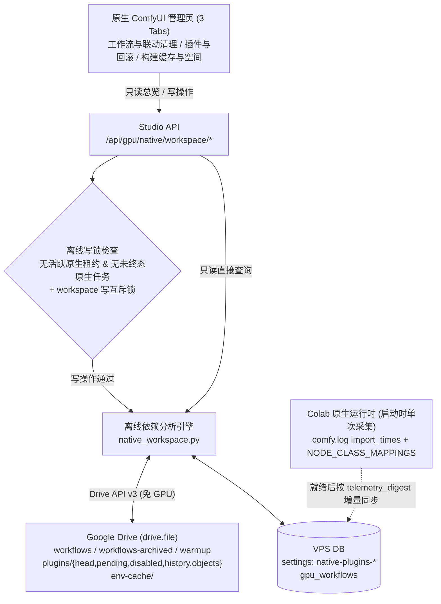

# 原生 ComfyUI 离线工作流、插件与构建缓存管理设计

## 1. 背景与目标

在长期使用原生 ComfyUI（Colab + Google Drive 持久化）的过程中，使用者往往会尝试并积累大量复杂工作流（例如多功能整合包工作流），这些工作流通常会通过 ComfyUI-Manager 附带安装十余个自定义节点插件。当旧工作流弃用后，会出现三类高频运维痛点：

1. **只增不减的隐性启动负担**：删除工作流 JSON 本身不提速，真正拖慢每次冷启动的是旧工作流遗留下来的重型插件（大体积归档下载解压、重 Python/CUDA 编译依赖、`comfy_start` 导入耗时、插件启动期拉取默认模型以及大量前端 JS 扩展）。
2. **依赖黑盒、不敢清理**：ComfyUI-Manager 不知道每个插件分别被哪些工作流引用（包括子图 `definitions.subgraphs` 与前端虚线节点如 `KJNodes` 的 `GetNode`/`SetNode`），也不区分“纯节点插件”与“全局 UI 辅助插件”，手工逐个核对极易误删主力工作流依赖。
3. **运维成本高且缺乏缓存控制**：传统清理必须消耗 CU 启动 GPU 才能进入 Manager；Drive `native-comfy/env-cache/` 中的构建缓存（如旧 Schema 或异常膨大包）与卸载插件后残留的 `plugins/objects/` 孤立归档也缺乏可视化查看、手动触发冷构建与空间回收入口。

### 设计目标

在 Studio 的「原生 ComfyUI」页面新增独立入口按钮，进入**「工作流、插件与构建缓存管理」**页面，实现：

- **纯离线写操作、零 GPU 消耗**：全部查看与清理能力通过 VPS 直接访问 Google Drive API 与本地元数据完成，不启动 Colab、不消耗 CU；写操作严格限定在原生实例完全停止时，彻底避免与运行中 Colab 的后台持久化进程产生双向覆盖竞态。
- **工作流 ↔ 插件依赖透明化与联动清理**：跨原生工作流、API 预热工作流及 Studio 创作页已发布工作流计算准确依赖图，支持停用归档/删除工作流时实时预演“随之失去引用的独占插件与预计减重体积”。
- **可观测驱动的启动瘦身**：启动原生 ComfyUI 时自动采集各插件的真实 `import` 耗时、精确节点映射、前端 JS 扩展数与依赖画像（`requirements.txt` / `install.py`），帮助一眼定位启动瓶颈。
- **真正提速的离线停用与可回滚安全网**：采用独立的 `plugins/disabled.json` 停用机制，使已停用插件在下次冷启动时**完全跳过下载、解压、扫描、依赖安装与导入**，同时保留不可变归档与最近 20 版历史 `generation` 快照支持随时回滚。
- **构建缓存与孤立归档闭环治理**：可视化查看并删除 `native-comfy/env-cache/`（用于清理异常缓存或手动强制冷构建），并支持安全清理历史保护窗口之外的孤立插件归档以释放 Drive 空间。

---

## 2. 总体架构与数据流



### 核心不变量

1. **严格离线写边界**：仅允许在**无活跃原生租约、无进行中原生启动/重启任务**时执行任何 Drive 写操作；写操作期间短暂锁定原生启动准入，杜绝竞态。
2. **Drive 协议 100% 向后兼容**：`plugins/head.json`、`plugins/pending.json`、`plugins/history/<generation>.json` 保持既有 `schema = 1` 与 `generation = digest(plugins)` 契约不变，不破坏既有 [node_persistence.py](../../api/app/gpu/node_persistence.py) 恢复与校验逻辑。
3. **原地覆写防重复文件**：Google Drive 允许同目录下存在多个同名文件。更新 `pending.json`、`disabled.json` 等固定文件名时，必须查找现有 `file_id` 并通过 media `PATCH` 覆盖（如发现历史同名重复文件须显式处理），绝不盲目 `POST` 创建副本。
4. **安全回退与零凭据泄露**：不修改 ComfyUI 内部前端配置文件（如 `comfy.settings.json`）；工作流删除默认移入 Google Drive 回收站（`trashed=true`）；所有路径严格防穿越校验，所有报错经脱敏，不返回 OAuth Token。
5. **有界内存**：VPS 容器默认内存受限（如 384 MiB），扫描工作流 JSON 时设置单文件体积上限（默认 20 MiB）并逐个解析释放，不常驻整批原始 JSON。

---

## 3. 存储布局与数据结构

### 3.1 Google Drive 目录布局扩展

沿用现有 `AI-Studio/<owner>/native-comfy/`，仅新增 1 个工作流归档目录与 1 个停用插件清单文件：

```text
AI-Studio/<owner>/native-comfy/
  user/default/workflows/          # 活跃原生工作流（ComfyUI 可见，计入活跃依赖保护）
  warmup/                          # API 预热工作流（Studio 预热列表可见，计入活跃依赖保护）
  workflows-archived/              # [新增] 已停用归档工作流（保留原相对路径；ComfyUI 不可见；不计入活跃保护）
  plugins/
    objects/<sha256>.tar.gz        # 不可变插件源码归档对象
    history/<generation>.json      # 历史插件清单快照
    head.json                      # 最近一次真实启动加载验证通过的清单
    pending.json                   # 待下次启动恢复生效的候选清单（优先于 head.json 加载）
    disabled.json                  # [新增] Studio 离线停用插件清单（schema=1）
  env-cache/
    <key>.tar.gz                   # Python 增量环境缓存包
    <key>.meta.json                # 缓存元数据
```

### 3.2 `plugins/disabled.json` 格式

用于存放通过 Studio 离线停用的插件条目。停用时将其从 `pending.json` 的 `plugins` 数组中移出并写入此文件，**保留原 `objects/<sha256>.tar.gz` 不删除**：

```json
{
  "schema": 1,
  "updated_at": 1795450000.0,
  "plugins": [
    {
      "entry": {
        "path": "LanPaint",
        "checksum": "<64-hex>",
        "enabled": true,
        "repo": "https://github.com/...",
        "commit": "<40-hex>",
        "version": "2.1.0",
        "archive": "<64-hex-sha256>",
        "kind": "directory"
      },
      "disabled_at": 1795450000.0,
      "source_generation": "<64-hex>",
      "origin": "studio_offline"
    }
  ]
}
```

**关键设计点**：
- 将原始 `manifest["plugins"]` 条目完整包裹在 `entry` 字段内，与停用元数据（`disabled_at`、`source_generation`、`origin`）严格隔离。重新启用时直接取回 `entry` 放回 `pending.json` 并按 `path` 排序，**100% 保证字段结构、`checksum` 与 `digest(plugins)` 语义一致**，同时天然兼容目录型插件与单文件 `.py` 插件（如 `websocket_image_save.py`）。
- 停用后，该插件不在 `pending.json` 中，下次 Colab 冷启动执行 `Persistence.restore()` 时**完全跳过下载、解压、扫描、依赖安装与模块导入**，提速效果与卸载完全一致，同时保留一键恢复能力。
- **兼容 ComfyUI-Manager 风格禁用**：若当前 `pending.json` 中已存在由 Manager 产生的禁用条目（`enabled == false`，路径形如 `foo.disabled` 或 `.disabled/foo`），由于 `restore()` 仍会下载解压它们，界面将其单独标注为「Manager 已禁用（仍占冷启下载）」，并支持一键转为「Studio 离线停用」（从 `pending.json` 移入 `disabled.json`，记录 `origin: "manager_migrated"`）。

### 3.3 VPS 数据库元数据扩展（零表结构迁移）

复用现有 `settings` 表中的 `native-plugins-<digest(owner)[:32]>` 记录（[native.py](../../api/app/gpu/native.py#L796-L810)），新增以下可选字段，完全向后兼容既有读取逻辑：

```json
{
  "manifest": { "...": "最近一次已验证 head 清单" },
  "status": { "...": "最近一次同步状态" },
  "history": [ "...最近 20 版历史清单..." ],
  "offline_pending": {
    "generation": "<64-hex>",
    "updated_at": 1795450000.0,
    "manifest": { "...": "离线提交的 pending 清单缓存" }
  },
  "telemetry_digest": "<64-hex>",
  "telemetry": {
    "schema": 1,
    "collected_at": 1795450000.0,
    "gpu_reported": "NVIDIA L4",
    "comfy_commit": "423cbd20511b...",
    "generation": "<64-hex>",
    "import_times": {
      "comfyui-easy-use": 8.4,
      "prompt-assistant": 8.0,
      "forbidden-vision": 5.4
    },
    "import_failed": [],
    "plugins": {
      "comfyui-impact-pack": {
        "node_count": 201,
        "js_count": 10,
        "has_requirements": true,
        "has_install_py": true
      },
      "comfyui-autocomplete-aaalice": {
        "node_count": 0,
        "js_count": 26,
        "has_requirements": false,
        "has_install_py": false
      }
    },
    "node_map": {
      "LanPaint_KSampler": "LanPaint",
      "ImpactIfNone": "comfyui-impact-pack",
      "ForbiddenVisionFaceProcessorIntegrated": "forbidden-vision"
    }
  }
}
```

---

## 4. Colab 端启动插件画像与导入耗时采集

为保证对现有冷启动耗时 **0 阻塞**，采集逻辑在 ComfyUI 就绪后的后台异步任务中执行一次，且仅按 hash 差异按需拉取，不增加高频轮询开销。

### 4.1 采集内容与时机

改动位置：[api/app/gpu/node_persistence.py](../../api/app/gpu/node_persistence.py)（`install()` 的异步 `loop()`）与 [api/app/gpu/native_runtime.py](../../api/app/gpu/native_runtime.py)（`EXTENSION`）。

在 `loop()` 等待 `healthy()` 通过、读取 `comfy.log`（从 `config['log_offset']` 起）完成加载校验后，立即执行一次轻量采集并原子写入 `/content/ai-studio/native/plugins-telemetry.json`：

1. **解析各插件启动导入耗时（`import_times`）**：
   - 定位本次启动日志块 `Import times for custom nodes:` 至紧随其后的空行或服务启动日志。
   - 正则匹配形如 `^\s*([0-9]+(?:\.[0-9]+)?)\s+seconds(?:\s+\(IMPORT FAILED\))?:\s+(.+)$` 的每一行。
   - 将路径归一化为相对于 `ComfyUI/custom_nodes/` 的插件名（兼容目录名与单文件 `.py`），过滤内部注入的 `studio_native_state.py` 与 `studio_native_guard`。
2. **构建精确节点映射（`node_map`）与 `node_count`**：
   - 直接读取同进程内存中的 `nodes.NODE_CLASS_MAPPINGS`（免发 HTTP `/object_info` 请求，耗时 `<10ms`）。
   - 对每个 `node_type -> cls`，解析 `getattr(cls, "__module__", "")`（或 `inspect.getsourcefile(cls)` 兜底），识别前缀 `custom_nodes.<plugin>` 归属至对应插件 `path`；统计每个插件的 `node_count`。
3. **统计前端 JS 扩展与重依赖画像（`js_count` / `has_requirements` / `has_install_py`）**：
   - 统计每个插件目录下对外暴露的 `.js` 文件数（优先检查 `WEB_DIRECTORY` 或常见 `web/`、`js/` 子目录，排除 `node_modules` / `.git`），用于区分纯后端节点与全局 UI 扩展。
   - 检查插件根目录是否存在 `requirements.txt` 与 `install.py`（如 `comfyui-impact-pack` 归档仅 2.75 MB，但通过 `has_install_py=true` + `node_count=201` 可直观识别其重依赖属性）。
4. **计算 `telemetry_digest`**：对 `telemetry` 负载计算稳定 SHA-256。

### 4.2 增量同步至 VPS（避免轮询带宽膨胀）

- `/studio_native/state` 仅在 `plugins` 字段中附带一个 64 字节的 `telemetry_digest`（不内嵌整份 `node_map`）。
- 在 `EXTENSION` 中新增只读内部端点 `GET /studio_native/plugin-telemetry`（受既有 Cloudflare Access Service Auth 保护），返回 `plugins-telemetry.json`。
- [native.py](../../api/app/gpu/native.py) `sync_plugins()` 每次收到 `/studio_native/state` 时，仅当 `remote_telemetry_digest != saved.get("telemetry_digest")` 时，才通过同一复用连接发起一次 `GET /studio_native/plugin-telemetry` 并落库。平时 watchdog 每分钟心跳轮询几乎零额外流量。

---

## 5. 离线依赖分析引擎设计

新增后端模块 `api/app/gpu/native_workspace.py`，负责免开 GPU 的 Drive 扫描、工作流解析、插件分类与安全写操作。

### 5.1 Drive 账号解析

复用 [drive_usage.py](../../api/app/gpu/drive_usage.py#L42-L90) 的 `resolve_owner_drive_account(repo, owner_id)`，保证与统一模型库、Drive 空间统计始终操作同一个 Drive 主盘账号，并在接口中明确返回当前 `drive_account_id` 与 `drive_account_alias`。

### 5.2 四源工作流扫描范围

| 来源标识 | 位置 | 是否计入活跃插件保护 | 允许离线写操作 |
| --- | --- | :---: | --- |
| `comfy` | Drive `native-comfy/user/default/workflows/`（递归 `.json`） | **是** | 停用归档、移入回收站 |
| `warmup` | Drive `native-comfy/warmup/`（`.json`） | **是** | 移入回收站 |
| `archived` | Drive `native-comfy/workflows-archived/`（递归 `.json`） | 否（单独记为归档引用） | 恢复启用、移入回收站 |
| `studio_db` | VPS DB `gpu_workflows`（`state == "published"` 或 `active == True`） | **是** | 只读（在「资产 → 工作流」页管理） |

> 外部 API 客户端（如 SillyTavern 柏宝绘）保存在客户端本地、未存入 Drive 的工作流无法被 Studio 感知，前端在联动清理确认弹窗中给出明确提示。

### 5.3 工作流节点解析与三级映射策略

对每个工作流 JSON 执行统一提取（同时兼容 **UI Graph JSON** 与 **API Prompt JSON**）：

1. **完整节点提取**：
   - UI 格式：遍历顶层 `nodes[]`，并递归遍历 `definitions.subgraphs[]` 内部的 `nodes[]`（记录子图 ID 集合，跳过将子图 UUID 当作 `type` 的占位引用节点）。
   - API 格式：遍历顶层节点字典的 `class_type`。
   - 忽略 ComfyUI 核心内置虚拟节点（`Note`、`MarkdownNote`、`Reroute`、`PrimitiveNode` 等）及核心模块节点（`comfy-core`）。
   - 同时保留节点运行模式（`mode == 0` 活跃 vs `mode in (2, 4)` 静音/绕过）；保护计算采用**保守策略**——只要工作流画布包含该节点即记为依赖，防止打开工作流时因缺失节点报错。
2. **三级插件归属映射**：
   - **第 1 级（精确运行期映射）**：查 `telemetry.node_map[node_type]` → 直接命中真实 `plugin_path`。
   - **第 2 级（静态元数据与前端虚线节点兜底）**：读取节点 `properties.cnr_id` 与 `properties.aux_id`（例如 `aux_id = "kijai/ComfyUI-KJNodes"` 提取末段规范化匹配 `comfyui-kjnodes`），专门覆盖两类场景：
     - **纯前端虚线节点**（如 `KJNodes` 的 `GetNode` / `SetNode`，它们不注册在后端 `NODE_CLASS_MAPPINGS` 中，但会完整记录 `properties.aux_id`）；
     - **升级首日尚未重新开机**、VPS 尚无 `telemetry` 快照时的离线兜底解析。
   - **第 3 级（未识别节点）**：无法归属到任何已装插件且非核心内置节点者，记入 `unresolved_nodes`（例如工作流原本依赖但当前环境本就没装的节点，如 `DLSS5NeuralRender`），不阻塞分析，在详情中透明展示。

### 5.4 插件状态分类（防误删机制）

每个已装或已停用插件按以下互斥状态归类：

| 状态枚举 | 判定条件 | 默认建议与保护级别 |
| --- | --- | --- |
| `in_use` | 位于活跃清单且被 ≥1 个活跃工作流（`comfy` / `warmup` / `studio_db`）引用 | **受保护**：展示关联工作流标签；停用/卸载需显式二次确认（接口需 `force_in_use=true`） |
| `archived_only` | 位于活跃清单，活跃引用为 0，仅被 `workflows-archived/` 中的停用工作流引用 | **建议停用或卸载**：不会影响任何活跃工作流 |
| `unused_ui` | 位于活跃清单，工作流引用为 0，但 `js_count > 0`（或尚无 `telemetry` 快照时保守标示） | **按日常习惯决定**：明确标注「含前端 UI 扩展，可能为补全/翻译/商店等界面工具」 |
| `unused` | 位于活跃清单，工作流引用为 0 且 `js_count == 0` | **可安全清理** |
| `manager_disabled` | 位于活跃清单但 `enabled == false`（Manager `.disabled` 风格） | **建议转为离线停用**：当前冷启动仍会下载解压该归档，转为离线停用后彻底省去下载开销 |
| `disabled` | 位于 `plugins/disabled.json` | **已离线停用（免下载）**：支持一键「恢复启用」或「彻底移除」 |

### 5.5 联动影响实时预演

当用户在工作流 Tab 勾选一个或多个活跃工作流准备「停用归档」或「移入回收站」时，前端（或调用预演接口）立即计算：
- **新释放的独占插件**：剔除所选工作流后，活跃引用数由 `>0` 变为 `0` 的全部插件；
- **分类拆解**：区分为「纯节点独占插件（默认勾选建议清理）」与「含全局 UI 扩展的独占插件（默认不勾选并提示确认）」；
- **预计减重收益**：汇总归档压缩包总 MB 与上次启动 `import_seconds` 总秒数。

---

## 6. 离线写锁与原子操作协议

### 6.1 严格离线写锁与启动互斥

所有写接口进入核心逻辑前必须获取 `repo.store.dispatch_lock()`，执行 `require_native_offline(repo, owner_id)` 检查：

1. 检查 `native.active_lease(repo, owner_id)` 必须为 `None`（不存在任何就绪、空闲、重启中或排空中的原生租约）；
2. 检查不存在任意 `snapshot.native_comfy == True` 且 `state not in TERMINAL` 的原生任务（拦截 `queued` / `validating` / `waiting_for_capacity` / `allocating` / `preparing` / `loading` / `running` / `uploading` / `cleaning_up`）；
3. 写入一个短租约标记 `native-workspace-write-lock-<owner_hash>`（含 `lock_id`、`started_at`、TTL 90 秒）后释放 `dispatch_lock` 执行外部 Drive API 调用，完成后在 `finally` 中释放该标记；
4. 在 [native.py](../../api/app/gpu/native.py) `admit()` 准入检查中增加对称校验：若存在未过期的 `native-workspace-write-lock`，返回 `HTTP 409`（`NATIVE_WORKSPACE_LOCKED`：「离线工作流/插件管理正在写入 Drive，请数秒后重试启动」）。

> 说明：同一账号下仅运行 `creation`（创作池）或 `ephemeral`（一次性冒烟）实例时，因三域硬隔离且不触碰 `native-comfy/` 目录，**不阻塞**原生离线管理。

### 6.2 工作流离线操作

- **停用归档（`archive`）**：
  - 校验 `source == "comfy"` 与相对路径合法（无 `..`、非绝对路径、以 `.json` 结尾）。
  - 在 `native-comfy/workflows-archived/` 下按需补建对应父子目录。
  - 通过 Drive API `PATCH /files/{id}?addParents={dst_parent}&removeParents={src_parent}` 原子移动；目标同名冲突时返回明确错误 `409 WORKFLOW_ARCHIVE_CONFLICT`（支持可选 `overwrite=true` 先将旧同名归档移入回收站）。
- **恢复启用（`restore`）**：反向从 `workflows-archived/` 移动回 `user/default/workflows/`。
- **删除（`trash`）**：调用 Drive API `PATCH /files/{id}` 写入 `{"trashed": true}`（移入 Google Drive 回收站，30 天内可找回），不执行不可逆的物理 `DELETE`。

### 6.3 插件离线操作（停用 / 启用 / 卸载 / 历史回滚）

1. **读取权威基线**：实时从 Drive 读取 `plugins/pending.json`（若不存在则回退读取 `plugins/head.json`），严格校验 `schema == 1` 且 `generation == digest(plugins)`；同时读取 `plugins/disabled.json`（缺失视为空）。
2. **变更计算**：
   - **`disable`（离线停用）**：将目标插件从活跃 `plugins` 移除，将其原始条目包入 `disabled.json`（不删 `objects/<sha256>.tar.gz`）。
   - **`enable`（恢复启用）**：先校验 `objects/<archive>.tar.gz` 在 Drive 中真实存在且非空，再将 `entry` 从 `disabled.json` 移回活跃 `plugins`（按 `path` 排序，去重）。
   - **`remove`（卸载）**：从活跃 `plugins` 中移除；若同时存在于 `disabled.json` 中一并移出（不删 `objects/` 归档，留给历史快照回滚或显式孤立归档清理）。
   - **`purge_disabled`（移除停用记录）**：仅从 `disabled.json` 移除，不再保留在停用列表中。
   - **`rollback`（回滚历史快照）**：读取 `plugins/history/<target_generation>.json`，校验 `schema == 1` 与 `generation` 一致性，并**逐项核对所有引用到的 `objects/<archive>.tar.gz` 均在 Drive 存在**（任一缺失则拒绝回滚并指明缺失插件，避免下次开机报错）；通过后将目标快照作为新 `pending.json` 提交，并从 `disabled.json` 中移除已恢复的同 `path` 条目。
   - **安全保护**：对于 `disable` / `remove`，若目标插件属于 `in_use` 且未传 `force_in_use=true`，返回 `HTTP 409 PLUGIN_IN_USE` 并附带依赖它的活跃工作流清单。
3. **崩溃安全提交顺序**：
   - ① 若 `disabled.json` 有变化：原地更新（或首次创建）Drive `plugins/disabled.json`；
   - ② 构造新清单 `{"schema": 1, "plugins": new_plugins, "snapshot": prev_snapshot, "backed_up_at": now, "generation": digest(new_plugins)}`（当 `new_plugins` 为空数组时同样合法，避免触发旧版 `legacy custom_nodes` 复活）；
   - ③ 写入不可变快照 `plugins/history/<new_generation>.json`（若同 generation 已存在则跳过）；
   - ④ 原地覆写 `plugins/pending.json`；
   - ⑤ 同步更新 VPS `settings` 的 `offline_pending` 与 `history`（最多保留 20 条），调用 `invalidate_drive_usage_cache(owner_id)`。

> **下次启动生效流程**：下次冷启动时 `Persistence.restore()` 自动优先读取新的 `pending.json`，跳过被停用/卸载的插件；加载与导入验证通过后自动晋升为新的 `head.json`，并同步回 VPS 清除「待生效」标记。

### 6.4 构建缓存（`env-cache`）与孤立插件归档清理

#### 构建缓存管理（`native-comfy/env-cache/`）
- **配对读取**：列出目录全部文件，按 `<key>.tar.gz` 与 `<key>.meta.json` 配对，读取 `.meta.json` 提取：
  - `schema`（当前最新为 `v3`）、`size`、`created_at`、`spec.comfy_commit`、`spec.python`、`spec.gpu`、`added_count`、`overlay_count`。
- **异常与状态标记**：
  - `legacy_schema`：`schema < 3`（历史旧格式缓存）；
  - `oversized`：体积 `> 500 MiB`（阈值由服务端常量 `ENV_CACHE_OVERSIZED_BYTES = 500 * 1024 * 1024` 控制，例如历史因 `__pycache__` 膨大至 1.58 GiB 的异常缓存包）；
  - `incomplete`：仅有 `.tar.gz` 缺 `.meta.json` 或仅有 `.meta.json` 缺 `.tar.gz` 的半成品残留。
- **删除行为**：构建缓存属于可再生的派生加速数据，执行单删或全清时直接调用 Drive API `DELETE /files/{id}` 彻底释放 Drive 空间（同步删除对应 `.tar.gz` 与 `.meta.json`），并刷新 `drive_usage` 缓存。清空后下次冷启动自动走干净的完整冷构建并生成全新缓存包。

#### 孤立插件归档清理（`native-comfy/plugins/objects/`）
- **安全保护集计算**：
  1. 当前 Drive `head.json` 引用的全部 `archive` SHA256；
  2. 当前 Drive `pending.json` 引用的全部 `archive` SHA256；
  3. 当前 Drive `disabled.json` 引用的全部 `archive` SHA256；
  4. 按 `backed_up_at` 倒序取最近 `keep_history` 版（默认 **5 版**，可选范围 `1..20`）`plugins/history/*.json` 快照引用的全部 `archive` SHA256。
- **清理动作**：
  - 仅删除 **不在上述保护集内** 的 `objects/<sha256>.tar.gz`（支持 `dry_run=true` 先返回可释放文件列表与总字节数）。
  - 执行删除使用 Drive API `DELETE /files/{id}` 彻底释放空间；清理后更早的历史快照仍在 `history/` 中保留元数据，但在 UI 回滚列表中自动标为「归档已清理·不可回滚」（按钮置灰），杜绝误回滚到损坏版本。

---

## 7. API 接口契约

全部接口挂载在 `/api/gpu/native/workspace`，均要求管理员登录会话（`admin(user)`），遵循现有 `{ok, data, request_id}` 响应信封与 `APIError` 规范：

| 方法与路径 | 写锁 | 用途与关键参数 |
| --- | :---: | --- |
| `GET /api/gpu/native/workspace/overview` | 否 | 获取完整管理视图数据。支持 `?refresh=true` 绕过短暂内存缓存（如 30s）；返回 `offline_writable`、`lock_reason`、`drive_account`、`plugin_state`、`workflows`、`plugins`、`env_caches`、`orphan_objects`。 |
| `POST /api/gpu/native/workspace/workflows/action` | **是** | 批量停用归档 / 恢复 / 移入回收站工作流，可选原子联动停用或卸载插件。<br/>Body: `{"action": "archive"|"restore"|"trash", "items": [{"source", "path"}], "overwrite": false, "also_plugins": {"action": "disable"|"remove", "paths": [...], "force_in_use": false}}` |
| `POST /api/gpu/native/workspace/plugins/action` | **是** | 批量离线停用 / 恢复启用 / 卸载 / 迁移 Manager 禁用插件。<br/>Body: `{"action": "disable"|"enable"|"remove"|"purge_disabled", "paths": [...], "force_in_use": false}` |
| `POST /api/gpu/native/workspace/plugins/rollback` | **是** | 回滚到指定历史快照。<br/>Body: `{"generation": "<64-hex>"}` |
| `DELETE /api/gpu/native/workspace/env-cache` | **是** | 删除指定或全部构建缓存。<br/>Body: `{"keys": ["..."]}` 或 `{"all": true}` |
| `POST /api/gpu/native/workspace/orphan-objects/cleanup` | **是** | 预览或清理孤立插件归档。<br/>Body: `{"keep_history": 5, "dry_run": false}` |

---

## 8. 前端页面与交互设计

### 8.1 入口与页面布局

- **入口按钮**：在 [NativeComfyPage.tsx](../../web/src/pages/NativeComfyPage.tsx#L403-L415) 顶部标题操作栏（与「配置向导」「API 设置」并列）新增次按钮 **「工作流与插件管理」**；当存在离线待生效插件变更时显示小型圆点提示。
- **视图形态**：点击后在「原生 ComfyUI」分页内切换至全宽独立管理子视图（顶部提供「← 返回原生 ComfyUI」按钮），避免窄弹窗承载多列依赖表格时在桌面端或手机端拥挤换行。
- **顶部全局状态栏**：
  - 左侧：当前 Drive 存储账号别名 +「刷新」按钮；
  - 在线只读态（`offline_writable === false`）：显示明显只读横幅（`role="status"`）：「当前原生 ComfyUI 正在运行或启动中，仅支持只读查看；停止实例后可进行停用、删除与缓存清理」，所有写操作按钮自动禁用；
  - 待生效提示（`has_pending_offline_changes === true`）：显示提示条：「已提交离线插件变更（目标版本 `xxxxxxxx`），将在下次启动原生 ComfyUI 时自动生效」。

### 8.2 三个核心 Tab

#### Tab 1：工作流与联动清理
- 分区展示：**活跃原生工作流**、**API 预热工作流**、**已停用归档工作流**（支持「恢复启用」与「移入回收站」），以及折叠区 **Studio 创作页已发布工作流（只读保护参考）**。
- 每行展示：工作流名称/相对路径、文件大小、节点总数、关联自定义插件标签（点击插件标签可高亮定位）、未安装/未识别节点提示。
- **多选联动清理流**：
  1. 用户勾选 1 个或多个活跃原生工作流，点击底部操作栏「停用归档」或「移入回收站」。
  2. 弹出联动确认对话框：
     - 上半区：列出将被停用/移入回收站的工作流（说明删除进 Google Drive 回收站 30 天可找回；提示如曾在网页顶部标签栏打开过旧工作流，下次打开后手动关闭旧标签即可）。
     - 下半区（若有新释放的独占插件）：实时列出「将不再被任何活跃工作流引用的独占插件」、预计减少归档总 MB 与上次启动 `import` 总秒数，提供每项插件的勾选与动作选择（默认「离线停用（免下载·可随时恢复）」，可切换为「卸载」）；对含 UI 扩展的插件（`js_count > 0`）**默认不勾选**并标示橙色提醒。
     - 底部一行免责提示：「请确认 SillyTavern 等外部客户端本地工作流未依赖上述插件。」

#### Tab 2：自定义节点 / 插件与历史回滚
- 顶部汇总卡：已启用插件数、归档总体积、已采集启动导入总耗时、已离线停用插件数；支持按「归档体积 / 启动导入耗时 / 状态」排序与状态筛选。
- 列表每行展示：
  - 插件名与版本号；
  - **状态徽章**：`活跃引用中` / `仅归档引用` / `无节点引用·含 UI` / `无引用` / `Manager 已禁用` / `已离线停用`；
  - **归档体积**（MB）；
  - **上次启动 `import` 耗时**（秒；尚未采集时显示「待下次开机采集」）；
  - **画像标签**：如 `201 节点`、`10 JS`、`含 install.py`、`含 requirements.txt`；
  - **关联工作流**：直接列出引用它的活跃/归档工作流芯片；
  - **操作按钮**：启用态支持「离线停用」「卸载」（点击 `in_use` 插件弹窗强提醒受影响的工作流清单）；已离线停用态支持「恢复启用」「移除记录」；Manager 禁用态支持「转为离线停用（免下载）」。
- 底部折叠区 **「历史插件快照（最近 20 版）」**：
  - 展示备份时间、插件数量、`generation` 前 8 位、标识（`当前已验证 head` / `待生效 pending` / `归档已清理`）以及「回滚到此版本」按钮。

#### Tab 3：构建缓存与空间清理
- **区块 1：Python 环境构建缓存（`native-comfy/env-cache/`）**
  - 汇总：缓存包数量、总占用体积；右上角提供 **「清空全部缓存（下次强制冷构建）」** 危险操作按钮（带二次确认）。
  - 列表展示：缓存 Key、Schema 版本标签（`v3` 正常 / `v1`、`v2` 旧版标黄）、体积（超过 `500 MiB` 标橙色「异常偏大」）、对应 GPU 标识与 ComfyUI commit、创建时间、完整性状态、单行「删除」按钮。
- **区块 2：孤立插件归档清理（`native-comfy/plugins/objects/`）**
  - 汇总：插件归档总占用体积、当前受保护归档数、可回收孤立归档数与可释放体积。
  - 提供「保留最近历史快照数」下拉选项（`3 版` / `5 版（默认）` / `10 版`），切换时实时刷新可回收预估；点击「清理孤立归档」弹二次确认（明确告知：受保护的当前清单、已停用插件及最近 N 版历史快照不会受影响，更早的历史快照将无法回滚）。

---

## 9. 涉及代码模块规划

| 层级 | 文件 | 职责 |
| --- | --- | --- |
| Colab 运行时 | `api/app/gpu/node_persistence.py` | 启动校验后采集 `import_times`、`node_map`、`node_count`、`js_count`、`has_requirements`、`has_install_py` 写入 `plugins-telemetry.json` 并在 `status()` 暴露 `telemetry_digest` |
| Colab 扩展 | `api/app/gpu/native_runtime.py` | `EXTENSION` 新增只读路由 `GET /studio_native/plugin-telemetry` |
| 控制面同步与准入 | `api/app/gpu/native.py` | `sync_plugins()` 按 `telemetry_digest` 增量拉取并存库；`admit()` 增加与离线写锁互斥检查 |
| 离线管理引擎 | `api/app/gpu/native_workspace.py` *(新增)* | Drive 读写封装（含原地覆写防同名副本）、四源工作流扫描与三级依赖映射、插件离线停用/启用/卸载/回滚、`env-cache` 与孤立归档清理 |
| REST API | `api/app/native_routes.py` | 注册 `/api/gpu/native/workspace/*` 6 个端点与参数/锁校验 |
| 前端组件 | `web/src/components/NativeWorkspaceManager.tsx` *(新增)* | 3 Tab 管理界面、联动预演弹窗、排序筛选、历史回滚与缓存清理交互 |
| 前端入口 | `web/src/pages/NativeComfyPage.tsx` | 顶部操作栏增加入口按钮与子视图切换 |
| 自动化测试 | `tests/test_native_workspace.py` *(新增)*<br/>`tests/test_node_persistence.py`<br/>`web/tests/*.test.mjs` | 离线依赖分析、子图/前端虚线节点识别、停用/启用/回滚、在线写锁冲突、缓存与孤立对象清理、前端渲染与契约测试 |

---

## 10. 测试与真机验收清单

### 10.1 离线自动化测试（零 GPU / 零外网）
1. **依赖解析准确性**：
   - UI 工作流含多层 `definitions.subgraphs`、静音/绕过节点（`mode=2/4`）、纯前端虚线节点（`KJNodes` `GetNode`/`SetNode`）及 API 格式工作流均正确映射；
   - 无 `telemetry` 快照时能通过 `cnr_id`/`aux_id` 正常降级解析；有 `telemetry` 时 `node_map` 精确优先；
   - `studio_db` 已发布工作流与 `warmup` 工作流均正确纳入保护；超过 20 MiB 的异常工作流文件安全跳过并报错而不 OOM。
2. **启动画像采集与增量同步**：
   - 模拟 `comfy.log` 输出（含正常插件、单文件 `.py`、`(IMPORT FAILED)` 与内部注入模块）验证 `import_times` 精确解析与内部模块过滤；
   - 验证 `telemetry_digest` 不变时不重复请求 `/studio_native/plugin-telemetry`。
3. **离线写锁与互斥**：
   - 存在活跃原生租约、进行中原生启动任务（`queued`/`allocating`/`loading`）或排空态时，所有写接口均返回 `409 NATIVE_INSTANCE_ACTIVE`；
   - 离线写操作持锁期间，并发 `POST /api/gpu/native/start` 返回 `409 NATIVE_WORKSPACE_LOCKED`；
   - 同账号仅有创作池（`creation`）活跃实例时，不误拦原生离线管理。
4. **插件离线停用 / 恢复 / 卸载 / 回滚**：
   - 停用目录型与单文件 `.py` 插件后，`pending.json` 正确移除且 `digest(plugins)` 合法、`disabled.json` 完整保存 `entry`；重新启用后 `pending.json` 与原 `generation` 完全一致；
   - 尝试停用/卸载 `in_use` 插件在 `force_in_use=false` 时被 `409` 拦截；
   - 清空全部插件（`plugins=[]`）写出合法 `pending.json`，下次启动不触发旧版 `legacy custom_nodes` 复活；
   - 回滚前若目标历史快照缺失某个 `objects/` 归档，明确拒绝并指明缺失插件。
5. **Drive 同名文件防护与清理**：
   - 连续多次离线修改 `pending.json` / `disabled.json` 仅更新原 `file_id`，不产生同名副本；
   - 工作流停用/恢复保留子目录结构，删除仅调用 `trashed=true`；
   - 孤立插件归档清理严格保护 `head` + `pending` + `disabled` + 最近 `keep_history` 版历史快照，仅删除保护集外对象，并同步失效 `drive_usage` 缓存。

### 10.2 `bero` 真机端到端验收
1. 启动一次 L4 原生 ComfyUI 并验证 `/studio_native/plugin-telemetry` 成功采集 `import_times` 与 `node_map`，停机后在管理页核对各插件实测导入耗时、归档体积与「工作流1」/「Anima」依赖图完全准确。
2. 在原生实例**运行中**打开管理页，确认全部数据可读、全部写按钮置灰锁定；停止实例后写操作解锁。
3. 选中「工作流1」系列 5 个工作流执行停用归档 + 联动离线停用其独占插件，验证 Drive `workflows-archived/`、`plugins/disabled.json`、`plugins/pending.json` 无同名重复文件。
4. 清空一次 `env-cache` 后重新启动全新 L4 实例，验证：
   - 被离线停用的插件**未下载、未解压、未导入**；
   - `Anima-修复版`、`Anima Turbo` 等保留工作流正常打开与出图；
   - 新的轻量 `env-cache` 自动生成并可在管理页查看真实体积。
5. 停止实例后测试将其中一个已停用插件一键恢复启用（或回滚到上一个历史 `generation`），再测试清理孤立归档并核对 Drive 空间释放与统计刷新。
